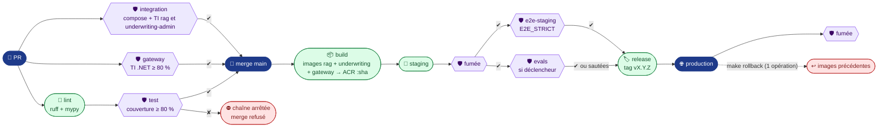

# AgentInsurFlow — monorepo (sprint 3, v0.5.0)

Assistant des **gestionnaires d'assurance auto** : une **gateway** (seule entrée publique) devant deux services,
**underwriting-admin** (dossiers minimisés et référentiel SQL des traces) et **rag**, qui ingère le **Code des assurances** depuis Légifrance, le cherche (recherche hybride pgvector) et répond par un
**agent à réponses citées**, sur un modèle **Azure AI Foundry** (`Kimi-K2.5`, API v1 compatible OpenAI). Le tout est
livré par une **chaîne GitHub Actions CI/CD/Evals bloquante** jusqu'à la production (Azure Container Apps).

Toutes les API sont **REST** et consultables dans **une seule page Swagger**, servie à la racine de la gateway.



Un merge sur `main` relance `lint`, `test` et `gateway` avant `build`. Les evals (portes : réussite ≥ 80 % et latence
p95 ≤ 30 s) ne tournent que si le prompt, un jeu d'évaluation, l'instantané du corpus ou la version du LLM changent
(voir *Évaluer l'agent*). Le job `evals-pr` (avant merge) est **désactivé jusqu'à U5** : voir le tableau des jobs.

## État au 20/10

| Projet | Langage | Rôle | État |
|---|---|---|---|
| [`gateway/`](gateway/README.md) | C# · YARP · .NET 10 | **Seule entrée publique** : routage, jeton Entra + rôle par route, limitation de débit, Swagger unique | ✅ déployée (staging, production) ; domaine personnalisé en production |
| [`rag/`](rag/README.md) | Python · hexagonal | Corpus Légifrance (ingestion, dédup, versions), recherche hybride, agent à 3 verrous, attribution Etalab 2.0 | ✅ déployé ; Code des assurances (instantané du 20/10, 119 articles lus, 107 insérés, [preuves](eval/preuves/)) réingéré à chaque déploiement |
| [`underwriting-admin/`](underwriting-admin/README.md) | C# · Clean Architecture · .NET 10 | Dossiers (vue minimisée, BOLA) et référentiel SQL des traces OpenTelemetry (`/v1/traces`, `/api/traces/{trace_id}`) | ✅ branche `feat/underwriting-admin` (v0.5.0) ; déploiement à 4 conteneurs après les réglages Entra d'Acerola |
| [`e2e/`](e2e/README.md) | Python · pytest | Parcours bout en bout par la gateway (compose ou staging) | ✅ ; job `e2e-staging` bloquant avant la release |

> **Pyramide au 20/10** : ≈ 52 % TU / 46 % TI / 2 % E2E, hors seuils ; le job `pyramide` est **informatif** en CI
> (décision d'Acerola) jusqu'à une tâche dédiée aux tests unitaires.

> **Production** : **`v0.4.0`** (`74fb443`, manifeste `0.4.0-build.43`) depuis le 20/10, corpus ingéré (110 chunks).
> Evals de staging passées à **81,8 %** (9/11, porte 80 %) : marge d'un cas, deux échecs connus (réponse trop
> longue sur `reference-exacte-l211-1`, annexe bonus-malus d'A121-1 absente de l'instantané).

Le contrat REST (ressources, méthodes, codes) et la correspondance avec les noms d'endpoints du brief sont dans
[`gateway/README.md`](gateway/README.md#contrat-rest-s3-24) ; le détail des routes de `rag` (rôles, erreurs, contrat
d'ingestion, agent) dans [`rag/README.md`](rag/README.md). Tests : pyramide **70 % TU / 20 % TI / 10 % E2E**
(règle [`.claude/rules/testing-pyramid.md`](.claude/rules/testing-pyramid.md), porte `make pyramide`).

### Architecture déployée

Chaque environnement (staging, production) est **une Container App** à **quatre conteneurs** qui partagent
`localhost` (modèle versionné : [`infra/containerapp.yaml`](infra/containerapp.yaml)) :

| Conteneur | Port | Rôle |
|---|---|---|
| `gateway` | 8000 | **seul exposé** (entrée de la Container App) ; valide jeton et rôle, puis transmet |
| `rag` | 8001 | API du corpus et de l'agent ; revalide le jeton ; migrations de la base au démarrage (`rag/demarrer.sh`) |
| `underwriting-admin` | 8002 | Dossiers (`/api/contrats`, BOLA) et traces (`/v1/traces`, `/api/traces/{trace_id}`) ; revalide le jeton ; migrations EF Core au démarrage |
| `postgres` | 5432 | **base annexe éphémère** (pgvector) : bases `vecteurs`, `dossiers`, `traces` ; une réplique, sans volume |

Documentation des données : [`docs/donnees/`](docs/donnees/) — [sources](docs/donnees/sources.md),
[pipeline](docs/donnees/pipeline.md), [modèle Merise](docs/donnees/modele.md), [SQL](docs/donnees/requetes-sql.md),
[RGPD](docs/donnees/rgpd.md), [recherche](docs/donnees/recherche.md), [traces](docs/donnees/traces.md) ;
OpenAPI : [`docs/openapi/`](docs/openapi/) (`make openapi`) ; démo : [`docs/demo-atelier-3.md`](docs/demo-atelier-3.md).

La base annexe repart **vide à chaque nouvelle révision** (déploiement ou rollback) : les migrations la recréent au
démarrage, puis `deploy.yml` réingère le dernier instantané versionné de `data/raw/` (rôle `Ingestion` de la CI).

## Arborescence

```text
.
├── rag/                       # 🐍 service rag (Python, hexagonal) — README, pyproject, Dockerfile, llm.env
│   ├── agentinsurflow_rag/    #   domain/ · application/ · infrastructure/ · api/ · cli/ · prompts/systeme.md
│   ├── migrations/            #   Alembic, arbre « vecteurs » (SQL écrit à la main), rejoué au démarrage
│   ├── demarrer.sh            #   point d'entrée du conteneur : migrations, puis uvicorn
│   └── tests/                 #   unit/ (TU, sans I/O) · integration/ (TI) · fakes.py (doublures des ports)
├── gateway/                   # 🚪 gateway YARP (C#, .NET 10) — README, Makefile, Dockerfile, src/, tests/
├── tests/unit/                # tests de l'outillage de la racine (tools/)
├── tools/evals.py             # make eval / make calibrer : golden set + jeu de démo contre une API, manifeste
├── tools/pyramide.py          # make pyramide : porte 70 / 20 / 10
├── tools/version.py           # release vX.Y.Z d'après les tags
├── data/raw/                  # instantanés Légifrance (code-assurances-<date>.json, manifeste + sha256)
├── docker-compose.yml         # make up : postgres + rag (:8001) + gateway (:8000)
├── CLAUDE.md                  # contrat transverse du monorepo (non-négociables, pyramide, versions)
├── .github/workflows/
│   ├── ci-cd.yml              # lint · test · gateway → [evals-pr] · build → staging → [evals] → release → production
│   └── deploy.yml             # déploiement (modèle containerapp.yaml) + fumée ; lancé à la main = rollback
├── infra/
│   ├── bootstrap.sh           # make infra : groupe de ressources, ACR, Container Apps, OIDC (idempotent)
│   ├── containerapp.yaml      # modèle des Container Apps : gateway + rag + postgres
│   ├── domaine.sh             # make domaine : domaine personnalisé de la production (certificat managé)
│   ├── entra.sh               # make entra : inscriptions Entra des API et rôles d'application
│   ├── postgres/ · postgres-annexe.sh  # make annexe : image PostgreSQL annexe et secrets des Container Apps
│   └── protection-main.json   # make proteger : checks exigés sur main
├── docs/                      # secrets, rollback ; preuves et démo de l'atelier du sprint 2
├── eval/
│   ├── golden.jsonl           # cas d'évaluation de l'agent (versionnés)
│   ├── questions-demo.jsonl   # jeu de démo (questions de gestionnaires, BOLA)
│   ├── preuves/               # journaux de chaîne, rapports d'evals et d'ingestion versionnés
│   └── ateliers/              # grille de l'atelier croisé n°2
├── Makefile                   # orchestre : lint, test, up, ingest, eval, infra… ; gateway-<cible> → gateway/
├── pyproject.toml · uv.lock   # espace de travail uv (membre : rag) ; version de la solution (0.4.0)
├── global.json · Directory.Build.props  # SDK .NET 10 et règles communes des projets C#
├── .python-version
└── .env.example               # toutes les clés, sans valeurs
```

| Python | Équivalent .NET |
|---|---|
| `pyproject.toml` + `uv.lock` | `.csproj` + `packages.lock.json` |
| `uv sync --locked` | `dotnet restore --locked-mode` |
| FastAPI + `Depends` | Minimal API + injection de dépendances |
| `DepotCorpus` (`Protocol`, `domain/ports.py`) | `interface IDepotCorpus` |
| `app.dependency_overrides` | remplacer un service dans `WebApplicationFactory` |
| `pydantic-settings` | `IOptions<T>` lié à la configuration |
| Alembic (`make migrate`) | migrations EF Core (`dotnet ef database update`) |

## Lancer (en local)

Prérequis : [uv](https://docs.astral.sh/uv/) et Docker.

```bash
cp .env.example .env      # remplir AZURE_OPENAI_ENDPOINT (+ la clé, ou az login), AZURE_TENANT_ID, RAG_SEUIL, PG_*_PASSWORD…
make install              # dépendances figées par uv.lock
make up                   # postgres + rag (:8001) + gateway (:8000) → http://localhost:8000/ : Swagger unique
make down                 # arrête tout et vide la base annexe
make run                  # rag seul, sans Docker : http://localhost:8000 → Swagger de rag
```

Dans la **page Swagger unique** de la gateway (`http://localhost:8000/`), le menu donne les 3 documents OpenAPI ;
« Authorize » se connecte à Entra (PKCE) et « Try it out » appelle les routes REST publiques de la gateway, avec
jeton, rôle (`Gestionnaire`, `Ingestion`) et limite de débit.

**Corpus** : `make up` crée la base et ses migrations ; il reste à la remplir.

```bash
make extraire                                    # Légifrance (bac à sable PISTE) → data/raw/code-assurances-<date>.json
make ingest INSTANTANE=data/raw/code-assurances-<date>.json   # rejeu d'un instantané → POST /api/ingestions
make calibrer URL=http://localhost:8000          # intervalle où choisir RAG_SEUIL (porte de pertinence)
```

`POST /api/reponses` rend une **réponse citée** (`statut`, `texte`, `citations`, `trace_id`) ou un refus
`NOT_FOUND_IN_CORPUS` ; LLM injoignable ou trop lent (30 s, `LLM_DELAI_S`) : `statut = REVUE_HUMAINE` (mode dégradé,
dossier-conception-v1.md, K5). Pour un article cité, `GET /api/documents/{doc_id}/attribution` donne ses mentions
**Etalab 2.0** (concédant DILA, licence, date de l'instantané). Détails : [`rag/README.md`](rag/README.md).

**Authentification au LLM** : **aucune clé hors de ton poste**. Le code utilise Entra ID
(`DefaultAzureCredential`) : OIDC dans la CI, identité managée dans Container Apps (rôle *Cognitive Services
User* sur `svespuce-971`). En local, la clé `AZURE_OPENAI_API_KEY` du `.env` reste possible, sinon `az login`.
Le modèle est épinglé dans `rag/llm.env` ; l'endpoint est accepté avec ou sans le suffixe `/openai/v1`.

## Tester

```bash
make lint                 # ruff (style) + mypy (typage strict)
make test                 # TU (sans Docker) : rag/tests/unit + outillage
make test-integration     # TU + TI contre le PostgreSQL du compose, couverture ≥ 80 % (job CI « test »)
make pyramide             # porte 70 / 20 / 10 (S3-22)
make gateway-test         # gateway : TI + couverture ≥ 80 % (job CI « gateway »)
```

Les jobs `lint`, `test` et `gateway` **mockent toujours le LLM** (`FakeLLM`, HTTP simulé) : aucun secret ni appel
réel. Seules les **evals** appellent le vrai modèle.
La couverture visée est la fourchette **80–83 %** ; la porte bloquante est sa borne basse (80 %, `pyproject.toml`).

## Évaluer l'agent (evals)

```bash
make eval                               # contre l'API locale (jeton : EVALS_JETON)
make eval URL=https://<staging>         # contre un environnement déployé
```

`tools/evals.py` rejoue `eval/golden.jsonl` et `eval/questions-demo.jsonl` en boîte noire : seuls
`POST /api/reponses`, `GET /api/extraits` et `/health` sont appelés, avec un jeton Entra de rôle `Gestionnaire`.
Chaque cas passe des contrôles déterministes, et la latence est mesurée :

| Contrôle | Vérifie |
|---|---|
| `http` | Le code HTTP attendu (200, ou 404 pour un dossier hors portefeuille : BOLA) |
| `statut` | Le statut attendu (`OK`, `NOT_FOUND_IN_CORPUS`…) |
| `articles` | Au moins un des articles attendus est cité |
| `mode_llm` | Pour une réponse attendue, le LLM a vraiment répondu (pas de repli) |
| `non_vide` | La réponse n'est pas vide |
| `longueur` | La réponse est bornée, y compris sous injection |
| **latence p95** | ≤ 30 s (dossier-conception-v1.md, D11) |

Porte : taux de réussite ≥ **80 %** (seuil de départ, `🔴 à calibrer`) **et** latence p95 ≤ 30 s.

**Déclenchement** : les evals ne tournent que si un fichier susceptible de changer leur résultat a changé
**depuis le dernier manifeste validé** (tag `manifeste-X.Y.Z-build.N`, job `changements`) ; sinon elles sont
sautées et la chaîne continue. Un manifeste dont les evals ont échoué n'est jamais tagué : le commit suivant
le réévalue, même s'il ne touche pas ces fichiers. Sans aucun tag `manifeste-*`, les evals tournent.

| Déclencheur | Fichier versionné |
|---|---|
| Prompt | `rag/agentinsurflow_rag/prompts/` |
| Jeux d'évaluation | `eval/golden.jsonl`, `eval/questions-demo.jsonl` |
| Instantané du corpus | `data/raw/` |
| Version du LLM | `rag/llm.env` (`AZURE_OPENAI_DEPLOYMENT`, épinglé et copié dans l'image) |

| Job | Quand | Contre quoi | Jeton |
|---|---|---|---|
| `evals-pr` | PR | API lancée dans le runner | ⏸️ **désactivé jusqu'à U5** : depuis R6, `/api/reponses` exige un jeton Entra, PostgreSQL et `RAG_SEUIL`, que ce job n'a pas encore. Sauté, il satisfait la protection de `main` |
| `evals` | merge, avant la production | **staging** déployé, corpus réingéré par `deploy.yml` ; cas à `numero_contrat` écartés jusqu'à underwriting-admin (U2, `--sans-dossiers`) | Entra par **OIDC** (`api://agentinsurflow-rag/.default`) : l'identité de la CI porte le rôle `Gestionnaire` (`make entra`) |

**Artefact de chaque passage** : `evals-staging-<sha>` (onglet *Summary* du run). Le rapport JSON s'ouvre sur un
**manifeste** qui dit ce qui a été évalué :

| Champ du manifeste | Contenu |
|---|---|
| `version` | Version du manifeste : `X.Y.Z-build.N` (pyproject + n° de run GitHub) |
| `date`, `commit`, `run`, `cible` | Quand, quel commit, lien du run GitHub, URL évaluée |
| `modele` | Déploiement épinglé (`rag/llm.env`) **et** modèle observé dans les réponses de l'API |
| `prompts` | Chaque prompt : fichier, empreinte sha256, contenu |
| `golden`, `questions` | Fichier, empreinte sha256, identifiants des cas |
| `corpus` | Dernier instantané ingéré et nombre de chunks (`/health`) |
| `portes` | Seuil de réussite et latence p95 maximale appliqués |

Viennent ensuite le taux, la latence p95 et le détail de chaque cas (contrôles ratés, latence, réponse).
Exemple du sprint 2 : `eval/preuves/evals-local-2026-10-15.json`.

> 🔁 **Analogie .NET** : une suite xUnit de non-régression, sauf qu'on mesure un **taux de réussite** au lieu
> d'exiger 100 % de `Assert`, car la sortie d'un LLM n'est pas déterministe (source : dossier-conception-v1.md, §7.2).

## Déployer

Installation, à faire une seule fois (écritures Azure et Entra : lancées à la main par Acerola) :

1. `make infra` crée le groupe de ressources, l'ACR, l'environnement Container Apps et deux apps (staging,
   production), reprend l'application Entra `agentinsurflow` et ses 4 fédérations OIDC (`main`, `staging`,
   `production`, `pull_request`), puis attribue les rôles. Il affiche les valeurs à reporter. Attribuer des rôles
   exige *Owner* ou *User Access Administrator*.
2. `make entra` inscrit les API `agentinsurflow-rag` (rôles `Gestionnaire`, `Ingestion`) et
   `agentinsurflow-underwriting` (`Gestionnaire`, `Telemetrie`), et attribue les rôles (toi, la CI, un 2ᵉ gestionnaire).
3. `make annexe` construit l'image PostgreSQL annexe (`agentinsurflow-postgres:1`) et pose les mots de passe en
   **secrets des Container Apps**.
4. `make domaine DOMAINE=…` lie le domaine personnalisé à la production (certificat managé), puis poser `PROD_URL`.
5. Reporter à la main les variables dans GitHub en suivant [docs/secrets.md](docs/secrets.md).
6. `git push`, puis `make proteger` : `main` n'accepte plus que des commits dont `lint`, `test`, `gateway` et
   `evals-pr` sont verts (un `evals-pr` sauté compte comme vert).

Ensuite, chaque **merge sur `main`** déclenche toute la chaîne, sans action manuelle. Trois versions :

| Version | Forme | Désigne | Où la lire |
|---|---|---|---|
| Release | `vX.Y.Z` (ex. `v0.2.0`) | le commit livré en production, tagué juste avant | `/health` → `release`, tags Git, résumé du run |
| Image | SHA du commit | les deux images (`agentinsurflow-gateway`, `agentinsurflow-rag`), même tag | `/health` (gateway) et `/health/rag` → `version` |
| Manifeste | `X.Y.Z-build.N` (ex. `0.4.0-build.35`) | ce qui a été évalué : modèle, prompts, jeux d'évaluation | `/health/rag` → `manifeste`, rapport d'évaluation, tag `manifeste-…` |

Les trois sont calculées par le job `changements` puis **gravées dans les images** : un rollback restaure aussi
les versions affichées. X.Y se choisissent à la main dans `pyproject.toml` (`version`, fixée par Acerola : 0.4.0
jusqu'à nouvel ordre).

- **Release** : Z est calculé par `tools/version.py` d'après les tags (`v0.1.0`, puis `v0.1.1`…) ; passer le
  pyproject à `0.2.0` donne `v0.2.0`. En staging, `release` est la **candidate** : le tag n'est posé qu'après
  staging et evals, juste avant la production.
- **Version croissante** : hors rollback, une release livrée ne descend jamais sous la précédente. Un pyproject
  dont X.Y est sous la dernière release fait échouer `changements` ; avant la production, `deploy.yml` compare la
  release à livrer à celle en service (`/health`) et refuse une version inférieure (égale = relance du même
  déploiement ; production injoignable = refus). Seul `deploy.yml` lancé à la main (`make rollback`) revient en arrière.
- **Manifeste** : si un déclencheur a changé, nouvelle version `X.Y.Z-build.<n° du run>` (`X.Y.Z-local` hors CI),
  taguée `manifeste-…` quand les evals passent ; sinon, celle du dernier manifeste validé.

La **fumée** (bloquante, par la gateway) attend que gateway **et** rag servent le SHA attendu (rag démarre après
ses migrations), puis vérifie que `/api/reponses` répond 401 sans jeton ; le LLM est vérifié par les evals de staging.

### Ressources Azure actuelles

| Ressource | Nom | État |
|---|---|---|
| Groupe de ressources | `svespuceRG` (`swedencentral`) | ✅ |
| Registre d'images | `acerolazacr` : `agentinsurflow-gateway`, `agentinsurflow-rag` (tag = SHA), `agentinsurflow-postgres:1` | ✅ |
| Environnement Container Apps | `cae-insurflow` | ✅ |
| Container App staging | `insurflow-staging` (3 conteneurs) → `https://insurflow-staging.redstone-0f3be5e1.swedencentral.azurecontainerapps.io` | ✅ reçoit chaque merge |
| Container App production | `insurflow-production` (3 conteneurs) → `https://aibrokerflow.fr` (domaine personnalisé, `PROD_URL`) | ✅ `v0.4.0` |
| Modèles | `Kimi-K2.5` et le déploiement d'embeddings (`AZURE_OPENAI_EMBEDDING_DEPLOYMENT`) sur la ressource Foundry `svespuce-971` | ✅ |
| Entra | application de la CI `agentinsurflow` + 4 fédérations OIDC ; API `agentinsurflow-rag` et `agentinsurflow-underwriting` | ✅ |
| Rôles (Contributor, AcrPush, AcrPull, Cognitive Services User) | — | ✅ attribués |

## Rollback

```bash
make rollback             # production → images précédentes, en une opération
make rollback ENV=staging TAG=<sha>   # ou une version précise
```

Le rollback redéploie **gateway et rag** au SHA de la révision précédente, puis réingère le corpus (base annexe
éphémère). Détails et scénario de répétition : [docs/rollback.md](docs/rollback.md).

## Preuves et atelier

| Sujet | Où |
|---|---|
| Secrets hors dépôt, report dans GitHub | [docs/secrets.md](docs/secrets.md) |
| Rollback | [docs/rollback.md](docs/rollback.md) |
| Ingestion du Code des assurances en staging (20/10) | `eval/preuves/ingestion-2026-10-20-staging*.json` |
| Journaux versionnés | `eval/preuves/` (`make preuve RUN=<id> NOM=<nom>`) |
| Rapport d'évaluation (manifeste + résultats) | artefact `evals-staging-<sha>` du run, à copier dans `eval/preuves/` |
| Sprint 2 : commit volontairement cassé et bloqué | [docs/preuve-blocage.md](docs/preuve-blocage.md) |
| Sprint 2 : script de la démo (20 min) | [docs/demo-atelier.md](docs/demo-atelier.md) |
| Grille de l'atelier | [eval/ateliers/sprint-2-grille.md](eval/ateliers/sprint-2-grille.md) |

## Hors périmètre actuel

Pas encore livrés : `underwriting-admin` (dossiers, traces : Tasks U), le point d'entrée **MCP** par la gateway (#15),
l'orchestrateur et les agents avec **validation humaine** (#7), l'OCR en A2A (source : dossier-conception-v1.md).
Les sujets encore ouverts (découpage des agents, protocoles…) ne sont pas présumés.
