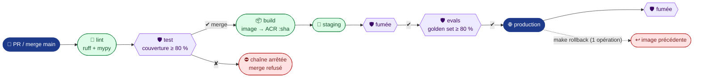

# AgentInsurFlow — le socle et la chaîne (Sprint 2)

Squelette de bout en bout : une **API REST FastAPI** qui donne accès à **un agent** dont la réponse vient
d'**Azure OpenAI**, livrée par une **chaîne GitHub Actions bloquante** jusqu'à la production
(Azure Container Apps). Rien de riche fonctionnellement, mais tout est branché : ce qui suivra passera par cette chaîne.

L'interface est **Swagger UI**, servie à la racine `/`.



## Arborescence

```text
.
├── agentinsurflow/            # le code (architecture hexagonale légère)
│   ├── api.py                 #   adaptateur HTTP : /health, POST /api/agent, Swagger sur /
│   ├── agent.py               #   domaine : l'agent, ne connaît que le port ClientLLM
│   ├── llm.py                 #   port ClientLLM + FakeLLM (tests) + adaptateur AzureLLM + config
│   └── prompts/systeme.md     #   prompt système (le modifier déclenche les evals)
├── tests/
│   ├── unit/                  # agent et adaptateur Azure (HTTP simulé, sans réseau)
│   └── integration/           # requête HTTP → route → agent, LLM mocké
├── tools/evals.py             # make eval : rejoue le golden set contre une API déployée
├── .github/workflows/
│   ├── ci-cd.yml              # lint → test → [evals-pr] · build → staging → [evals] → production
│   └── deploy.yml             # déploiement + fumée ; lancé à la main = rollback
├── infra/
│   ├── bootstrap.sh           # make infra : crée l'infra Azure (idempotent)
│   └── protection-main.json   # make proteger : main exige lint + test verts
├── docs/                      # secrets, blocage, rollback, démo d'atelier
├── eval/
│   ├── golden.jsonl           # cas d'évaluation de l'agent (versionnés)
│   ├── preuves/               # journaux de chaîne et captures versionnés
│   └── ateliers/              # grille de l'atelier croisé n°2
├── llm.env                    # version du LLM épinglée (la modifier déclenche les evals)
├── Dockerfile · Makefile · pyproject.toml · uv.lock · .python-version
└── .env.example               # toutes les clés, sans valeurs
```

| Python | Équivalent .NET |
|---|---|
| `pyproject.toml` + `uv.lock` | `.csproj` + `packages.lock.json` |
| `uv sync --locked` | `dotnet restore --locked-mode` |
| FastAPI + `Depends` | Minimal API + injection de dépendances |
| `ClientLLM` (`Protocol`) | `interface ILlmClient` |
| `app.dependency_overrides` | remplacer un service dans `WebApplicationFactory` |
| `pydantic-settings` | `IOptions<T>` lié à la configuration |

## Lancer (en local)

Prérequis : [uv](https://docs.astral.sh/uv/) et Docker.

```bash
cp .env.example .env      # remplir le bloc Azure OpenAI ; sans lui, l'agent répond en mode dégradé
make install              # dépendances figées par uv.lock
make run                  # http://localhost:8000 → Swagger
make docker               # la même chose, dans l'image qui part en production
```

Exemple de réponse de `POST /api/agent` : `{"texte": "…", "mode": "llm", "modele": "<déploiement>"}`.
Avec `"mode": "degrade"`, le LLM n'est pas joignable et la demande part en revue humaine
(source : dossier-conception-v1.md, K5).

## Tester

```bash
make lint                 # ruff (style) + mypy (typage strict)
make test                 # pytest : unitaires + intégration, couverture ≥ 80 %
```

En CI, le LLM est **toujours mocké** (`FakeLLM`, HTTP simulé) : aucun secret n'est nécessaire pour tester.
La couverture visée est la fourchette **80–83 %** ; la porte bloquante est sa borne basse (80 %, `pyproject.toml`).

## Évaluer l'agent (evals)

```bash
make eval                               # contre l'API locale (make run)
make eval URL=https://<staging>         # contre un environnement déployé
```

`tools/evals.py` rejoue `eval/golden.jsonl` en boîte noire (seul `POST /api/agent` est appelé). Chaque cas
passe des contrôles déterministes, et la latence est mesurée :

| Contrôle | Vérifie |
|---|---|
| `mode_llm` | Le LLM a vraiment répondu (pas de repli) |
| `non_vide` | La réponse n'est pas vide |
| `longueur` | La réponse est bornée (600 caractères par défaut), y compris sous injection |
| `contient_un` | La réponse contient au moins un mot attendu (sujet, réponse en français) |
| **latence p95** | ≤ 30 s (dossier-conception-v1.md, D11) |

Porte : taux de réussite ≥ **80 %** (seuil de départ, `🔴 à calibrer`) **et** latence p95 ≤ 30 s.

**Déclenchement** : les evals ne tournent que si un fichier susceptible de changer leur résultat est modifié
(job `changements`) ; sinon elles sont sautées et la chaîne continue.

| Déclencheur | Fichier versionné |
|---|---|
| Prompt | `agentinsurflow/prompts/` |
| Golden dataset | `eval/golden.jsonl` |
| Version du LLM | `llm.env` (`AZURE_OPENAI_DEPLOYMENT`, épinglé et copié dans l'image) |

| Job | Quand | Contre quoi | Authentification au LLM |
|---|---|---|---|
| `evals-pr` | PR (exigé avant merge) | API lancée **dans le runner** | **OIDC, sans clé** (rôle sur la ressource Foundry) |
| `evals` | merge, avant la production | **staging** déployé | celle de la Container App |

**Artefact de chaque passage** : `evals-pr-<sha>` ou `evals-staging-<sha>` (onglet *Summary* du run). Le rapport
JSON s'ouvre sur un **manifeste** qui dit ce qui a été évalué :

| Champ du manifeste | Contenu |
|---|---|
| `date`, `commit`, `run`, `cible` | Quand, quel commit, lien du run GitHub, URL évaluée |
| `modele` | Déploiement épinglé (`llm.env`) **et** modèle observé dans les réponses de l'API |
| `prompts` | Chaque prompt : fichier, empreinte sha256, contenu |
| `golden` | Fichier, empreinte sha256, identifiants des cas |
| `portes` | Seuil de réussite et latence p95 maximale appliqués |

Viennent ensuite le taux, la latence p95 et le détail de chaque cas (contrôles ratés, latence, réponse).
Exemple réel : `eval/preuves/evals-local-2026-10-15.json`.

> 🔁 **Analogie .NET** : une suite xUnit de non-régression, sauf qu'on mesure un **taux de réussite** au lieu
> d'exiger 100 % de `Assert`, car la sortie d'un LLM n'est pas déterministe (source : dossier-conception-v1.md, §7.2).

## Déployer

Installation, à faire une seule fois :

1. `make infra` crée le groupe de ressources, l'ACR, l'environnement Container Apps et deux apps (staging, production) ainsi que l'identité OIDC de la CI. Il affiche ensuite les valeurs à reporter.
2. Reporter à la main les variables et le secret dans GitHub en suivant [docs/secrets.md](docs/secrets.md).
3. `git push`, puis `make proteger` : `main` n'accepte plus que des commits dont `lint` et `test` sont verts.

Ensuite, chaque **merge sur `main`** déclenche toute la chaîne, sans action manuelle. L'image est tagguée par
le SHA du commit, et `/health` renvoie ce SHA : on lit ainsi quelle version tourne.

## Rollback

```bash
make rollback             # production → image précédente, en une opération
make rollback ENV=staging TAG=<sha>   # ou une version précise
```

Détails et scénario de répétition : [docs/rollback.md](docs/rollback.md).

## Preuves et atelier

| Sujet | Où |
|---|---|
| Secrets hors dépôt, report dans GitHub | [docs/secrets.md](docs/secrets.md) |
| Commit volontairement cassé et bloqué | [docs/preuve-blocage.md](docs/preuve-blocage.md) |
| Rollback | [docs/rollback.md](docs/rollback.md) |
| Script de la démo (20 min) | [docs/demo-atelier.md](docs/demo-atelier.md) |
| Journaux versionnés | `eval/preuves/` (`make preuve RUN=<id> NOM=<nom>`) |
| Rapport d'évaluation (manifeste + résultats) | artefact `evals-staging-<sha>` ou `evals-pr-<sha>` du run, à copier dans `eval/preuves/` |
| Grille de l'atelier | [eval/ateliers/sprint-2-grille.md](eval/ateliers/sprint-2-grille.md) |

## Hors périmètre du socle

Le parcours V1 n'est pas dans ce socle : RAG, MCP, HITL, gateway, OCR en A2A. Il viendra aux sprints suivants
(source : dossier-conception-v1.md). Les sujets encore ouverts (découpage des agents, protocoles…) ne sont pas présumés.
