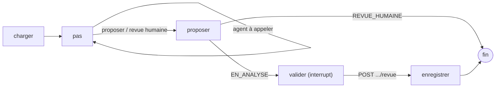

# Cluster d'agents — AgentInsurFlow

Service FastAPI (Python, architecture hexagonale) qui évalue un dossier d'assurance auto : un graphe LangGraph déroule le plan de référence sur quatre agents (Pièces, Analyste, Rédacteur, Actuaire), écrit un brouillon, puis **attend la revue du gestionnaire** (`interrupt()`). Le LLM ne fait que rédiger : toute sortie est comparée à la référence déterministe et aux garde-fous, sinon repli.

## Graphe



**Texte alternatif.** `charger` lit le dossier et passe les observations au garde d'entrée ; `pas` boucle sur les agents tant que le plan en demande un ; `proposer` écrit le brouillon et le statut `EN_ANALYSE` (ou `REVUE_HUMAINE` : fin du graphe) ; `valider` met le graphe en pause jusqu'à `POST /evaluations/{numero}/revue`, puis `enregistrer` écrit la décision. `thread_id` = numéro de contrat.

## API (jeton Entra, rôle `Gestionnaire`, audience `api://agentic-cluster` ou appId du cluster)

| Route | Réponses |
|---|---|
| `POST /evaluations/{numero_contrat}` | `200 {statut, fiche, prime, message, synthese}` ; `404 CONTRAT_INTROUVABLE` ; `409 EVALUATION_EN_ATTENTE` ; `502 OUTIL_INDISPONIBLE` |
| `POST /evaluations/{numero_contrat}/revue` `{decision, validation, motif (1-500)}` | `200 {statut}` ; `409 AUCUNE_REVUE_EN_ATTENTE` ; `422 REQUETE_INVALIDE` |
| `GET /health` (sans jeton) | `200 {version, prompts, garde_fous}` ; `503` tant que LLM Guard n'est pas chargé |

Erreurs : `application/problem+json` avec un `code` stable. Le message de `REVUE_HUMAINE` est neutre : jamais la cause ni le nom d'un détecteur.

## Configuration (variables d'environnement, aucune valeur dans le dépôt)

- Entra et gateway : `AZURE_TENANT_ID`, `GATEWAY_URL`, `MCP_API_CLIENT_ID`, `LLM_AUDIENCE`, `INSURFLOW_CLUSTER_CLIENT_ID`, `INSURFLOW_AGENT_<AGENT>_CLIENT_ID`, `INSURFLOW_CLIENT_SECRET` (local) ou `AZURE_UAMI_CLIENT_ID` (Azure).
- Points de reprise : `INSURFLOW_CHECKPOINT_DSN` (PostgreSQL, schéma `agent_state`, créé au démarrage) ; absent : mémoire, avec un avertissement (local, tests).
- Garde globale : `INSURFLOW_BUDGET_S` (25 s) ; budget d'un agent = `min(délai de l'agent, 25 - écoulé - 2)`, sous 0,3 s : revue humaine (`duree`).
- Observabilité : `OTEL_SERVICE_NAME=agentic-cluster`, `OTEL_EXPORTER_OTLP_*`. Un enregistrement `audit.agent` (journal `insurflow.audit`) et un span `invoke_agent` par agent ; ni jeton, ni nom, ni prompt, ni observations (empreintes SHA-256 seulement).

## Lancer

```bash
make test                                   # TU
uv run pytest agentic-cluster/tests --no-cov  # TU + TI (hors modèles réels, `-m lent`)
docker compose build agentic-cluster        # image : modèles LLM Guard cuits (≈ 2,5 Go de modèles)
```
