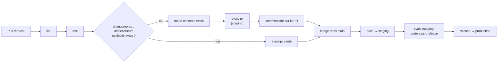

# Chaîne d'évaluation sur pull request

**Critère C13 (issue #55)** : « Documentation : installation, configuration et test de la chaîne + doc utilisateur de
déclenchement ». Cette page décrit le job `evals-pr` de `.github/workflows/ci-cd.yml` tel qu'il est livré.

## Ce que fait la chaîne

Sur une pull request, `evals-pr` teste d'abord les données d'évaluation hors ligne (`make donnees-evals`), puis
rejoue le golden set (`eval/golden.jsonl`) et le jeu de démo (`eval/questions-demo.jsonl`) **de la PR** contre
l'API de **staging**, avec la porte bloquante de `tools/evals.py` (taux de réussite, latence p95). Le résumé est
posté en commentaire sur la PR.

Aucun secret : le jeton d'évaluation est demandé à Entra par OIDC (`azure/login`, puis
`az account get-access-token`). Aucune écriture Azure ni Entra n'est nécessaire pour utiliser la chaîne.

## Schéma



*Description du schéma : après lint et test, la PR lance `evals-pr` si un déclencheur a changé ou si le libellé
`evals` est posé (données testées, évaluation contre staging, commentaire). Après le merge, la chaîne
build → staging → `evals` → release → production s'exécute ; `evals` reste la porte bloquante avant la release.*

## Déclencheurs

| Déclencheur | Condition | Effet |
|---|---|---|
| PR ouverte, mise à jour (`synchronize`), rouverte | un fichier de `DECLENCHEURS_EVALS` a changé (job `changements`) | `evals-pr` s'exécute |
| Libellé `evals` posé sur la PR | libellé présent | `evals-pr` s'exécute |
| `workflow_dispatch` (à la main) | lancé **depuis `main`** | `evals-pr` s'exécute, sans commentaire (pas de PR) |
| Merge dans `main` | un déclencheur a changé depuis le dernier manifeste validé | job `evals` de staging (inchangé) |

Fichiers déclencheurs (`DECLENCHEURS_EVALS`) : `rag/agentinsurflow_rag/prompts/`, `eval/golden.jsonl`,
`eval/questions-demo.jsonl`, `data/raw/`, `rag/llm.env`.

Tout **autre libellé** posé sur la PR relance aussi la chaîne de PR (`labeled`) ; la précédente est annulée
(`cancel-in-progress`).

## Installation et configuration

À faire une fois, par Acerola :

| Élément | Où | Commande ou valeur |
|---|---|---|
| `AZURE_CLIENT_ID`, `AZURE_TENANT_ID` | variables du dépôt | déjà posées pour `ci-cd.yml` et `deploy.yml` |
| `STAGING_URL` | variable du dépôt | `gh variable set STAGING_URL --body <URL de la gateway de staging>` |
| Libellé `evals` | dépôt | `gh label create evals` |
| Sujets OIDC fédérés | Entra, application de la CI | créés par `infra/bootstrap.sh` : `ref:refs/heads/main`, `environment:staging`, `environment:production`, `pull_request` |
| Rôle `Gestionnaire` sur `agentinsurflow-rag` | Entra | attribué à la CI par `infra/entra.sh` (avec `Ingestion`) |

Sans `STAGING_URL`, le job échoue avec le message « variable STAGING_URL absente ».

**Pourquoi `workflow_dispatch` ne marche que depuis `main`** : le sujet OIDC d'un lancement manuel est
`ref:refs/heads/<branche>`, et seul `ref:refs/heads/main` est fédéré. Depuis une autre branche, `azure/login` est
refusé. Sur une PR, le sujet est `pull_request`, fédéré lui aussi.

## Test de la chaîne

En local, sans Azure :

```bash
make donnees-evals
```

Vérifie le schéma des deux jeux, la présence des articles attendus dans `data/raw/` et le sha256 de l'instantané.

Contre une API déployée (avec un jeton de rôle `Gestionnaire`) :

```bash
export EVALS_JETON=$(az account get-access-token --scope "api://agentinsurflow-rag/.default" --query accessToken -o tsv)
make eval URL=<URL de staging>
```

`tools/evals.py` accepte aussi `--resume <fichier.md>` (résumé Markdown, repris en commentaire) et
`--rapport <fichier.json>`. Le jeton n'est jamais écrit dans le rapport.

## Procédure de démonstration

1. Créer une **branche du dépôt** (pas un fork : les forks n'ont ni OIDC ni variables).
2. Modifier un fichier d'évaluation, par exemple une question de `eval/questions-demo.jsonl`, ou ne rien
   modifier et poser le libellé `evals`.
3. Ouvrir la PR vers `main`.
4. Poser le libellé `evals` (si aucun déclencheur n'a changé).
5. Attendre `lint`, `test`, puis `evals-pr` au vert.
6. Lire le commentaire du bot sur la PR et l'artefact `evals-pr-<sha>`.

## Lire le rapport

Un seul commentaire du bot par PR, **édité à chaque passage** (`gh pr comment --edit-last --create-if-none`). Si les
évaluations n'ont pas pu s'exécuter, il indique « rapport absent » avec le lien du run. Le résumé est aussi dans
l'onglet *Summary* du run ; l'artefact contient `evals-pr.json` et `evals-pr.md`.

| Champ du rapport JSON | Sens |
|---|---|
| `taux` | part des cas sans échec ; porte bloquante sous le seuil (0,8 par défaut) |
| `latence_p95_s` | latence p95 en secondes ; porte bloquante au-dessus de 30 s par défaut |
| `manifeste` | ce qui a été évalué : commit, modèle, prompts, golden set, questions, corpus, portes |
| `resultats[].echecs` | par cas, causes d'échec : `mode_llm`, `statut`, `articles`, `non_vide`, `longueur` |

## Limites

- `evals-pr` évalue le **code de `main` déployé en staging** avec les **jeux d'évaluation de la PR**. Un prompt ou un
  instantané modifié dans la PR n'est évalué par le modèle qu'**après le merge**, par le job `evals` de staging
  (porte bloquante avant la release, inchangée). Le test des données, lui, porte bien sur les fichiers de la PR.
- Pas de service PostgreSQL dans le job : la base est celle de staging.
- Le critère « service PostgreSQL, `RAG_SEUIL` » de #55 n'est donc couvert qu'à travers staging. La couverture
  complète (rag de la PR évalué avec le vrai LLM dans le runner) est l'objet de l'issue de suite **#180**.
- `workflow_dispatch` ne fonctionne que depuis `main` (voir plus haut).
- Les cas à `numero_contrat` sont écartés (`--sans-dossiers`) jusqu'à underwriting-admin (U2).
