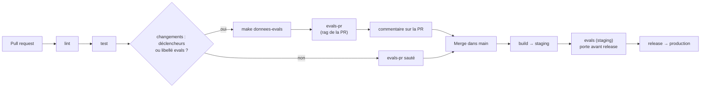

# Chaîne d'évaluation sur pull request

**Rattachement : E3 : C12 Tests automatisés, C13 Livraison continue.**

**Critère C13 (issue #55)** : « Documentation : installation, configuration et test de la chaîne + doc utilisateur de
déclenchement ». Cette page décrit le job `evals-pr` de `.github/workflows/ci-cd.yml` tel qu'il est livré.

## Ce que fait la chaîne

Sur une pull request, `evals-pr` teste d'abord les données d'évaluation hors ligne (`make donnees-evals`), puis
rejoue le golden set (`eval/golden.jsonl`) et le jeu de démo (`eval/questions-demo.jsonl`) **de la PR** contre
le **rag de la PR**, démarré dans le runner avec PostgreSQL et le vrai LLM (#180), avec la porte bloquante de `tools/evals.py` (taux de réussite, latence p95). Le résumé est
posté en commentaire sur la PR.

Aucun secret : le jeton d'évaluation est demandé à Entra par OIDC (`azure/login`, puis
`az account get-access-token`). Une fois l'identité de la CI installée (`infra/bootstrap.sh`, `infra/entra.sh` et `make llm`), aucune écriture
Azure ni Entra n'est nécessaire pour utiliser la chaîne.

## Schéma



*Description du schéma : après lint et test, la PR lance `evals-pr` si un déclencheur a changé ou si le libellé
`evals` est posé (données testées, évaluation du rag de la PR, commentaire). Après le merge, la chaîne
build → staging → `evals` → release → production s'exécute ; `evals` reste la porte bloquante avant la release.*

## Déclencheurs

| Déclencheur | Condition | Effet |
|---|---|---|
| PR ouverte, mise à jour (`synchronize`), rouverte | un fichier de `DECLENCHEURS_EVALS` a changé (job `changements`) | `evals-pr` s'exécute |
| Libellé `evals` posé sur la PR | libellé présent | `evals-pr` s'exécute |
| `workflow_dispatch` (à la main) | lancé **depuis `main`** | `evals-pr` s'exécute, sans commentaire (pas de PR) |
| Merge dans `main` | un déclencheur a changé depuis le dernier manifeste validé | job `evals` de staging (inchangé) |

Fichiers déclencheurs (`DECLENCHEURS_EVALS`) : `rag/agentinsurflow_rag/prompts/`, `eval/golden.jsonl`,
`eval/questions-demo.jsonl`, `data/raw/`, `rag/llm.env`.

Tout **autre libellé** posé sur la PR relance aussi la chaîne de PR (`labeled`) ; la précédente est annulée
(`cancel-in-progress`).

### Tous les déclencheurs de la chaîne

| Événement | Fichier | Ce qui part |
|---|---|---|
| PR ouverte, mise à jour, rouverte ou libellée | `ci-cd.yml` | `lint`, `test`, `integration`, `pyramide`, `modele`, `gateway`, `underwriting-admin` ; `evals-pr` selon le tableau ci-dessus |
| Push sur `main` (fusion) | `ci-cd.yml` | Les mêmes portes, puis `build` → staging → `evals` si besoin → `e2e-staging` → `release` → production |
| Push sur `main` limité à la documentation (`paths-ignore`) | `ci-cd.yml` | Rien : ni build, ni version, ni déploiement |
| **Approbation humaine** de l'environnement `staging`, puis `production` | environnements GitHub | Reprise du job de déploiement en attente |
| `workflow_dispatch` de `ci-cd.yml` (depuis `main`) | `ci-cd.yml` | `evals-pr` à la main |
| `workflow_dispatch` de `deploy.yml` (`make rollback`) | `deploy.yml` | Redéploiement d'un environnement, avec un tag précis ou la révision précédente |
| Appel par `ci-cd.yml` (`workflow_call`) | `deploy.yml` | Déploiement de staging et de production dans la chaîne |

Une PR remplace sa propre chaîne en cours (`cancel-in-progress`), jamais celle de `main`.

## Installation et configuration

Installation complète, dans l'ordre, sur un dépôt et un abonnement Azure neufs :

1. `infra/bootstrap.sh` crée l'application de la CI et ses sujets OIDC : aucun mot de passe n'est stocké dans GitHub.
2. `make infra`, `make entra`, `make llm`, `make calcul`, `make annexe` et `make vigie` provisionnent Azure, à la main (écritures Azure).
3. Reporter les variables et les secrets dans GitHub : [`secrets.md`](secrets.md), clé par clé.
4. Créer les environnements GitHub `staging` et `production`, avec un relecteur obligatoire.
5. `make proteger` applique la protection de `main` (`infra/protection-main.json`) : les portes de PR deviennent obligatoires.
6. Finir avec le tableau ci-dessous, puis le test de la chaîne.

À faire une fois, par Acerola :

| Élément | Où | Commande ou valeur |
|---|---|---|
| `AZURE_CLIENT_ID`, `AZURE_TENANT_ID` | variables du dépôt | déjà posées pour `ci-cd.yml` et `deploy.yml` |
| `STAGING_URL` | variable du dépôt | `gh variable set STAGING_URL --body <URL de la gateway de staging>` |
| Libellé `evals` | dépôt | `gh label create evals` |
| Sujets OIDC fédérés | Entra, application de la CI | créés par `infra/bootstrap.sh` : `ref:refs/heads/main`, `environment:staging`, `environment:production`, `pull_request` |
| Rôle `Gestionnaire` sur `agentinsurflow-rag` | Entra | attribué à la CI par `infra/entra.sh` (avec `Ingestion`) |
| Rôle `LLM` sur `agentinsurflow-llm` | Entra | attribué à la CI par `make llm`, à la main (#180) |
| `LLM_AUDIENCE`, `RAG_API_CLIENT_ID`, `RAG_SEUIL` | variables du dépôt | déjà posées |

Sans `STAGING_URL`, le job échoue avec le message « variable STAGING_URL absente ».

**Pourquoi `workflow_dispatch` ne marche que depuis `main`** : le sujet OIDC d'un lancement manuel est
`ref:refs/heads/<branche>`, et seul `ref:refs/heads/main` est fédéré. Depuis une autre branche, `azure/login` est
refusé. Sur une PR, le sujet est `pull_request`, fédéré lui aussi.

## Test de la chaîne

En local, sans Azure :

```bash
make donnees-evals
```

Vérifie le schéma des deux jeux, la présence des articles attendus dans `data/raw/` et le sha256 de l'instantané.

Contre une API déployée (avec un jeton de rôle `Gestionnaire`) :

```bash
export EVALS_JETON=$(az account get-access-token --scope "api://agentinsurflow-rag/.default" --query accessToken -o tsv)
make eval URL=<URL de staging>
```

`tools/evals.py` accepte aussi `--resume <fichier.md>` (résumé Markdown, repris en commentaire) et
`--rapport <fichier.json>`. Le jeton n'est jamais écrit dans le rapport. En local, `make eval` ne passe pas
`--sans-dossiers` (contrairement à la CI) : les cas à `numero_contrat` sont donc inclus.

## Procédure de démonstration

1. Créer une **branche du dépôt** (pas un fork : les forks n'ont ni OIDC ni variables).
2. Faire au moins un commit trivial (GitHub refuse une PR sans commit entre les branches), par exemple une
   modification de la doc ou d'une question de `eval/questions-demo.jsonl`. Si aucun déclencheur n'a changé,
   le libellé `evals` (étape 4) force l'exécution.
3. Ouvrir la PR vers `main`.
4. Poser le libellé `evals` (si aucun déclencheur n'a changé).
5. Attendre `lint`, `test`, puis `evals-pr` au vert.
6. Lire le commentaire du bot sur la PR et l'artefact `evals-pr-<sha>`.

## Lire le rapport

Un seul commentaire du bot par PR, **édité à chaque passage** (`gh pr comment --edit-last --create-if-none`). Si les
évaluations n'ont pas pu s'exécuter, il indique « rapport absent » avec le lien du run. Le résumé est aussi dans
l'onglet *Summary* du run ; l'artefact contient `evals-pr.json` et `evals-pr.md`. Sur une PR, le commit du manifeste
est le commit de fusion que GitHub construit (tête de la PR fusionnée dans `main`), pas la tête de la PR.

| Champ du rapport JSON | Sens |
|---|---|
| `taux` | part des cas sans échec ; porte bloquante sous le seuil (0,8 par défaut) |
| `latence_p95_s` | latence p95 en secondes ; porte bloquante au-dessus de 30 s par défaut |
| `manifeste` | ce qui a été évalué : commit, modèle, prompts, golden set, questions, corpus, portes |
| `resultats[].echecs` | par cas, causes d'échec : `mode_llm`, `statut`, `articles`, `non_vide`, `longueur` |
| `resultats[].rejeu` | présent si le cas a été rejoué une fois (`429`, `http 0` ou `latence` > porte) : raison et latence de la première tentative ; la porte juge la réponse rejouée (#192). Le résumé de PR liste les cas rejoués |

## Limites

- `evals-pr` évalue le **rag de la PR** : prompts, code et instantanés de la PR, démarré dans le runner avec PostgreSQL du compose et le vrai LLM. Le LLM et les embeddings passent par la gateway de **staging**, seule porte vers Foundry.
- Le rag de la PR prend le jeton de l'identité de la CI par la connexion OIDC de `az` (`RAG_CREDENTIAL_AZ_CLI`). Aucun secret n'est stocké. Il faut que la CI porte le rôle `LLM` : `make llm`, à la main, avec `AZURE_CLIENT_ID` dans le `.env`.
- Chaque passage consomme des tokens Foundry : le job ne part que sur un déclencheur d'évaluation, un libellé ou à la main.
- `workflow_dispatch` ne fonctionne que depuis `main` (voir plus haut).
- Les cas à `numero_contrat` sont écartés (`--sans-dossiers`) : le runner n'a ni underwriting-admin ni serveur MCP.
