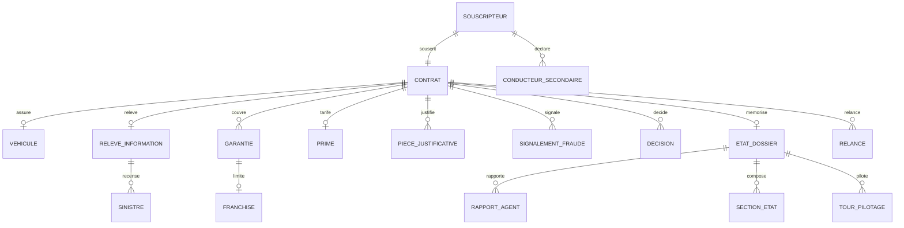
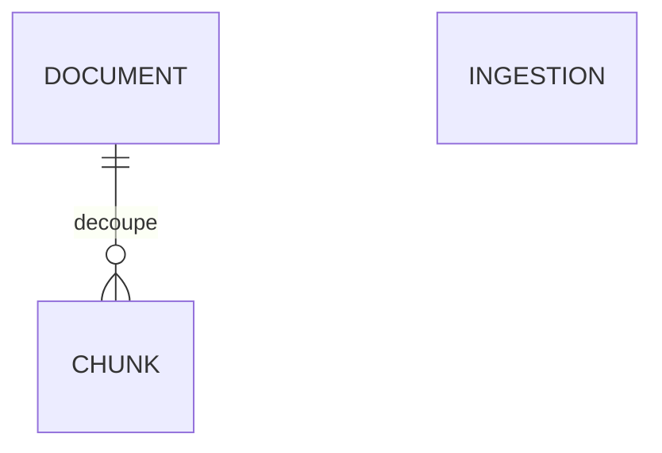

# Modèle de données — Merise, MPD, SGBD, installation

*Livrable L4 · compétence C4. Sources : migrations EF Core de `underwriting-admin`
(`underwriting-admin/src/AgentInsurFlow.UnderwritingAdmin.Infrastructure/Dossiers/` et `Traces/`),
migrations Alembic de `rag` (`rag/migrations/vecteurs/versions/`), image annexe `infra/postgres/init.sh`.*

Trois bases dans une seule instance PostgreSQL 16 + pgvector, chacune avec son propriétaire :

| Base | Propriétaire (projet) | Migrations | Comptes d'exécution |
|---|---|---|---|
| `vecteurs` | `rag` | Alembic, SQL écrit à la main | `writer` (SELECT, INSERT, UPDATE), `reader` (SELECT) |
| `dossiers` | `underwriting-admin` | EF Core | `dossiers` (SELECT sur la vue minimisée **seulement**) |
| `traces` | `underwriting-admin` | EF Core | `traces_writer` (INSERT), `traces_reader` (SELECT) |

Le compte `migrateur` possède les trois bases et ne sert qu'au démarrage (migrations).

## 1. MCD (Merise) — base `dossiers`

Le MCD officiel du fil rouge (11 entités) plus `DECISION`. Les cardinalités sont lues « une occurrence de
l'entité de gauche participe à … ». Les entités qui ne servent pas en V1 (conducteur secondaire, pièces,
signalement, décision) existent et restent vides jusqu'aux agents (S4).

| Association | Entité A (card.) | Entité B (card.) |
|---|---|---|
| **souscrit** | SOUSCRIPTEUR (1,1) | CONTRAT (1,1) |
| **déclare** | SOUSCRIPTEUR (0,n) | CONDUCTEUR_SECONDAIRE (1,1) |
| **assure** | CONTRAT (0,1) | VEHICULE (1,1) |
| **relève** | CONTRAT (0,1) | RELEVE_INFORMATION (1,1) |
| **recense** | RELEVE_INFORMATION (0,n) | SINISTRE (1,1) |
| **couvre** | CONTRAT (0,n) | GARANTIE (1,1) |
| **limite** | GARANTIE (0,1) | FRANCHISE (1,1) |
| **tarife** | CONTRAT (0,1) | PRIME (1,1) |
| **justifie** | CONTRAT (0,n) | PIECE_JUSTIFICATIVE (1,1) |
| **signale** | CONTRAT (0,n) | SIGNALEMENT_FRAUDE (1,1) |
| **décide** | CONTRAT (0,n) | DECISION (1,1) |
| **mémorise** | CONTRAT (0,1) | ETAT_DOSSIER (1,1) |
| **rapporte** | ETAT_DOSSIER (0,n) | RAPPORT_AGENT (1,1) |
| **compose** | ETAT_DOSSIER (0,n) | SECTION_ETAT (1,1) |
| **pilote** | ETAT_DOSSIER (0,n) | TOUR_PILOTAGE (1,1) |
| **relance** | CONTRAT (0,3) | RELANCE (1,1) |

Les cinq dernières entités (migrations `MemoireDossier` du 23/10 et `Relances` du 27/10) sont la mémoire du
cluster d'agents (K11) et les relances du gestionnaire (K8, trois au plus par dossier).



*Lecture du schéma : `||--||` un pour un ; `||--o|` un pour zéro ou un ; `||--o{` un pour zéro ou plusieurs.*

## 2. MPD — base `dossiers` (migration `Mcd`)

Noms en snake_case (convention EF `UseSnakeCaseNamingConvention`), clés `uuid`, montants en `numeric` (euros).

| Table | Colonnes principales | Clés et index |
|---|---|---|
| `souscripteur` | `id`, **`civilite`**, `nom`, `prenom`, `date_naissance`, `adresse`, `email`, `telephone`, `situation_familiale`, `permis_numero`, `permis_date_obtention`, `permis_pays`, **`code_postal`** | PK `id` |
| `contrat` | `id`, **`numero_contrat`**, `souscripteur_id`, **`gestionnaire_id`**, `date_effet`, `statut`, `formule`, `mis_a_jour` | PK `id` · UNIQUE `numero_contrat` · index `gestionnaire_id` · FK UNIQUE `souscripteur_id` |
| `conducteur_secondaire` | `id`, `souscripteur_id`, `identite`, `lien_parente`, `historique_permis` | FK `souscripteur_id` |
| `vehicule` | `id`, `contrat_id`, `immatriculation`, `vin`, `marque`, `modele`, `version`, `puissance_fiscale_cv`, `puissance_din`, `carburant`, `date1re_mise_circulation`, `type_usage`, `km_annuel_estime`, `mode_stationnement`, `code_postal_stationnement` | FK UNIQUE `contrat_id` |
| `releve_information` | `id`, `contrat_id`, `crm_bonus_malus`, `nb_suspensions_permis`, `nb_resiliations` | FK UNIQUE `contrat_id` |
| `sinistre` | `id`, `releve_information_id`, `date_sinistre`, `nature`, `taux_responsabilite` | FK `releve_information_id` |
| `garantie` | `id`, `contrat_id`, `type`, `formule`, `plafond_indemnisation` | FK `contrat_id` |
| `franchise` | `id`, `garantie_id`, `garantie_liee`, `montant` | FK UNIQUE `garantie_id` |
| `prime` | `id`, `contrat_id`, `prime_pure`, taxes (`taxe_fiscale`, `contribution_fgao`, `taxe_attentats_fgti`), `frais_dossier`, `remises`, `surprimes`, `prime_ht`, `prime_ttc`, `periodicite`, `date_effet`, **`etat_validation`** | FK UNIQUE `contrat_id` |
| `piece_justificative` | `id`, `contrat_id`, `type`, `nom_fichier`, `url_blob` | FK `contrat_id` |
| `signalement_fraude` | `id`, `contrat_id`, `motif`, `signale_le`, `statut` | FK `contrat_id` |
| `decision` | `id`, `contrat_id`, `decision_rendue`, `contrat_type`, `score`, `version_bareme`, `regle_id`, `motifs` (jsonb), `citations` (jsonb), `etat_validation`, `auteur`, `horodatage` | FK `contrat_id` |
| `etat_dossier` (migration `MemoireDossier`) | `numero_contrat`, `version_schema`, `statut_parcours`, `tentative`, `nb_relances`, `maj_le` | PK et FK `numero_contrat` → `contrat` (clé alternative `ak_contrat_numero_contrat`) |
| `rapport_agent` | `numero_contrat`, `agent`, `tentative`, `trace_id`, `rapport` (jsonb), `mode` (LLM ou repli), `cause`, `version_prompt`, `cree_le` | PK (`numero_contrat`, `agent`, `tentative`, `trace_id`) · FK → `etat_dossier` |
| `section_etat` | `numero_contrat`, `section`, `tentative`, `contenu` (jsonb) | PK (`numero_contrat`, `section`, `tentative`) · FK → `etat_dossier` |
| `tour_pilotage` | `numero_contrat`, `tentative`, `tour`, `outil_appele`, `precondition`, `mode` | PK (`numero_contrat`, `tentative`, `tour`) · FK → `etat_dossier` |
| `relance` (migration `Relances`) | `numero_contrat`, `rang`, `texte`, `pieces` (jsonb), `envoyee_le`, `envoyee_par` (`oid` du gestionnaire) | PK (`numero_contrat`, `rang`) · FK → `contrat` |

### Vue `vue_contrat_minimisee` (migration `VueEtDroits`, D39)

Seul objet lisible par le compte `dossiers` (`GRANT SELECT` sur la vue, aucun droit sur les tables) :
`numero_contrat`, `gestionnaire_id`, `tranche_age` (`<25`, `25-39`, `40-59`, `60+`, depuis `date_naissance`),
`anciennete_permis_ans`, `departement` (2 caractères, 3 en outre-mer, depuis `code_postal`), `crm_bonus_malus`,
`nb_sinistres` (agrégat), `suspensions`, `resiliations`, `formule`, `mis_a_jour`.
**Aucun nom, aucune adresse, aucun numéro de permis.** SQL : `Dossiers/VueMinimisee.cs`.

### Vues des exceptions à la minimisation (migrations `ContratAccepte`, `FicheSouscripteur`, `ContratComplet`)

Décision d'Acerola du 27/10 ; accordées au compte `dossiers`, la table `souscripteur` lui restant fermée. Jamais lues
par le cluster ni envoyées à un LLM (voir [`rgpd.md`](rgpd.md)).

| Vue | Contenu | Filtre |
|---|---|---|
| `vue_contrat_accepte` | parties au contrat imprimé : identité, naissance, adresse, téléphone, e-mail, permis (n°, date, pays), véhicule (marque, modèle, version, immatriculation, VIN, 1re mise en circulation, usage, stationnement) | contrats `ACCEPTE` |
| `vue_garanties_contrat_accepte` | garanties du contrat et franchise (`garantie` ⟕ `franchise`) | contrats `ACCEPTE` |
| `vue_fiche_souscripteur` | fiche du lead dans le détail du dossier : civilité, identité, adresse, mobile, e-mail, véhicule | tout statut |

Toutes portent `numero_contrat` et `gestionnaire_id` : la route filtre sur l'`oid` du jeton (BOLA).

### Seed (migration `Seed`)

Dossiers synthétiques, dont les `oid` Entra viennent de `SEED_GESTIONNAIRE_A`, `_B` et `_C` (variables
d'environnement, jamais commitées). `ON CONFLICT DO NOTHING` : rejouable. Répartition : `AIF-2026-000001` à `000003` et
`000010` (refusé par le barème, R01) → gestionnaire A, `000004` à `000006` → gestionnaire B, `000007` à `000009` →
gestionnaire C (identité de la CI, migration `SeedGestionnaireC`) ; une valeur qui n'est pas un GUID fait échouer la
migration. Civilité (M. pour les numéros impairs, Mme pour les pairs) et garanties par formule (protection juridique ;
vol, incendie et tempête et bris de glace dès `tiers_etendu` ; dommages tous accidents et assistance en
`tous_risques`) sont posées par les migrations `FicheSouscripteur` et `ContratComplet`. La migration n'est jouée qu'une fois par base ; sans ces variables au premier démarrage, le seed est vide
(redémarrer sur une base neuve pour le rejouer).

### Écarts au MCD officiel (documentés)

| Écart | Raison | Décision |
|---|---|---|
| `CONTRAT.numero` → `numero_contrat` UNIQUE | Clé pivot entre l'agent, la vue et le BOLA | S3-7 |
| `SOUSCRIPTEUR.code_postal` | Le département remplace l'adresse dans la vue minimisée | S3-8 |
| `SOUSCRIPTEUR.civilite` | Fiche du lead et contrat imprimé (27/10) | Acerola, 27/10 |
| `CONTRAT.gestionnaire_id` | `oid` Entra du gestionnaire : contrôle BOLA (OWASP API1) | S3-17 |
| `PRIME` 1–1 avec `CONTRAT` + `periodicite`, `date_effet`, `etat_validation` | Une prime par contrat (MCD officiel) ; brouillon validé par un humain (S4) | P18, tranché par Acerola le 20/10 |
| `DECISION` ajoutée | Trace de la décision de souscription (dossier de conception, L6.7) | S3-17 |
| Mémoire du dossier (`ETAT_DOSSIER`, `RAPPORT_AGENT`, `SECTION_ETAT`, `TOUR_PILOTAGE`) ajoutée | Reprise après redémarrage du cluster, audit de la Saga (K11) | Migration `MemoireDossier`, 23/10 |
| `RELANCE` ajoutée | Relance des pièces manquantes par le gestionnaire, bornée à trois (K8) | Migration `Relances`, 27/10 (#134) |
| Catégorie du véhicule absente de la vue | Champ absent du MCD | 🔴 point ouvert |

## 3. MPD — base `traces` (migration EF Core de `Traces/`)

Une table `span` au modèle de données OTLP : voir [`traces.md`](traces.md).

## 4. MPD — base `vecteurs` (Alembic `0001_corpus`, `0002_extrait_le`, `0003_regle_id`)

| Table | Colonnes | Contraintes et index |
|---|---|---|
| `document` (une **version** d'un article) | `id` bigserial, `doc_id`, `collection`, `version`, `date_debut`, `etat`, `url_source`, `hash_contenu` char(64), `obsolete`, `ingere_le`, `extrait_le`, `regle_id` text NULL (règle du barème fondée par une procédure interne, renvoyée dans la citation des extraits) | UNIQUE (`doc_id`, `version`) · CHECK `collection` ∈ {`textes_reglementaires`, `procedures_internes`, `cgv_conditions`, `notices_produits`} (l'API ingère toutes les collections sauf `cgv_conditions` ; le rôle `Gestionnaire` lit les trois autres) · index partiel (`collection`) WHERE NOT `obsolete` · UNIQUE partiel (`doc_id`) WHERE NOT `obsolete` (une seule version courante) |
| `chunk` (unité de recherche et de citation) | `id`, `document_id` → `document` (ON DELETE CASCADE), `article`, `ordre`, `texte`, `embedding vector(1536)`, `tsv tsvector` **généré** (`to_tsvector('french', article ‖ ' ' ‖ texte)`) | **HNSW** `vector_cosine_ops` · **GIN** (`tsv`) · B-tree (`article`), (`document_id`) |
| `ingestion` | `id`, `instantane_sha256`, `recu_le`, `rapport` jsonb | PK `id` |



## 5. Choix du SGBD : PostgreSQL 16 + pgvector

- **Une seule technologie** pour le relationnel (dossiers, traces), le vectoriel (HNSW) et le plein texte
  (`tsvector`, GIN) : la recherche hybride se fait en une requête SQL (RRF), sans moteur de recherche séparé.
- **Contraintes et droits natifs** : la minimisation (vue + `GRANT`) et l'idempotence (`UNIQUE`,
  `ON CONFLICT DO NOTHING`) sont garanties par la base, pas par le code.
- **Écartés** : base vectorielle dédiée (Chroma, Qdrant) — un système de plus à opérer et pas de jointure avec
  les dossiers ; ClickHouse pour les traces — deux conteneurs de plus pour un service (spec §9.1).
- **Limite assumée** : conteneur annexe éphémère dans la Container App (S3-5), vidé à chaque déploiement ;
  PostgreSQL Flexible plus tard.

## 6. Installation pas à pas

```bash
make up          # postgres annexe (crée les 3 bases et les comptes), rag, underwriting-admin, serveur MCP, cluster d'agents, calcul, gateway
make migrate     # base vecteurs (Alembic) ; dossiers et traces migrent au démarrage d'underwriting-admin
make ingest URL=http://localhost:8000 INSTANTANE=data/raw/code-assurances-2026-10-20.json
```

Les mots de passe des comptes viennent du `.env` local (clés listées dans `.env.example`) ; en Azure, des
secrets de la Container App (`infra/postgres-annexe.sh`).
