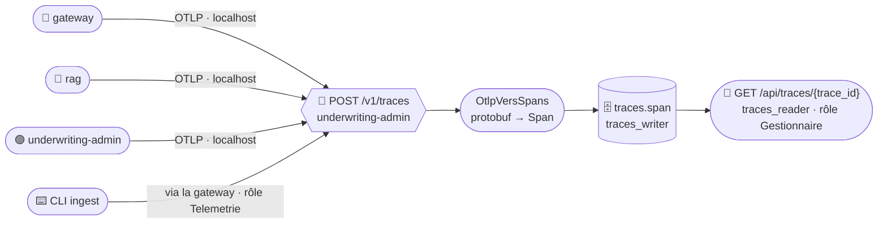

# Référentiel SQL des traces (OpenTelemetry)

*Livrable L6 · compétences C2, C4. Code : `underwriting-admin` (C#) — `Infrastructure/Otlp/OtlpVersSpans.cs`,
`Infrastructure/Traces/`, `Api/TracesEndpoints.cs`, `Api/SourcesSansJeton.cs`. Spec §9, décisions S3-13, S3-17, S3-21.*

## Pourquoi cette forme

| Option | Décision |
|---|---|
| **A · base `traces` au modèle OTLP + récepteur OTLP/HTTP** | ✅ retenue : du SQL sur les traces, aucun conteneur de plus |
| B · Collector OTel + ClickHouse | Écartée : deux conteneurs de plus pour un service |
| C · Application Insights + Langfuse seuls | Écartée : pas de SQL (ils restent prévus en complément) |

La conformité OpenTelemetry repose sur le **protocole** OTLP/HTTP protobuf (tout SDK l'émet) et sur le
**modèle de données** OTLP (les colonnes reprennent les champs de `Span`).

## Chemin d'un span



*Lecture : les trois services de la Container App exportent sur `localhost:8002` ; la CLI passe par la gateway
avec un jeton. Le récepteur convertit la requête protobuf en lignes `span`, relues par `trace_id`.*

## Règle d'accès à `POST /v1/traces` (S3-21)

- **Sans jeton** seulement si la requête n'a **pas** d'en-tête `X-Forwarded-For` **et** vient d'une adresse de
  `Otlp:SourcesSansJeton` (CIDR ; défaut `127.0.0.1/32,::1/128`, la boucle locale de la réplique).
- Sinon, rôle d'app **`Telemetrie`** exigé (audience `agentinsurflow-underwriting`).
- La gateway réécrit `X-Forwarded-For` : tout appel venu de l'extérieur porte donc l'en-tête et exige le jeton.
  Un `X-Forwarded-For` forgé ne peut pas faire passer une requête sans jeton (test
  `V1Traces_via_gateway_sans_jeton_401`, et E2E `test_v1_traces_sans_jeton_refuse_depuis_l_exterieur`).
- **En local**, le compose ajoute son réseau interne à la liste, pour que `rag` et la gateway (autres
  conteneurs) exportent ; en Azure, le défaut (boucle locale) s'applique.
- `application/x-protobuf` seulement (sinon 415) ; réponse : `ExportTraceServiceResponse` vide.

## Table `span`

| Colonne | Type | Champ OTLP |
|---|---|---|
| `trace_id` | `char(32)` | `Span.trace_id` (hexa) |
| `span_id` | `char(16)` | `Span.span_id` |
| `parent_span_id` | `char(16)` NULL | `Span.parent_span_id` |
| `trace_state` | `text` | `Span.trace_state` |
| `name` · `kind` | `text` · `smallint` | `Span.name` · `Span.kind` |
| `start_time_unix_nano` · `end_time_unix_nano` | `bigint` | idem |
| `duree_ms` | `double precision`, colonne générée | (fin − début) / 1e6 |
| `status_code` · `status_message` | `smallint` · `text` | `Span.status` |
| `service_name` | `text` | `Resource` → `service.name` (`inconnu` s'il manque) |
| `resource_attributes` · `attributes` | `jsonb` | `Resource.attributes` · `Span.attributes` (`AnyValue` → JSON) |
| `scope_name` · `scope_version` | `text` | `InstrumentationScope` |
| `events` · `links` | `jsonb` | `Span.events` · `Span.links` |
| `recu_le` | `timestamptz` | — (réception) |

- **Clé primaire** (`trace_id`, `span_id`) : un span reçu deux fois est ignoré (`ON CONFLICT DO NOTHING`, SQL paramétré). Insertion par lots : un `INSERT` multi-lignes par lot de 1 000 spans, dans une transaction.
- **Index** : B-tree (`service_name`, `start_time_unix_nano`), B-tree (`parent_span_id`), GIN (`attributes`).
- **Droits** : `traces_writer` → INSERT ; `traces_reader` → SELECT.
- `/v1/traces` et `/health` ne sont pas instrumentés (pas de boucle).

## Spans produits

| Span | Service | Attributs (jamais de donnée personnelle) |
|---|---|---|
| HTTP serveur (automatique) | gateway, rag, underwriting | méthode, route, statut ; `client.address` sur la gateway (IP réelle derrière l'envoy, S3-26, posé par la gateway) |
| `rag.recherche` | rag | statut, cosinus max, seuil, référence exacte, articles |
| `agent.repondre` | rag | statut, verrou (1, 2, 3 ou aucun), articles cités, `question.sha256`, `question.longueur` |
| `llm.completer` · `embeddings.vectoriser` | rag | modèle, usage, version du prompt |
| `ingestion.lot` | rag | collection, insérés, inchangés, rejets, quasi-doublons |
| `ingest.run` · `ingest.lot` | CLI | sha256 de l'instantané, nb d'articles, mode |

Le texte de la question n'est **jamais** tracé (seulement son sha256 et sa longueur) ; un contrat n'apparaît que
par `contrat.present = true`.

## Une trace sur trois services

`POST /api/reponses` (via la gateway) renvoie un `trace_id`. `GET /api/traces/{trace_id}` rend, dans l'ordre de
début, le span HTTP de la gateway, ceux de `rag` (`agent.repondre`, `rag.recherche`, `llm.completer`) et, si un
`numero_contrat` est fourni, l'appel OBO reçu par `underwriting-admin` (le `traceparent` est propagé). Vérifié
localement le 20/10 : la table reçoit des spans `gateway`, `rag` et `agentinsurflow-underwriting` ; test E2E
`test_question_couverte_citee_et_tracable`.

## Requêtes d'exemple

```sql
-- Durée moyenne et p95 par nom de span
SELECT service_name, name, count(*) AS n, round(avg(duree_ms)::numeric, 1) AS moy_ms,
       round(percentile_cont(0.95) WITHIN GROUP (ORDER BY duree_ms)::numeric, 1) AS p95_ms
FROM span GROUP BY service_name, name ORDER BY moy_ms DESC;

-- Les traces récentes d'un service
SELECT DISTINCT trace_id, min(recu_le) AS recue
FROM span WHERE service_name = 'agentinsurflow-rag'
GROUP BY trace_id ORDER BY recue DESC LIMIT 20;

-- Refus par verrou de l'agent
SELECT attributes ->> 'agent.verrou' AS verrou, count(*)
FROM span WHERE name = 'agent.repondre' AND attributes ->> 'agent.statut' = 'NOT_FOUND_IN_CORPUS'
GROUP BY 1 ORDER BY 2 DESC;

-- Une ingestion de bout en bout (CLI + rag)
SELECT service_name, name, duree_ms FROM span
WHERE trace_id = (SELECT trace_id FROM span WHERE name = 'ingest.run' ORDER BY recu_le DESC LIMIT 1)
ORDER BY start_time_unix_nano;
```

## Limites

- Base annexe éphémère : les traces sont **vidées à chaque déploiement** (pas encore durables, Flexible plus tard).
- Durée de conservation et fréquence de purge : 🔴 à décider (voir [`rgpd.md`](rgpd.md)).
