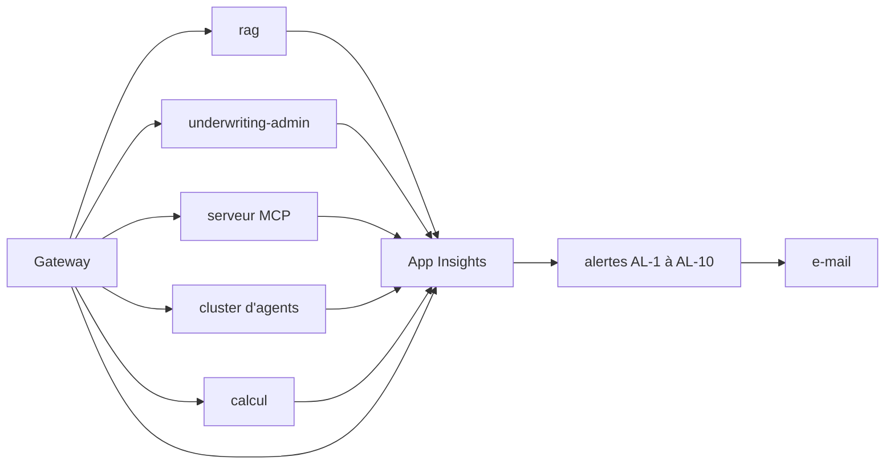

# Exploitation d'AgentInsurFlow

## 1. À quoi sert ce document

Ce document est le point d'entrée de l'exploitation. Il apprend à déployer une version, à diagnostiquer une panne depuis l'e-mail d'alerte, et à revenir en arrière.
Il part d'un environnement déjà en place. Il suppose le poste d'Acerola, déjà connecté à Azure et à GitHub.
Il renvoie à [`rollback.md`](rollback.md) et à [`secrets.md`](secrets.md) pour le détail, sans le recopier.



Légende : la gateway est la seule entrée publique. Elle appelle cinq services : rag, underwriting-admin, le serveur MCP, le cluster d'agents et la fonction de calcul. Chaque service, gateway comprise, envoie ses traces à Application Insights (la fonction de calcul reçoit `APPLICATIONINSIGHTS_CONNECTION_STRING` à l'étape ③ de `infra/vigie.sh`). Application Insights déclenche les alertes AL-1 à AL-10, et chaque alerte envoie un e-mail.

## 2. Avant de commencer

Cette section vérifie les prérequis. Elle n'en crée aucun.
Toutes les commandes se lancent depuis la racine du dépôt.

1. Vérifier que le fichier de variables existe.

   ```bash
   test -f .env && echo present
   ```

   Résultat attendu : `present`.

2. Vérifier la connexion à Azure.

   ```bash
   az account show --query id -o tsv
   ```

   Résultat attendu : un identifiant d'abonnement sur une seule ligne, identique à `AZURE_SUBSCRIPTION_ID` dans le `.env`. Une erreur « Please run 'az login' » signifie que la session a expiré.

3. Vérifier la connexion à GitHub.

   ```bash
   gh auth status
   ```

   Résultat attendu : « Logged in to github.com », avec un compte qui a accès au dépôt `acerolaz/agentinsurflow`.

4. Vérifier que le `.env` porte les cinq variables utiles aux sections 3, 5 et 7. La commande compte les lignes renseignées et n'affiche aucune valeur.

   ```bash
   grep -cE '^(AZURE_RESOURCE_GROUP|APP_STAGING|APP_PRODUCTION|ALERTE_EMAIL|GITHUB_REPO)=.+' .env
   ```

   Résultat attendu : `5`. Un nombre plus petit signifie qu'une variable manque ou est vide : la remplir à partir de `.env.example`. `GITHUB_REPO` est nécessaire au rollback. Les variables de la vigie sont listées en section 10.

La gestion des secrets est décrite dans [`secrets.md`](secrets.md). Aucun secret ne s'écrit dans ce document.

## 3. Déployer

### Voie normale : fusionner sur `main`

1. Fusionner la pull request sur `main`.
2. Suivre le run `ci-cd` :

   ```bash
   gh run watch -R acerolaz/agentinsurflow
   ```

   Sans identifiant de run, `gh` ouvre une liste à choisir au clavier : choisir le run `ci-cd` en cours.
3. Attendre les étapes, dans cet ordre : lint, tests, build, staging, evals et e2e-staging (en parallèle), release, production. Compter environ 28 minutes (mesure du 28/10, spec O4).
4. Approuver la production quand le run l'attend : ouvrir le run dans l'onglet Actions de GitHub, puis le bouton « Review deployments ». La règle se règle dans GitHub, Settings, Environments, `production`, règle « Required reviewers » : seul le compte `acerolaz` y figure.

Le job `evals-pr` est sauté : voir la [section 9](#9-limites-connues).

### Voie manuelle : `deploy.yml`

Cette voie déploie un SHA donné sans fusion. Elle écrit dans Azure : elle est lancée à la main par Acerola, jamais par un agent.

1. Relever le SHA courant de `main` :

   ```bash
   git fetch origin && git rev-parse origin/main
   ```

2. Vérifier que l'image de ce SHA existe déjà dans le registre. `ci-cd.yml` la construit à chaque fusion sur `main` : un SHA jamais fusionné est refusé par `deploy.yml` (« image absente de l'ACR », voir [`rollback.md`](rollback.md)). Vérifier (lecture seule, `<ACR_NAME>` : la variable du `.env`) :

   ```bash
   az acr repository show-tags -n <ACR_NAME> --repository agentinsurflow-gateway --query "[?@=='<sha>']" -o tsv
   ```

   Résultat attendu : le SHA s'affiche. Une ligne vide veut dire que l'image n'existe pas.
3. Lancer le workflow en staging sur ce SHA :

   ```bash
   make rollback ENV=staging TAG=<sha>
   ```

4. Suivre le run avec `gh run watch -R acerolaz/agentinsurflow`, en choisissant le run `deploy` dans la liste.

Sans `TAG`, la même commande est un rollback, pas un déploiement : voir la [section 7](#7-revenir-en-arrière).

### Vérifier le déploiement

1. Le test de fumée de `deploy.yml` est bloquant : un run vert l'a déjà passé.
2. Obtenir l'adresse de la gateway, en lecture seule. Remplacer `<APP_STAGING>` et `<AZURE_RESOURCE_GROUP>` par les valeurs du `.env` :

   ```bash
   az containerapp show -n <APP_STAGING> -g <AZURE_RESOURCE_GROUP> --query properties.configuration.ingress.fqdn -o tsv
   ```

   Résultat attendu : un nom d'hôte, noté `<fqdn>` ci-dessous.
3. Interroger `https://<fqdn>/health`, par exemple avec `curl -s https://<fqdn>/health`. La réponse est un JSON avec les champs `statut`, `version` et `release`. Résultat attendu : `statut` vaut `ok`, et `version` est le SHA déployé.
4. Répéter pour chaque route et comparer le champ `version` : il doit être identique partout.
   - `/health/rag`
   - `/health/underwriting`
   - `/health/mcp`
   - `/health/cluster`
   - `/health/calcul`
5. Ouvrir le tableau de bord `vigie-<env>` dans le portail Azure, voir la [section 4](#4-surveiller).

### En local

1. Démarrer la solution :

   ```bash
   make up
   ```

2. Ouvrir Swagger sur `http://localhost:8000/`.
3. Lire les traces dans le référentiel SQL, via `GET /api/traces/{trace_id}` (décision D-V2 amendée : en Azure, les traces vont aussi à Application Insights).
4. Arrêter avec `make down`.

## 4. Surveiller

Le tableau de bord `vigie-<env>` se lit tuile par tuile. Chaque tuile répond à une question.

| Tuile | Ce qu'elle répond | Objectif |
|---|---|---|
| Comment lire ce tableau | Mode d'emploi du tableau | sans objet |
| Alertes en cours | Lien vers les alertes du portail | aucune alerte |
| Le service répond-il ? | Réussite du test `/health` | 100 % |
| Combien de dossiers évalués ? | Nombre d'évaluations par heure | pas d'objectif |
| Combien de temps prend une évaluation ? | p95 en millisecondes | ≤ 30 s (30 000 ms) |
| Quelle part part en revue humaine, et pourquoi ? | Part en % et répartition par cause | ≤ 20 % ; alerte > 30 % |
| Combien coûte un dossier ? | Moyenne en $ et $ par agent et modèle | alerte > 0,15 $ |
| Les garde-fous bloquent-ils plus que d'habitude ? | Taux sur 1 h face à la référence | alerte > 2× |
| Combien d'évaluations sans décision ? | Part d'évaluations terminées sans décision (statut final `ERREUR`) | < 1 % |
| Le modèle de langage est-il disponible ? | Appels en échec (`llm_ko`) et réponses 429 | 0 |

Pour voir le trafic en direct, ouvrir Live Metrics dans la ressource Application Insights `appi-insurflow-<env>`.
Les alertes arrivent par e-mail à l'adresse `ALERTE_EMAIL`, envoyées par l'Action Group `ag-insurflow-<env>`.
Le détail de chaque seuil est au catalogue de la [section 10](#10-annexes).

## 5. Diagnostiquer une panne

### Méthode générale

1. Lire l'e-mail d'alerte : noter le numéro AL-n, l'heure et l'environnement.
2. Ouvrir le tableau de bord `vigie-<env>` et repérer la tuile qui sort de son objectif.
3. Ouvrir la fiche de l'alerte dans la [section 6](#6-fiches-par-alerte).
4. Lancer la requête KQL de la fiche, comme décrit ci-dessous dans « Lancer une requête d'une fiche ».
5. Ouvrir une ligne en échec dans Transaction Diagnostics pour suivre la requête de bout en bout.
6. Nommer la cause.
7. Appliquer l'action de la fiche, ou ouvrir un incident, voir la [section 8](#8-ouvrir-et-fermer-un-incident).

### Lancer une requête d'une fiche

Les fichiers de `infra/vigie/kql/` sont des gabarits : `make vigie` y remplace `$APPI_ID`, `$CLUSTER_APP` et `$PRIX_KQL` avant de créer les alertes. Pour les lancer à la main, il faut faire ce remplacement soi-même.

1. Récupérer l'identifiant de la ressource Application Insights (lecture seule) :

   ```bash
   az monitor app-insights component show -a appi-insurflow-staging -g <AZURE_RESOURCE_GROUP> --query id -o tsv
   ```

   Résultat attendu : une ligne qui commence par `/subscriptions/` et finit par `/components/appi-insurflow-staging`.
2. Ouvrir dans le portail Azure l'espace Log Analytics nommé par `LOG_ANALYTICS_WORKSPACE` dans le `.env`, puis l'onglet « Journaux » (Logs). Les requêtes lisent les tables de cet espace (`AppTraces`, `AppRequests`, `ContainerAppSystemLogs_CL`) : elles ne marchent pas dans l'onglet Journaux d'Application Insights, qui expose d'autres tables.
3. Coller le contenu du fichier `.kql` de la fiche.
4. Remplacer `$APPI_ID` par l'identifiant de l'étape 1.
5. Si la requête contient `$CLUSTER_APP`, le remplacer par la valeur de `CLUSTER_APP_STAGING` du `.env`. Si elle contient `$PRIX_KQL`, le remplacer par les tarifs de `PRIX_USD_MILLION`, écrits `"modèle",entrée,sortie,` pour chaque modèle.
6. Lancer. Le résultat est dans la colonne `valeur`.

### La panne type : le LLM coupé (alerte AL-2)

Cet exercice se joue en staging. Il ne demande aucune pull request.

1. Acerola coupe le LLM du cluster de staging, à la main :

   ```bash
   make recette ACTION=llm-off
   ```

   Le script règle la variable `INSURFLOW_LLM_ACTIF=false` sur la Container App du cluster, `ai-cluster-staging` par défaut (variable `CLUSTER_APP_NAME`).

2. Lancer une évaluation dans l'espace gestionnaire de staging. Il est servi par la gateway, à `https://<fqdn>/app/` (`<fqdn>` : voir la section 3). Le compte gestionnaire de staging est remis par Acerola. Elle part en revue humaine, avec le message « Service temporairement indisponible ».
3. Attendre l'e-mail d'alerte AL-2. La règle est évaluée toutes les 5 minutes sur une fenêtre de 5 minutes, seuil : au moins 1 erreur `llm_ko`.
4. Lancer la requête [`al-2-llm-ko.kql`](../infra/vigie/kql/al-2-llm-ko.kql) comme décrit dans « Lancer une requête d'une fiche ». La colonne `valeur` donne le nombre d'erreurs `llm_ko`.
5. Lire la cause : `llm_ko`, le cluster n'a pas pu appeler le LLM. Ici, c'est que le LLM est coupé par `INSURFLOW_LLM_ACTIF=false`.
6. Rétablir le LLM, à la main :

   ```bash
   make recette ACTION=llm-on
   ```

   Le script attend la nouvelle révision et affiche « prête, 100 % du trafic ».
7. Vérifier : lancer une nouvelle évaluation. Elle passe avec le LLM actif, et la colonne `valeur` de la même requête retombe à 0 une fois la fenêtre de 5 minutes écoulée.

## 6. Fiches par alerte

Chaque fiche a la même forme : ce que ça veut dire, la requête, les causes probables, l'action, et le rollback.
Pour lancer une requête, suivre « Lancer une requête d'une fiche » dans la [section 5](#lancer-une-requête-dune-fiche).
Une cause « à documenter au premier déclenchement » n'a pas encore été vue : la noter dans l'issue incident (section 8).
Un rollback n'est utile que si l'alerte suit un déploiement. Il écrit dans Azure : Acerola le lance à la main (voir la [section 7](#7-revenir-en-arrière)).

<a id="al-1"></a>

### AL-1 — latence p95 d'une évaluation

- **Ce que ça veut dire** : le p95 de la durée d'une évaluation dépasse 30 s (30 000 ms) sur 15 min, règle évaluée toutes les 15 min, gravité 2. L'objectif SLO-2 est un p95 de 30 s ou moins.
- **Requête** : [`al-1-latence-p95.kql`](../infra/vigie/kql/al-1-latence-p95.kql), à lancer comme décrit dans la [section 5](#lancer-une-requête-dune-fiche).
- **Causes probables** :
  - 502 en cumul quand plusieurs évaluations tournent ensemble (#122).
  - Un LLM lent : en staging, Kimi-K2.5 prenait environ 14 s par appel ; le cluster utilise `gpt-4.1-mini` depuis #105.
  - Toute autre cause : À documenter au premier déclenchement.
- **Action** :
  1. Lancer la requête : la colonne `valeur` donne le p95 en millisecondes.
  2. Ouvrir une évaluation lente dans Transaction Diagnostics (section 5) et repérer l'appel le plus long.
  3. Lire l'heure du dernier déploiement : `gh run list --workflow ci-cd.yml --limit 1 -R acerolaz/agentinsurflow` (ou l'onglet Actions du dépôt, runs `ci-cd` et `deploy`). Si l'alerte arrive dans l'heure qui suit, voir « Rollback ? » ci-dessous.
  4. Si le p95 reste au-dessus de 30 s à la fenêtre suivante, ouvrir un incident, voir la [section 8](#8-ouvrir-et-fermer-un-incident).
- **Rollback ?** Oui, si l'alerte arrive dans l'heure qui suit un déploiement : suivre la [section 7](#7-revenir-en-arrière). Sinon, non.

<a id="al-2"></a>

### AL-2 — erreurs `llm_ko`

- **Ce que ça veut dire** : au moins 1 appel LLM a échoué (cause `llm_ko`) en 5 min, règle évaluée toutes les 5 min, gravité 1. En nominal il y en a 0 depuis `gpt-4.1-mini` (#105). Les dossiers concernés partent en revue humaine avec le message « Service temporairement indisponible ».
- **Requête** : [`al-2-llm-ko.kql`](../infra/vigie/kql/al-2-llm-ko.kql), à lancer comme décrit dans la [section 5](#lancer-une-requête-dune-fiche).
- **Causes probables** :
  - Le LLM du cluster est coupé par `INSURFLOW_LLM_ACTIF=false` (`make recette ACTION=llm-off`). C'est la panne type de la [section 5](#la-panne-type--le-llm-coupé-alerte-al-2).
  - Un LLM trop lent : Kimi-K2.5, environ 14 s par appel, avant #105.
  - Toute autre cause : À documenter au premier déclenchement.
- **Action** :
  1. Lancer la requête : la colonne `valeur` donne le nombre d'erreurs `llm_ko`.
  2. Si le LLM a été coupé pour un exercice, Acerola le rétablit à la main : `make recette ACTION=llm-on`.
  3. Sinon, suivre une ligne en échec dans Transaction Diagnostics et nommer la cause.
  4. Lire l'heure du dernier déploiement : `gh run list --workflow ci-cd.yml --limit 1 -R acerolaz/agentinsurflow` (ou l'onglet Actions du dépôt, runs `ci-cd` et `deploy`).
  5. Vérifier que `valeur` retombe à 0 après la fenêtre de 5 minutes.
- **Rollback ?** Oui, si l'alerte arrive dans l'heure qui suit un déploiement : suivre la [section 7](#7-revenir-en-arrière). Sinon, non.

<a id="al-3"></a>

### AL-3 — cluster en `503 GARDE_FOUS_EN_CHARGEMENT`

- **Ce que ça veut dire** : les échecs de sonde du cluster durent plus de 180 s sur 5 min, règle évaluée toutes les 5 min, gravité 1. La sonde de démarrage autorise environ 3 min : au-delà, le chargement des garde-fous est anormalement long.
- **Requête** : [`al-3-garde-fous-chargement.kql`](../infra/vigie/kql/al-3-garde-fous-chargement.kql), à lancer comme décrit dans la [section 5](#lancer-une-requête-dune-fiche).
- **Causes probables** :
  - Durée normale du chargement des modèles LLM Guard : environ 6 s en local, mesuré à la main. Elle n'explique pas un dépassement de 180 s.
  - Toute autre cause : À documenter au premier déclenchement.
- **Action** :
  1. Lancer la requête : la colonne `valeur` donne l'écart en secondes entre le premier et le dernier échec de sonde.
  2. Interroger le cluster : `curl -s https://<fqdn>/health/cluster` (`<fqdn>` : voir la [section 3](#vérifier-le-déploiement)). Résultat attendu, cluster prêt : un JSON avec les champs `version`, `prompts`, `reglages` et `garde_fous` valant `prets`. Tant que les garde-fous chargent, la réponse est un `503` de code `GARDE_FOUS_EN_CHARGEMENT`.
  3. Si le cluster n'est toujours pas prêt après quelques minutes, ouvrir un incident, voir la [section 8](#8-ouvrir-et-fermer-un-incident).
- **Rollback ?** Non : cette alerte ne suit pas un déploiement. Ne revenir en arrière que si l'enquête la relie à un déploiement récent.

<a id="al-4"></a>

### AL-4 — `MCP_INDISPONIBLE`

- **Ce que ça veut dire** : au moins 1 évaluation a pour cause `MCP_INDISPONIBLE` en 5 min, règle évaluée toutes les 5 min, gravité 1. L'API répond `502 OUTIL_INDISPONIBLE`. En nominal il y en a 0.
- **Requête** : [`al-4-mcp-indisponible.kql`](../infra/vigie/kql/al-4-mcp-indisponible.kql), à lancer comme décrit dans la [section 5](#lancer-une-requête-dune-fiche).
- **Causes probables** :
  - Délai du serveur MCP de 22 s dépassé (#146).
  - 502 en cumul sous charge (#122).
  - Toute autre cause : À documenter au premier déclenchement.
- **Action** :
  1. Lancer la requête : la colonne `valeur` donne le nombre d'évaluations en échec.
  2. Interroger le serveur MCP : `curl -s https://<fqdn>/health/mcp` (`<fqdn>` : voir la [section 3](#vérifier-le-déploiement)). Résultat attendu, serveur sain : un JSON avec les champs `version`, `release` et `environnement`.
  3. Suivre une évaluation en échec dans Transaction Diagnostics jusqu'au serveur MCP.
  4. Si le serveur MCP ne répond pas, ouvrir un incident, voir la [section 8](#8-ouvrir-et-fermer-un-incident).
- **Rollback ?** Non : cette alerte ne suit pas un déploiement. Ne revenir en arrière que si l'enquête la relie à un déploiement récent.

<a id="al-5"></a>

### AL-5 — part des évaluations en `REVUE_HUMAINE`

- **Ce que ça veut dire** : plus de 30 % des évaluations sont parties en revue humaine sur 2 h, règle évaluée toutes les heures, gravité 2. La mesure est nulle sous 10 évaluations. L'objectif SLO-5 est 20 % ou moins.
- **Requête** : [`al-5-revue-humaine.kql`](../infra/vigie/kql/al-5-revue-humaine.kql), à lancer comme décrit dans la [section 5](#lancer-une-requête-dune-fiche). Pour le détail par cause : [`tuiles/revue-par-cause.kql`](../infra/vigie/kql/tuiles/revue-par-cause.kql), lancée de la même façon.
- **Causes probables** :
  - Une panne du LLM (`llm_ko`) : voir AL-2.
  - Un outil indisponible (`MCP_INDISPONIBLE`) : voir AL-4.
  - Un refus des garde-fous : voir AL-7.
  - Toute autre cause : À documenter au premier déclenchement.
- **Action** :
  1. Lancer la requête : la colonne `valeur` donne le pourcentage.
  2. Lancer `tuiles/revue-par-cause.kql` : le résultat donne les évaluations en `REVUE_HUMAINE` par cause.
  3. Traiter la cause dominante avec la fiche correspondante.
- **Rollback ?** Non : cette alerte ne suit pas un déploiement. Ne revenir en arrière que si l'enquête la relie à un déploiement récent.

<a id="al-6"></a>

### AL-6 — coût moyen par dossier

- **Ce que ça veut dire** : le coût moyen par dossier dépasse 0,15 USD sur 24 h, règle évaluée toutes les heures, gravité 2. Le coût est la somme des jetons multipliée par les prix de `PRIX_USD_MILLION`, sans conversion. L'alerte n'est pas créée sans `PRIX_USD_MILLION`.
- **Requête** : [`al-6-cout-dossier.kql`](../infra/vigie/kql/al-6-cout-dossier.kql), à lancer comme décrit dans la [section 5](#lancer-une-requête-dune-fiche). Pour le détail par agent : [`tuiles/cout-par-agent.kql`](../infra/vigie/kql/tuiles/cout-par-agent.kql), lancée de la même façon.
- **Causes probables** :
  - À documenter au premier déclenchement.
- **Action** :
  1. Lancer la requête : la colonne `valeur` donne le coût moyen en USD.
  2. Lancer `tuiles/cout-par-agent.kql` : le résultat donne le coût en USD par agent et par modèle.
  3. Vérifier que les tarifs de `PRIX_USD_MILLION` sont ceux du modèle en service.
- **Rollback ?** Non : cette alerte ne suit pas un déploiement. Ne revenir en arrière que si l'enquête la relie à un déploiement récent.

<a id="al-7"></a>

### AL-7 — taux de refus des garde-fous

- **Ce que ça veut dire** : le taux de refus sur 1 h dépasse 2 fois le taux de référence, règle évaluée toutes les heures sur une fenêtre de 48 h, gravité 2. La référence est le reste de la fenêtre, heure courante exclue. La mesure est nulle sous 10 évaluations dans l'heure.
- **Requête** : [`al-7-refus-garde-fous.kql`](../infra/vigie/kql/al-7-refus-garde-fous.kql), à lancer comme décrit dans la [section 5](#lancer-une-requête-dune-fiche).
- **Causes probables** :
  - À documenter au premier déclenchement.
- **Action** :
  1. Lancer la requête : la colonne `valeur` donne le rapport au taux de référence.
  2. Il n'existe pas de requête de détail pour cette alerte. Noter l'heure du dépassement.
  3. Si les refus visent des contrats légitimes, ouvrir un incident, voir la [section 8](#8-ouvrir-et-fermer-un-incident).
- **Rollback ?** Non : cette alerte ne suit pas un déploiement. Ne revenir en arrière que si l'enquête la relie à un déploiement récent.

<a id="al-8"></a>

### AL-8 — 429 de Foundry vus par la gateway

- **Ce que ça veut dire** : le nombre de réponses 429 de Foundry atteint le seuil `SEUIL_AL8` du `.env` (**1**, décidé le 29/10 : aucune 429 de Foundry en 30 jours), règle évaluée toutes les heures sur 1 h, gravité 2. L'alerte n'est pas créée sans `SEUIL_AL8`.
- **Requête** : [`al-8-foundry-429.kql`](../infra/vigie/kql/al-8-foundry-429.kql), à lancer comme décrit dans la [section 5](#lancer-une-requête-dune-fiche).
- **Causes probables** :
  - À documenter au premier déclenchement.
- **Action** :
  1. Lancer la requête : la colonne `valeur` donne le nombre de réponses refusées pour excès de débit.
  2. Relever l'heure et le modèle visé.
  3. Noter la cause dans l'issue incident (section 8).
- **Rollback ?** Non : cette alerte ne suit pas un déploiement. Ne revenir en arrière que si l'enquête la relie à un déploiement récent.

<a id="al-9"></a>

### AL-9 — 403 de la gateway

- **Ce que ça veut dire** : le nombre de réponses 403 de la gateway atteint le seuil `SEUIL_AL9` du `.env` (**1**, décidé le 29/10 : aucun 403 de la gateway en 30 jours), règle évaluée toutes les heures sur 1 h, gravité 2. Le dossier ne le chiffrait pas ; la valeur vient de cette mesure, elle n'est pas inventée. L'alerte n'est pas créée sans `SEUIL_AL9`.
- **Requête** : [`al-9-gateway-403.kql`](../infra/vigie/kql/al-9-gateway-403.kql), à lancer comme décrit dans la [section 5](#lancer-une-requête-dune-fiche).
- **Causes probables** :
  - À documenter au premier déclenchement.
- **Action** :
  1. Lancer la requête : la colonne `valeur` donne le nombre de réponses refusées pour droits insuffisants.
  2. Lire l'heure du dernier déploiement : `gh run list --workflow ci-cd.yml --limit 1 -R acerolaz/agentinsurflow` (ou l'onglet Actions du dépôt, runs `ci-cd` et `deploy`).
  3. Si oui, revenir en arrière (section 7) ; sinon ouvrir un incident, voir la [section 8](#8-ouvrir-et-fermer-un-incident).
- **Rollback ?** Oui : cette alerte suit un déploiement. Suivre la [section 7](#7-revenir-en-arrière).

<a id="al-10"></a>

### AL-10 — base annexe vidée ou injoignable

- **Ce que ça veut dire** : rag a levé au moins 1 erreur SQL en 5 min, règle évaluée toutes les 5 min, gravité 1. Chaque question reçoit alors un `503 BASE_INDISPONIBLE`. En nominal il y en a 0.
- **Requête** : [`al-10-base-annexe.kql`](../infra/vigie/kql/al-10-base-annexe.kql), à lancer comme décrit dans la [section 5](#lancer-une-requête-dune-fiche).
- **Causes probables** :
  - Azure a replanifié la réplique de la base annexe : son stockage est éphémère, elle repart vide, sans schéma ni corpus (`relation "chunk" does not exist`, staging le 29/10, #186).
  - La base annexe est arrêtée ou injoignable.
- **Action** :
  1. Lancer la requête : la colonne `valeur` donne le nombre d'erreurs SQL de rag.
  2. Interroger `curl -s https://<fqdn>/health/rag` (`<fqdn>` : voir la [section 3](#vérifier-le-déploiement)). Un champ `corpus` à `null` confirme une base vide ou injoignable. Relever le champ `version` : c'est le SHA en place.
  3. Redéployer ce même SHA, à la main : `make rollback ENV=<env> TAG=<sha>`. Chaque run recrée la base annexe vide, rejoue les migrations de rag et d'underwriting-admin, puis réingère le corpus.
  4. Vérifier que `corpus` n'est plus `null` sur `/health/rag` et que `valeur` retombe à 0 après la fenêtre de 5 minutes.
- **Rollback ?** Non : on redéploie la version en place, on ne revient pas en arrière. Les points de reprise de la Saga sont perdus avec la base (voir la [section 7](#7-revenir-en-arrière)).

## 7. Revenir en arrière

Ces commandes écrivent dans Azure : Acerola les lance à la main, jamais un agent.
Le détail de l'opération est dans [`rollback.md`](rollback.md).

1. Revenir à la version précédente en production :

   ```bash
   make rollback
   ```

2. Pour revenir à une version précise en staging, lancer à la main :

   ```bash
   make rollback ENV=staging TAG=<sha>
   ```

3. Suivre le run avec `gh run watch -R acerolaz/agentinsurflow`, en choisissant le run `deploy` dans la liste.

Attention : la « version précédente » est l'avant-dernière révision créée. Relancer `make rollback` revient donc en avant. Un SHA antérieur aux cinq images est refusé (voir [`rollback.md`](rollback.md)).

Effets à connaître, chacun détaillé dans [`rollback.md`](rollback.md) :
- la base annexe repart vide, puis elle est ressemée par les migrations ;
- le corpus est réingéré depuis le dernier instantané versionné de `main` ;
- les points de reprise de la Saga (schéma `points_reprise` de la base annexe, écrit par underwriting-admin, D106) sont perdus : un dossier en attente de revue doit être réévalué.

Vérifier le retour :

1. Le run `deploy` est vert, son test de fumée l'a donc validé.
2. Les routes de santé de la section 3 répondent `statut` à `ok`, avec le champ `version` attendu (même commande `az containerapp show` et mêmes `curl`, avec `APP_STAGING` ou `APP_PRODUCTION`).
3. Le tableau de bord `vigie-<env>` revient dans ses objectifs.

## 8. Ouvrir et fermer un incident

1. Ouvrir une issue avec le modèle [`incident.md`](../.github/ISSUE_TEMPLATE/incident.md) : symptôme, alerte reçue, heure, environnement, requête KQL lancée, cause, correction, pull request.
2. Reproduire le problème en local :
   - mettre `INSURFLOW_LLM_ACTIF=false` dans `.env` ;
   - lancer `make up` ;
   - rejouer l'évaluation et lire la trace dans le référentiel SQL ;
   - retirer `INSURFLOW_LLM_ACTIF=false` du `.env`, puis relancer `make up`.
3. Corriger le code sur une branche `fix/…`, ouvrir une pull request en brouillon et la lier à l'issue.
4. Fermer l'issue quand la correction est déployée et que l'alerte est revenue au calme.

Un exemple d'incident joué de bout en bout sera consigné avec [`exploitation-test.md`](exploitation-test.md).

## 9. Limites connues

- Le job `evals-pr` est désactivé jusqu'à U5 : il n'a ni identité de CI ni base annexe (décision D-V12). Les evals de staging restent bloquantes.
- L'objectif A8 (évaluation en ligne > 0,8) n'a pas d'évaluation en ligne : les evals tournent seulement dans la CI, et aucune alerte n'existe.
- La base annexe est éphémère : elle repart vide à chaque révision, et les traces du référentiel SQL sont perdues avec elle.
- Le taux de faux positifs des garde-fous est mesuré hors ligne seulement (`make garde-fous`), pas en production.

## 10. Annexes

### Catalogue des métriques, seuils et alertes

Le catalogue des alertes AL-1 à AL-10, avec leurs seuils et leurs requêtes, est au §4 de [`contrat-personnel.md`](contrat-personnel.md). Il est la source unique : ce document ne le recopie pas.

### Installer ou mettre à jour la vigie

Cette commande écrit dans Azure : Acerola la lance à la main.

1. Installer `jq` si besoin : `jq --version` doit répondre.
2. Renseigner dans `.env` les variables que `infra/vigie.sh` exige. Pour `<ENV>`, lire `STAGING` ou `PRODUCTION` :
   - `AZURE_RESOURCE_GROUP`, `AZURE_LOCATION`, `LOG_ANALYTICS_WORKSPACE` ;
   - `ALERTE_EMAIL` : destinataire des e-mails ;
   - `APP_<ENV>`, `CLUSTER_APP_<ENV>`, `RAG_APP_<ENV>`, `MCP_APP_<ENV>`, `UW_APP_<ENV>`, `CALCUL_APP_<ENV>` : les Container Apps et la Function ;
   - `PRIX_USD_MILLION` (facultative) : prix par million de jetons, sans lui AL-6 n'est pas créée ;
   - `SEUIL_AL8` et `SEUIL_AL9` (facultatives) : seuils d'AL-8 et d'AL-9, vides = règle non créée.
3. Lancer, par environnement :

   ```bash
   make vigie ENV=staging
   make vigie ENV=production
   ```

La commande est rejouable : tout y est idempotent.
