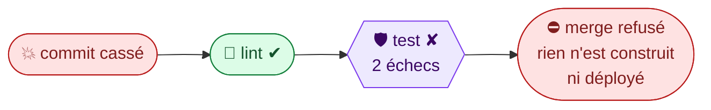

# Preuve du blocage : le commit volontairement cassé

> 🗄️ **Preuve du sprint 2**, conservée telle quelle. Depuis, la protection de `main` exige aussi le job `gateway`
> (`lint`, `test`, `gateway`, `evals-pr`), et `evals-pr` est désactivé jusqu'à U5 : voir le [README](../README.md).

**Critère 3 de la grille** : « Le commit volontairement cassé est arrêté par la chaîne, démontré en live »
(source : grille-atelier-2-socle-chaine.pdf).

## Ce qu'on casse et pourquoi

Le mode dégradé ment : sans LLM configuré, l'agent prétend avoir répondu par le LLM (`mode="llm"`).
C'est une vraie régression métier, puisque K5 exige un repli visible (source : dossier-conception-v1.md).
Elle **passe le lint** (le code reste valide et typé) : seule la porte **test** l'arrête.

```bash
git switch -c demo/commit-casse
sed -i.bak 's/return Reponse(texte=REPLI, mode="degrade")$/return Reponse(texte=REPLI, mode="llm")/' \
  agentinsurflow/agent.py && rm agentinsurflow/agent.py.bak
git commit -am "demo: le mode dégradé se fait passer pour le LLM (commit volontairement cassé)"
git push -u origin demo/commit-casse
gh pr create --fill
```

## Résultat attendu (vérifié en local le 14/10/2026, revérifié le 16/10/2026)

| Job | Résultat |
|---|---|
| `lint` | ✔ vert |
| `test` | ✘ rouge : **2 échecs** sur 29, `test_sans_llm_configure_passe_en_mode_degrade` (unitaire) et `test_sans_llm_l_agent_repond_en_mode_degrade` (intégration) |
| `evals-pr` | ⏭️ sauté (`needs: test`, et aucun déclencheur modifié) |
| `build`, `staging`, `production` | ⏭️ jamais lancés (`needs: test`, et ces jobs ne tournent qu'après un merge) |
| Bouton *Merge* de la PR | ⛔ bloqué par la protection de `main` (`make proteger` : `lint`, `test` et `evals-pr` exigés, y compris pour l'administrateur) |



## Variante (en question bonus)

Ajouter une ligne de plus de 100 caractères : c'est alors `lint` qui échoue, et `test` n'est même pas lancé.

## Preuves à versionner

| Preuve | Commande ou geste | Fichier |
|---|---|---|
| Journal du run rouge | `make preuve RUN=<id> NOM=blocage-AAAA-MM-JJ` | `eval/preuves/blocage-AAAA-MM-JJ.log` + `.resume.txt` |
| Capture de la PR (checks rouges, merge bloqué) | capture d'écran | `eval/preuves/blocage-AAAA-MM-JJ-pr.png` |

`<id>` est donné par `gh run list -R acerolaz/agentinsurflow --branch demo/commit-casse`.

## Remettre en ordre

```bash
gh pr close demo/commit-casse --delete-branch && git switch main
```
