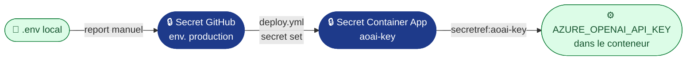

# Secrets et variables : du `.env` à GitHub

**Règle** : aucune valeur sensible dans le dépôt. `.env.example` (versionné) liste les clés **sans valeurs** ;
`.env` (ignoré par `.gitignore` et `.dockerignore`) porte les valeurs locales. Pour la chaîne, chaque clé est
reportée **à la main** dans GitHub.

> 🔁 **Analogie .NET** : `.env` joue le rôle de `secrets.json` (User Secrets) en local ; les secrets GitHub
> d'environnement jouent celui d'Azure Key Vault dans un pipeline Azure DevOps.

## 1. Les trois emplacements GitHub

| Emplacement GitHub | Chemin dans l'interface | Lu dans le YAML par | Pour |
|---|---|---|---|
| **Variable de repo** | Settings › Secrets and variables › Actions › *Variables* | `${{ vars.NOM }}` | Identifiants non sensibles, communs à tous les jobs |
| **Variable d'environnement** | Settings › Environments › `staging` ou `production` › *Environment variables* | `${{ vars.NOM }}` dans un job qui déclare `environment:` | Valeurs propres à un environnement |
| **Secret d'environnement** | Settings › Environments › … › *Environment secrets* | `${{ secrets.NOM }}`, masqué dans les journaux | Valeurs sensibles |

Avant tout report, créer les deux environnements : Settings › Environments › *New environment* › `staging`, puis `production`.

## 2. Report clé par clé

| Clé du `.env` | Où dans GitHub | Nom côté GitHub | Usage dans le YAML |
|---|---|---|---|
| `AZURE_CLIENT_ID` | Variable de repo | `AZURE_CLIENT_ID` | `azure/login` (OIDC) : `ci-cd.yml` › build, `deploy.yml` |
| `AZURE_TENANT_ID` | Variable de repo | `AZURE_TENANT_ID` | idem |
| `AZURE_SUBSCRIPTION_ID` | Variable de repo | `AZURE_SUBSCRIPTION_ID` | idem |
| `AZURE_RESOURCE_GROUP` | Variable de repo | `AZURE_RESOURCE_GROUP` | `deploy.yml` : `RG` |
| `ACR_NAME` | Variable de repo | `ACR_NAME` | `ci-cd.yml` › build (push), `deploy.yml` (image) |
| `APP_STAGING` | Variable de l'env. `staging` | `CONTAINER_APP_NAME` | `deploy.yml` : `APP` |
| `APP_PRODUCTION` | Variable de l'env. `production` | `CONTAINER_APP_NAME` | `deploy.yml` : `APP` |
| `AZURE_OPENAI_ENDPOINT` | Variable des **deux** env. | `AZURE_OPENAI_ENDPOINT` | `deploy.yml` › `--set-env-vars` |
| `AZURE_OPENAI_DEPLOYMENT` | Variable des **deux** env. | `AZURE_OPENAI_DEPLOYMENT` | idem |
| `AZURE_OPENAI_API_KEY` 🔒 | **Secret** des **deux** env. | `AZURE_OPENAI_API_KEY` | `deploy.yml` › secret Container Apps `aoai-key` |
| `APP_ENV`, `LLM_DELAI_S` | — (non reporté) | — | `APP_ENV` est posé par `deploy.yml` ; `LLM_DELAI_S` garde sa valeur par défaut |
| `AZURE_LOCATION`, `CONTAINERAPPS_ENV`, `GITHUB_REPO` | — (non reporté) | — | Lus seulement par `make` en local |

Si tu préfères la ligne de commande à l'interface, chaque report a son équivalent `gh`, à taper toi-même :

```bash
gh variable set ACR_NAME -R acerolaz/agentinsurflow                       # variable de repo
gh variable set CONTAINER_APP_NAME -R acerolaz/agentinsurflow -e staging  # variable d'environnement
gh secret set AZURE_OPENAI_API_KEY -R acerolaz/agentinsurflow -e production  # secret (valeur demandée, non affichée)
```

## 3. Pourquoi aucun secret pour se connecter à Azure

La CI s'authentifie par **OIDC** : GitHub émet un jeton à courte durée de vie, et Entra ID l'accepte grâce aux
*federated credentials* créées par `make infra`. Elles couvrent trois sujets : `main`, l'environnement `staging`
et l'environnement `production`. `AZURE_CLIENT_ID`, `AZURE_TENANT_ID` et `AZURE_SUBSCRIPTION_ID` sont des
**identifiants**, pas des secrets, d'où des *variables*.

> 🔁 **Analogie .NET** : c'est la *Workload Identity Federation* d'une *service connection* Azure DevOps, au lieu
> d'un Service Principal avec mot de passe.

## 4. Le trajet de la clé Azure OpenAI



La clé n'apparaît jamais dans l'image, dans le dépôt ni en clair dans les journaux (masquage GitHub).

## 5. Vérifier

```bash
git ls-files | grep -E '^\.env$' && echo "✘ .env versionné !" || echo "✔ .env hors dépôt"
gh variable list -R acerolaz/agentinsurflow
gh secret list -R acerolaz/agentinsurflow -e production   # noms seulement, jamais les valeurs
```

**Reconstruire depuis le repo seul** : `git clone` → `cp .env.example .env` → remplir → `make infra` →
reporter dans GitHub (§2) → `git push`.
