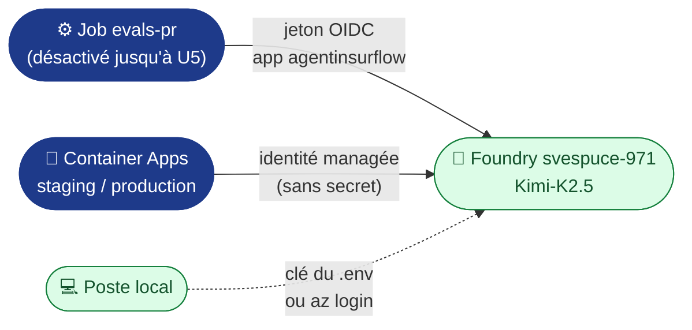

# Secrets et variables : du `.env` à GitHub

**Règle** : aucune valeur sensible dans le dépôt. `.env.example` (versionné) liste les clés **sans valeurs** ;
`.env` (ignoré par `.gitignore` et `.dockerignore`) porte les valeurs locales. Pour la chaîne, chaque clé est
reportée **à la main** dans GitHub.

> 🔁 **Analogie .NET** : `.env` joue le rôle de `secrets.json` (User Secrets) en local ; les secrets GitHub
> d'environnement jouent celui d'Azure Key Vault dans un pipeline Azure DevOps.

## 1. Les trois emplacements GitHub

| Emplacement GitHub | Chemin dans l'interface | Lu dans le YAML par | Pour |
|---|---|---|---|
| **Variable de repo** | Settings › Secrets and variables › Actions › *Variables* | `${{ vars.NOM }}` | Identifiants non sensibles, communs à tous les jobs |
| **Variable d'environnement** | Settings › Environments › `staging` ou `production` › *Environment variables* | `${{ vars.NOM }}` dans un job qui déclare `environment:` | Valeurs propres à un environnement |
| **Secret d'environnement** | Settings › Environments › … › *Environment secrets* | `${{ secrets.NOM }}`, masqué dans les journaux | Valeurs sensibles : **aucun utilisé** aujourd'hui |

Avant tout report, créer les deux environnements : Settings › Environments › *New environment* › `staging`, puis `production`.

Les **mots de passe PostgreSQL** de la base annexe ne passent pas par GitHub : ce sont des **secrets des Container
Apps** (`pg-*-password`), posés à la main par `make annexe` (`infra/postgres-annexe.sh`) et lus par `secretRef` dans
`infra/containerapp.yaml`.

## 2. Report clé par clé

| Clé du `.env` | Où dans GitHub | Nom côté GitHub | Usage dans le YAML |
|---|---|---|---|
| `AZURE_CLIENT_ID` | Variable de repo | `AZURE_CLIENT_ID` | `azure/login` (OIDC) : `ci-cd.yml` › build et evals (et evals-pr, désactivé), `deploy.yml` |
| `AZURE_TENANT_ID` | Variable de repo | `AZURE_TENANT_ID` | idem |
| `AZURE_SUBSCRIPTION_ID` | Variable de repo | `AZURE_SUBSCRIPTION_ID` | idem |
| `AZURE_RESOURCE_GROUP` | Variable de repo | `AZURE_RESOURCE_GROUP` | `deploy.yml` : `RG` |
| `ACR_NAME` | Variable de repo | `ACR_NAME` | `ci-cd.yml` › build (push), `deploy.yml` (image) |
| `APP_STAGING` | Variable de l'env. `staging` | `CONTAINER_APP_NAME` | `deploy.yml` : `APP` |
| `APP_PRODUCTION` | Variable de l'env. `production` | `CONTAINER_APP_NAME` | `deploy.yml` : `APP` |
| `AZURE_OPENAI_ENDPOINT` | Variable de **repo** | `AZURE_OPENAI_ENDPOINT` | `deploy.yml` → `infra/containerapp.yaml` (conteneur rag) ; `ci-cd.yml` › `evals-pr` (désactivé) |
| `RAG_SEUIL` | Variable de **repo** | `RAG_SEUIL` | `deploy.yml` → conteneur rag (porte de pertinence ; vide → `/api/extraits` en 503) |
| `RAG_API_CLIENT_ID` | Variable de **repo** | `RAG_API_CLIENT_ID` | `deploy.yml` → audiences de la gateway et de rag, connexion de la page Swagger |
| `UNDERWRITING_API_CLIENT_ID` | Variable de **repo** | `UNDERWRITING_API_CLIENT_ID` | `deploy.yml` → audiences de la gateway |
| `MCP_API_CLIENT_ID` | Variable de **repo** | `MCP_API_CLIENT_ID` | `deploy.yml` (liste `envsubst`) → audiences de la gateway et du serveur MCP ; affiché par `make entra` |
| `MCP_AZP_ORCHESTRATEUR`, `MCP_AZP_REDACTEUR`, `MCP_AZP_ACTUAIRE` | Variable de **repo** | idem | `deploy.yml` → conteneur serveur-mcp : `azp` des agents (matrice d'accès) ; vides tant que #7 n'a pas inscrit les agents |
| `AZURE_UAMI_CLIENT_ID` | Variable de **repo** | `AZURE_UAMI_CLIENT_ID` | `deploy.yml` → identité managée fédérée de rag et du serveur MCP (OBO sans secret) |
| `SEED_GESTIONNAIRE_A`, `SEED_GESTIONNAIRE_B` | Variable de **repo** | idem | `deploy.yml` → conteneur underwriting-admin : `oid` (GUID) des gestionnaires du seed BOLA |
| `E2E_CONTRAT_PROPRE` | Variable de **repo** | `E2E_CONTRAT_PROPRE` | `ci-cd.yml` › E2E : contrat du gestionnaire de la CI (témoin positif BOLA) |
| — | Variable de l'env. `production` | `PROD_URL` | `deploy.yml` : URL publique de la production (domaine personnalisé, `make domaine`) ; la fumée vérifie aussi son certificat |
| `AZURE_OPENAI_DEPLOYMENT` | — (**pas dans GitHub**) | — | Épinglé dans `llm.env`, versionné et copié dans l'image : le changer déclenche les evals |
| `MCP_CLIENT_SECRET` 🔒 | — (**jamais dans GitHub**) | — | Local seulement (OBO du serveur MCP) ; en Azure, identité managée fédérée |
| `AZURE_OPENAI_API_KEY` 🔒 | — (**jamais dans GitHub**) | — | Local seulement ; la CI et les Container Apps s'authentifient sans clé (§4) |
| `PG_*_PASSWORD` 🔒 | — (**jamais dans GitHub**) | — | Secrets des Container Apps (`make annexe`) ; en local, `.env` |
| `APP_ENV`, `LLM_DELAI_S` | — (non reporté) | — | `APP_ENV` est posé par `deploy.yml` ; `LLM_DELAI_S` garde sa valeur par défaut (30 s) |
| `AZURE_LOCATION`, `CONTAINERAPPS_ENV`, `GITHUB_REPO` | — (non reporté) | — | Lus seulement par `make` en local |
| `LEGIFRANCE_*`, `INGESTION_JETON`, `TELEMETRIE_JETON`, `RAG_CLIENT_SECRET` 🔒, `RAG_TOP_K`, `RAG_API_AUDIENCES`, `UNDERWRITING_API_AUDIENCES`, `UNDERWRITING_URL`, `MCP_API_AUDIENCES`, `GATEWAY_URL`, `OTEL_*`, `PG_HOST`, `PG_PORT` | — (non reporté) | — | Local seulement : `make extraire`, `make ingest`, compose ; en Azure, leurs valeurs viennent de `infra/containerapp.yaml` ou de leurs défauts |

Si tu préfères la ligne de commande à l'interface, chaque report a son équivalent `gh`, à taper toi-même :

```bash
gh variable set ACR_NAME -R acerolaz/agentinsurflow                       # variable de repo
gh variable set CONTAINER_APP_NAME -R acerolaz/agentinsurflow -e staging  # variable d'environnement
```

## 3. Pourquoi aucun secret pour se connecter à Azure

La CI s'authentifie par **OIDC** : GitHub émet un jeton à courte durée de vie, et Entra ID l'accepte grâce aux
*federated credentials* de l'application Entra `agentinsurflow`. Elles couvrent quatre sujets :

| Fédération | Sujet (format immuable de GitHub) | Jobs |
|---|---|---|
| `ref-refs-heads-main` | `repo:acerolaz@186313822/agentinsurflow@1420380073:ref:refs/heads/main` | `build` ; `evals` : jeton pour `api://agentinsurflow-rag` (rôle `Gestionnaire` de la CI, `make entra`) |
| `environment-staging` | `…:environment:staging` | déploiement staging |
| `environment-production` | `…:environment:production` | déploiement production, rollback |
| `pull_request` | `…:pull_request` | `evals-pr` (⏸️ désactivé jusqu'à U5) : le jeton Entra sert aussi à **appeler le LLM, sans clé** |

Le préfixe du sujet dépend du repo : `make infra` le lit sur GitHub
(`gh api repos/<repo>/actions/oidc/customization/sub`). `AZURE_CLIENT_ID`, `AZURE_TENANT_ID` et
`AZURE_SUBSCRIPTION_ID` sont des **identifiants**, pas des secrets, d'où des *variables*.

> 🔁 **Analogie .NET** : c'est la *Workload Identity Federation* d'une *service connection* Azure DevOps, au lieu
> d'un Service Principal avec mot de passe.

## 4. Aucune clé pour le LLM : identités Entra ID

Le dépôt et GitHub ne contiennent **aucun secret** : ni pour Azure, ni pour le modèle.



| Qui appelle le modèle | Identité | Rôle requis sur `svespuce-971` |
|---|---|---|
| Job `evals-pr` (désactivé jusqu'à U5) | application Entra `agentinsurflow` (OIDC) | *Cognitive Services User* |
| `insurflow-staging`, `insurflow-production` (conteneur rag) | identité managée de chaque app | *Cognitive Services User* |
| Toi, en local | clé du `.env`, ou ton compte (`az login`) | aucun avec la clé ; *Cognitive Services User* sans clé |

> 🔁 **Analogie .NET** : c'est `DefaultAzureCredential` d'`Azure.Identity`, comme une Web App qui lit SQL avec
> `Authentication=Active Directory Managed Identity` au lieu d'un mot de passe.

Sans ce rôle, l'agent répond en mode dégradé (`REVUE_HUMAINE`) ; la fumée ne l'appelle pas, ce sont les **evals
de staging** qui bloquent alors la release.

## 5. On-Behalf-Of sans consentement administrateur : la pré-autorisation (#47)

rag lit les dossiers chez underwriting **au nom du gestionnaire connecté** (OBO), et le serveur MCP fait de même
vers rag et underwriting : le contrôle BOLA s'applique à l'identité réelle. Entra n'émet ce jeton que si le client a
le consentement pour la portée `access_as_user` de l'API.

| | Consentement administrateur | Pré-autorisation (retenue) |
|---|---|---|
| Qui le donne | un administrateur du tenant Simplon | le propriétaire de l'API (Acerola), dans `make entra` |
| Portée | **tous les utilisateurs du tenant** (`consentType: AllPrincipals`) | un client nommé, une portée nommée, sur une API |
| Droit requis | élevé (`Authorization_RequestDenied` pour Acerola) | aucun au-delà de la propriété des inscriptions |
| Où c'est écrit | dans le tenant, hors du dépôt | `api.preAuthorizedApplications` de chaque API, versionné dans `infra/entra.sh` |

| API | Clients pré-autorisés sur `access_as_user` |
|---|---|
| `agentinsurflow-underwriting` | Azure CLI, `agentinsurflow-rag`, `agentinsurflow-mcp` |
| `agentinsurflow-rag` | Azure CLI, `agentinsurflow-mcp` |
| `agentinsurflow-mcp` | Azure CLI |

**Pourquoi ce choix** : un consentement administrateur accorde la permission pour **tout le tenant**, pas seulement
pour le gestionnaire qui teste ; la pré-autorisation est le plus petit droit qui débloque l'OBO, décidé par le
propriétaire de l'API, et le même mécanisme sert déjà à Azure CLI (jetons de la CI et du poste). Elle ne contourne
rien : le gestionnaire doit toujours avoir le rôle `Gestionnaire` de l'API, et le contrôle BOLA s'applique à son
identité.

**Premier obstacle rencontré (22/10)** : avant tout contrôle de consentement, Entra répondait
`AADSTS500011: The resource principal named api://<appId d'underwriting> was not found`. L'OBO demande la portée
`api://<appId>/access_as_user` alors que l'API ne déclarait que `api://agentinsurflow-underwriting` : chaque API
déclare désormais les deux URI (`identifierUris`).

**Si Entra refuse encore** : `azure-identity` journalise le refus avec son message exact
(`OnBehalfOfCredential.get_token failed: … AADSTS…`, sans le jeton) ; la réponse reste 503 `DOSSIERS_INDISPONIBLES`.

```bash
az containerapp logs show -n "$APP_PRODUCTION" -g "$AZURE_RESOURCE_GROUP" --container rag --tail 200 | grep AADSTS
```

## 6. Vérifier

```bash
git ls-files | grep -E '^\.env$' && echo "✘ .env versionné !" || echo "✔ .env hors dépôt"
gh variable list -R acerolaz/agentinsurflow
gh secret list -R acerolaz/agentinsurflow -e production   # noms seulement, jamais les valeurs
```

**Reconstruire depuis le repo seul** : `git clone` → `cp .env.example .env` → remplir → `make infra` →
`make entra` (avant le premier déploiement : il crée l'API du serveur MCP dont `MCP_API_CLIENT_ID` vient) → `make annexe` → `make domaine DOMAINE=…` → reporter dans GitHub (§2) → `git push`.
