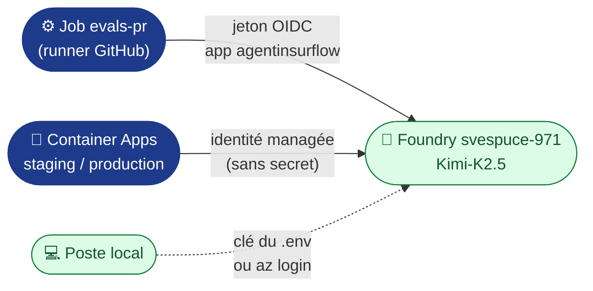

# Secrets et variables : du `.env` à GitHub

**Règle** : aucune valeur sensible dans le dépôt. `.env.example` (versionné) liste les clés **sans valeurs** ;
`.env` (ignoré par `.gitignore` et `.dockerignore`) porte les valeurs locales. Pour la chaîne, chaque clé est
reportée **à la main** dans GitHub.

> 🔁 **Analogie .NET** : `.env` joue le rôle de `secrets.json` (User Secrets) en local ; les secrets GitHub
> d'environnement jouent celui d'Azure Key Vault dans un pipeline Azure DevOps.

## 1. Les trois emplacements GitHub

| Emplacement GitHub | Chemin dans l'interface | Lu dans le YAML par | Pour |
|---|---|---|---|
| **Variable de repo** | Settings › Secrets and variables › Actions › *Variables* | `${{ vars.NOM }}` | Identifiants non sensibles, communs à tous les jobs |
| **Variable d'environnement** | Settings › Environments › `staging` ou `production` › *Environment variables* | `${{ vars.NOM }}` dans un job qui déclare `environment:` | Valeurs propres à un environnement |
| **Secret d'environnement** | Settings › Environments › … › *Environment secrets* | `${{ secrets.NOM }}`, masqué dans les journaux | Valeurs sensibles : **aucun utilisé** aujourd'hui |

Avant tout report, créer les deux environnements : Settings › Environments › *New environment* › `staging`, puis `production`.

## 2. Report clé par clé

| Clé du `.env` | Où dans GitHub | Nom côté GitHub | Usage dans le YAML |
|---|---|---|---|
| `AZURE_CLIENT_ID` | Variable de repo | `AZURE_CLIENT_ID` | `azure/login` (OIDC) : `ci-cd.yml` › build et evals-pr, `deploy.yml` |
| `AZURE_TENANT_ID` | Variable de repo | `AZURE_TENANT_ID` | idem |
| `AZURE_SUBSCRIPTION_ID` | Variable de repo | `AZURE_SUBSCRIPTION_ID` | idem |
| `AZURE_RESOURCE_GROUP` | Variable de repo | `AZURE_RESOURCE_GROUP` | `deploy.yml` : `RG` |
| `ACR_NAME` | Variable de repo | `ACR_NAME` | `ci-cd.yml` › build (push), `deploy.yml` (image) |
| `APP_STAGING` | Variable de l'env. `staging` | `CONTAINER_APP_NAME` | `deploy.yml` : `APP` |
| `APP_PRODUCTION` | Variable de l'env. `production` | `CONTAINER_APP_NAME` | `deploy.yml` : `APP` |
| `AZURE_OPENAI_ENDPOINT` | Variable de **repo** | `AZURE_OPENAI_ENDPOINT` | `deploy.yml` › `--set-env-vars` ; `ci-cd.yml` › `evals-pr` |
| `AZURE_OPENAI_DEPLOYMENT` | — (**pas dans GitHub**) | — | Épinglé dans `llm.env`, versionné et copié dans l'image : le changer déclenche les evals |
| `AZURE_OPENAI_API_KEY` 🔒 | — (**jamais dans GitHub**) | — | Local seulement ; la CI et les Container Apps s'authentifient sans clé (§4) |
| `APP_ENV`, `LLM_DELAI_S` | — (non reporté) | — | `APP_ENV` est posé par `deploy.yml` ; `LLM_DELAI_S` garde sa valeur par défaut (30 s) |
| `AZURE_LOCATION`, `CONTAINERAPPS_ENV`, `GITHUB_REPO` | — (non reporté) | — | Lus seulement par `make` en local |

Si tu préfères la ligne de commande à l'interface, chaque report a son équivalent `gh`, à taper toi-même :

```bash
gh variable set ACR_NAME -R acerolaz/agentinsurflow                       # variable de repo
gh variable set CONTAINER_APP_NAME -R acerolaz/agentinsurflow -e staging  # variable d'environnement
```

## 3. Pourquoi aucun secret pour se connecter à Azure

La CI s'authentifie par **OIDC** : GitHub émet un jeton à courte durée de vie, et Entra ID l'accepte grâce aux
*federated credentials* de l'application Entra `agentinsurflow`. Elles couvrent quatre sujets :

| Fédération | Sujet (format immuable de GitHub) | Jobs |
|---|---|---|
| `ref-refs-heads-main` | `repo:acerolaz@186313822/agentinsurflow@1420380073:ref:refs/heads/main` | `build` |
| `environment-staging` | `…:environment:staging` | déploiement staging |
| `environment-production` | `…:environment:production` | déploiement production, rollback |
| `pull_request` | `…:pull_request` | `evals-pr` : le jeton Entra sert aussi à **appeler le LLM, sans clé** |

Le préfixe du sujet dépend du repo : `make infra` le lit sur GitHub
(`gh api repos/<repo>/actions/oidc/customization/sub`). `AZURE_CLIENT_ID`, `AZURE_TENANT_ID` et
`AZURE_SUBSCRIPTION_ID` sont des **identifiants**, pas des secrets, d'où des *variables*.

> 🔁 **Analogie .NET** : c'est la *Workload Identity Federation* d'une *service connection* Azure DevOps, au lieu
> d'un Service Principal avec mot de passe.

## 4. Aucune clé pour le LLM : identités Entra ID

Le dépôt et GitHub ne contiennent **aucun secret** : ni pour Azure, ni pour le modèle.



| Qui appelle le modèle | Identité | Rôle requis sur `svespuce-971` |
|---|---|---|
| Job `evals-pr` | application Entra `agentinsurflow` (OIDC) | *Cognitive Services User* |
| `insurflow-staging`, `insurflow-production` | identité managée de chaque app | *Cognitive Services User* |
| Toi, en local | clé du `.env`, ou ton compte (`az login`) | aucun avec la clé ; *Cognitive Services User* sans clé |

> 🔁 **Analogie .NET** : c'est `DefaultAzureCredential` d'`Azure.Identity`, comme une Web App qui lit SQL avec
> `Authentication=Active Directory Managed Identity` au lieu d'un mot de passe.

Sans ce rôle, l'app répond en mode dégradé, et la fumée bloque alors le déploiement.

## 5. Vérifier

```bash
git ls-files | grep -E '^\.env$' && echo "✘ .env versionné !" || echo "✔ .env hors dépôt"
gh variable list -R acerolaz/agentinsurflow
gh secret list -R acerolaz/agentinsurflow -e production   # noms seulement, jamais les valeurs
```

**Reconstruire depuis le repo seul** : `git clone` → `cp .env.example .env` → remplir → `make infra` →
reporter dans GitHub (§2) → `git push`.
