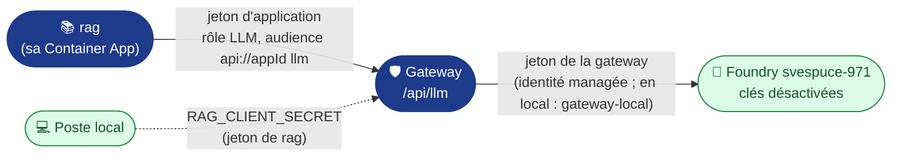

# Secrets et variables : du `.env` à GitHub

**Règle** : aucune valeur sensible dans le dépôt. `.env.example` (versionné) liste les clés **sans valeurs** ;
`.env` (ignoré par `.gitignore` et `.dockerignore`) porte les valeurs locales. Pour la chaîne, chaque clé est
reportée **à la main** dans GitHub.

> 🔁 **Analogie .NET** : `.env` joue le rôle de `secrets.json` (User Secrets) en local ; les secrets GitHub
> d'environnement jouent celui d'Azure Key Vault dans un pipeline Azure DevOps.

## 1. Les trois emplacements GitHub

| Emplacement GitHub | Chemin dans l'interface | Lu dans le YAML par | Pour |
|---|---|---|---|
| **Variable de repo** | Settings › Secrets and variables › Actions › *Variables* | `${{ vars.NOM }}` | Identifiants non sensibles, communs à tous les jobs |
| **Variable d'environnement** | Settings › Environments › `staging` ou `production` › *Environment variables* | `${{ vars.NOM }}` dans un job qui déclare `environment:` | Valeurs propres à un environnement |
| **Secret d'environnement** | Settings › Environments › … › *Environment secrets* | `${{ secrets.NOM }}`, masqué dans les journaux | Valeurs sensibles : **aucun utilisé** aujourd'hui |

Avant tout report, créer les deux environnements : Settings › Environments › *New environment* › `staging`, puis `production`.

Les **mots de passe PostgreSQL** de la base annexe ne passent pas par GitHub : ce sont des **secrets des Container
Apps** (`pg-*-password`), posés à la main par `make annexe` (`infra/postgres-annexe.sh`) et lus par `secretRef` dans
`infra/containerapp.yaml`.

## 2. Report clé par clé

| Clé du `.env` | Où dans GitHub | Nom côté GitHub | Usage dans le YAML |
|---|---|---|---|
| `AZURE_CLIENT_ID` | Variable de repo | `AZURE_CLIENT_ID` | `azure/login` (OIDC) : `ci-cd.yml` › build et evals (et evals-pr, désactivé), `deploy.yml` |
| `AZURE_TENANT_ID` | Variable de repo | `AZURE_TENANT_ID` | idem |
| `AZURE_SUBSCRIPTION_ID` | Variable de repo | `AZURE_SUBSCRIPTION_ID` | idem |
| `AZURE_RESOURCE_GROUP` | Variable de repo | `AZURE_RESOURCE_GROUP` | `deploy.yml` : `RG` |
| `ACR_NAME` | Variable de repo | `ACR_NAME` | `ci-cd.yml` › build (push), `deploy.yml` (image) |
| `APP_STAGING` | Variable de l'env. `staging` | `CONTAINER_APP_NAME` | `deploy.yml` : `APP` |
| `APP_PRODUCTION` | Variable de l'env. `production` | `CONTAINER_APP_NAME` | `deploy.yml` : `APP` |
| `PG_APP_STAGING` / `PG_APP_PRODUCTION` | Variable de l'env. `staging` / `production` | `PG_APP_NAME` | `deploy.yml` : Container App de la base annexe (entrée **TCP interne** 5432), déployée **en premier** ; son nom est le `PG_HOST` de rag et d'underwriting-admin. Affiché par `make infra`. Sans VNet : seule l'entrée TCP *externe* en exige un (doc Microsoft), l'environnement actuel convient (vérifié le 22/10) |
| `UW_APP_STAGING` / `UW_APP_PRODUCTION` | Variable de l'env. `staging` / `production` | `UW_APP_NAME` | `deploy.yml` : Container App d'underwriting-admin (entrée interne 8002), lancée après la base annexe, en même temps que le MCP, le cluster, la gateway et rag (#172) ; affiché par `make infra`. Son FQDN interne est lu par le workflow (`UNDERWRITING_APP_FQDN` : cluster `underwriting` et traces de la gateway) |
| `RAG_APP_STAGING` / `RAG_APP_PRODUCTION` | Variable de l'env. `staging` / `production` | `RAG_APP_NAME` | `deploy.yml` : Container App de rag (entrée interne), lancée après la base annexe, en même temps que les autres Container Apps (#172) ; affiché par `make infra`. Son FQDN interne est lu par le workflow (`RAG_APP_FQDN`, cluster `rag` de la gateway) |
| `MCP_APP_STAGING` / `MCP_APP_PRODUCTION` | Variable de l'env. `staging` / `production` | `MCP_APP_NAME` | `deploy.yml` : Container App du serveur MCP (entrée interne) ; affiché par `make infra`. Son FQDN interne (`<app>.internal.<domaine>`) est lu par le workflow, rien à reporter (`MCP_APP_FQDN`) |
| `CALCUL_APP_STAGING` / `CALCUL_APP_PRODUCTION` | Variable de l'env. `staging` / `production` | `CALCUL_APP_NAME` | `deploy.yml` : déploiement de la Function de calcul ; affiché par `make calcul` |
| (sortie de `make calcul`) | Variable de l'env. `staging` / `production` | `CALCUL_URL` | `deploy.yml` : fumée de la Function ; → `infra/containerapp.yaml` (cluster `calcul` de la gateway). Le serveur MCP n'appelle plus la Function : `CALCUL_URL` = `<gateway>/api/calcul` |
| (sortie de `make calcul`) | Variable de l'env. `staging` / `production` | `CALCUL_AUDIENCE` | `deploy.yml` → gateway (`Entra__Audiences__calcul__0`, portée `Calcul__Portee` = `<audience>/.default`) et serveur MCP (`CALCUL_AUDIENCE`) ; `api://<appId agentinsurflow-calcul>` |
| (sortie de `make calcul`) | Variable de l'env. `staging` / `production` | `CALCUL_API_CLIENT_ID` | `deploy.yml` (liste `envsubst`) → `infra/containerapp.yaml` (`Entra__Audiences__calcul__1`, GUID de l'application : `aud` des jetons v2) |
| `AZURE_OPENAI_ENDPOINT` | Variable de **repo** | `AZURE_OPENAI_ENDPOINT` | **La gateway** : `https://<FQDN de la gateway>/api/llm` (jamais Foundry). `deploy.yml` ne la lit plus (il pose `${GATEWAY_URL}/api/llm` dans `infra/containerapp-rag.yaml`) ; seul `ci-cd.yml` › `evals-pr` (désactivé) l'utiliserait |
| `LLM_AUDIENCE` | Variable de **repo** | `LLM_AUDIENCE` | `deploy.yml` (liste `envsubst`) → gateway (`Entra__Audiences__llm__0`) et rag (audience du jeton d'application) ; `api://<appId agentinsurflow-llm>`, affiché par `make llm` |
| `LLM_API_CLIENT_ID` | Variable de **repo** | `LLM_API_CLIENT_ID` | `deploy.yml` → gateway (`Entra__Audiences__llm__1`, GUID : `aud` des jetons v2) ; affiché par `make llm` |
| `FOUNDRY_ENDPOINT` | Variable de **repo** | `FOUNDRY_ENDPOINT` | `deploy.yml` → gateway : cluster `llm` (`https://<ressource>.openai.azure.com`, sans `/openai`) ; lu aussi, en lecture seule, pour vérifier que les modèles de `agentic-cluster/agents.toml` existent ; affiché par `make llm` |
| `RAG_SEUIL` | Variable de **repo** | `RAG_SEUIL` | `deploy.yml` → conteneur rag (porte de pertinence ; vide → `/api/extraits` en 503) |
| `RAG_API_CLIENT_ID` | Variable de **repo** | `RAG_API_CLIENT_ID` | `deploy.yml` → audiences de la gateway et de rag, connexion de la page Swagger |
| `UNDERWRITING_API_CLIENT_ID` | Variable de **repo** | `UNDERWRITING_API_CLIENT_ID` | `deploy.yml` → audiences de la gateway et d'underwriting-admin, `Telemetrie__Audience` de la gateway (`api://<appId>`) |
| `MCP_API_CLIENT_ID` | Variable de **repo** | `MCP_API_CLIENT_ID` | `deploy.yml` (liste `envsubst`) → audiences de la gateway et du serveur MCP ; affiché par `make entra` |
| `MCP_AZP_ORCHESTRATEUR`, `MCP_AZP_REDACTEUR`, `MCP_AZP_ACTUAIRE`, `MCP_AZP_PIECES`, `MCP_AZP_ANALYSTE` | Variable de **repo** | idem | `deploy.yml` → Container App du serveur MCP : `azp` des agents (matrice d'accès) ; vides tant que #7 n'a pas inscrit les agents |
| `AZURE_UAMI_CLIENT_ID` | Variable de **repo** | `AZURE_UAMI_CLIENT_ID` | `deploy.yml` → identité managée de la **gateway** seule depuis #70 (`Calcul__IdentiteClientId`, jeton Foundry) ; c'est aussi la seule application admise par l'Easy Auth de la Function (`make calcul`) |
| `AZURE_UAMI_RAG_CLIENT_ID` | Variable de **repo** | `AZURE_UAMI_RAG_CLIENT_ID` | `deploy.yml` → identité managée PROPRE de rag (`AZURE_UAMI_CLIENT_ID` de son conteneur) : OBO, jeton LLM et traces sans secret ; affiché par `make entra` |
| `AZURE_UAMI_MCP_CLIENT_ID` | Variable de **repo** | `AZURE_UAMI_MCP_CLIENT_ID` | `deploy.yml` → identité managée PROPRE du serveur MCP (`AZURE_UAMI_CLIENT_ID` de son conteneur) : OBO et jetons d'application sans secret ; affiché par `make entra` |
| `SEED_GESTIONNAIRE_A`, `SEED_GESTIONNAIRE_B`, `SEED_GESTIONNAIRE_C` | Variable de **repo** | idem | `deploy.yml` → Container App d'underwriting-admin : `oid` (GUID) des gestionnaires du seed BOLA (A, B : comptes humains de la démo ; C : identité de la CI, facultative) |
| `ESPACE_COMPTE_A`, `ESPACE_COMPTE_B` | Variable de **repo** | idem | `deploy.yml` → gateway (`Espace__Comptes__A/B`) : UPN des gestionnaires A et B, préremplis à la connexion de l'espace `/app/` (`loginHint`) ; pas un secret, facultatifs |
| `LOG_ANALYTICS_WORKSPACE` | — (non reporté) | — | Lu par `make vigie` seulement : Log Analytics (`workspace-svespucepZG6`) qui reçoit `appi-insurflow-<env>` |
| `appinsights-connection` 🔒 | — (**jamais dans GitHub**) | — | Secret des cinq Container Apps (gateway, underwriting-admin, cluster, rag, serveur MCP). **Posé** par `make vigie ENV=…` (`infra/vigie.sh`, à la main). **Lu** par chaque app via `secretRef` dans la variable `APPLICATIONINSIGHTS_CONNECTION_STRING` ; `deploy.yml` bloque le déploiement si le secret manque sur l'une des cinq (lecture seule). La Function reçoit la même chaîne en réglage d'application, pas en secret de Container App. La valeur ne s'affiche jamais |
| `E2E_CONTRAT_PROPRE` | Variable de **repo** | `E2E_CONTRAT_PROPRE` | `ci-cd.yml` › E2E : contrat du gestionnaire de la CI (témoin positif BOLA) |
| — | Variable de l'env. `production` | `PROD_URL` | `deploy.yml` : URL publique de la production (domaine personnalisé, `make domaine`) ; la fumée vérifie aussi son certificat |
| `AZURE_OPENAI_DEPLOYMENT` | — (**pas dans GitHub**) | — | **rag seulement** : épinglé dans `rag/llm.env`, versionné et copié dans l'image ; le changer déclenche les evals. Le cluster n'a pas cette variable : ses modèles (`modele` par agent) sont dans `agentic-cluster/agents.toml`, copié dans l'image, vérifié par `deploy.yml` sur Foundry (`FOUNDRY_ENDPOINT`) avant tout déploiement |
| `MCP_CLIENT_SECRET` 🔒 | — (**jamais dans GitHub**) | — | Local seulement (OBO du serveur MCP) ; en Azure, identité managée fédérée |
| `GATEWAY_CLIENT_ID`, `GATEWAY_CLIENT_SECRET` 🔒 | — (**jamais dans GitHub**) | — | Local seulement : identité de la gateway (`agentinsurflow-gateway-local`, `make llm`) ; en Azure, identité managée (§4) |
| `PG_*_PASSWORD` 🔒 | — (**jamais dans GitHub**) | — | Secrets des Container Apps (`make annexe`) : les sept sur l'app postgres, cinq sur celle d'underwriting-admin, trois sur rag (plus aucun sur la principale) ; en local, `.env` |
| `INSURFLOW_CLUSTER_CLIENT_ID`, `INSURFLOW_AGENT_ORCHESTRATEUR_CLIENT_ID`, `INSURFLOW_AGENT_PIECES_CLIENT_ID`, `INSURFLOW_AGENT_ANALYSTE_CLIENT_ID`, `INSURFLOW_AGENT_REDACTEUR_CLIENT_ID`, `INSURFLOW_AGENT_ACTUAIRE_CLIENT_ID` | Variable de **repo** | idem | `deploy.yml` → Container App du cluster d'agents ; affichés par `make entra`. Noms techniques conservés : l'inscription de la Saga (ex-orchestrateur) reste `agentinsurflow-agent-orchestrateur` ; elle n'a pas de rôle LLM (rag et les quatre sous-agents l'ont) |
| `AZURE_UAMI_CLUSTER_CLIENT_ID` | Variable de **repo** | idem | `deploy.yml` → identité managée PROPRE du cluster (OBO, jeton LLM, traces sans secret) |
| `CLUSTER_APP_STAGING` / `CLUSTER_APP_PRODUCTION` | Variable de l'env. `staging` / `production` | `CLUSTER_APP_NAME` | `deploy.yml` : Container App du cluster (entrée interne, port 8004) ; affiché par `make infra` |
| `E2E_CONTRAT_HOSTILE`, `E2E_CONTRAT_PAUSE`, `E2E_CLUSTER_INTERNE` | Variable de **repo** / sortie de `deploy.yml` | idem | `ci-cd.yml` › E2E : deuxième et troisième contrats complets du gestionnaire de la CI (observations écrasées ; pause et reprise) ; URL interne du cluster (contrôle d'inaccessibilité) |
| `PG_POINTS_REPRISE_PASSWORD` 🔒 | — (**jamais dans GitHub**) | — | Secret `pg-points-reprise-password` de l'app postgres **et** de l'app underwriting-admin, seule propriétaire de la base (`make annexe`) ; le cluster n'a plus ni DSN ni mot de passe de base (D106) ; en local, `.env` |
| `INSURFLOW_CLIENT_SECRET` 🔒 | — (**jamais dans GitHub**) | — | Local seulement (secret commun aux inscriptions du cluster et des agents) ; en Azure, identité managée fédérée |
| `INSURFLOW_LLM_ACTIF`, `INSURFLOW_LLM_DELAI_S`, `INSURFLOW_BUDGET_S`, `INSURFLOW_RESERVE_S`, `TELEMETRIE_AUDIENCE` | — (non reporté) | — | Posés par `infra/containerapp-cluster.yaml` ; défauts : LLM actif, délai 30 s, budget 25 s, réserve 2 s |
| `APP_ENV`, `LLM_DELAI_S` | — (non reporté) | — | `APP_ENV` est posé par `deploy.yml` ; `LLM_DELAI_S` garde sa valeur par défaut (30 s) |
| `AZURE_LOCATION`, `CONTAINERAPPS_ENV`, `GITHUB_REPO`, `FOUNDRY_NAME`, `FOUNDRY_RESOURCE_GROUP` | — (non reporté) | — | Lus seulement par `make` en local |
| `LEGIFRANCE_*`, `INGESTION_JETON`, `TELEMETRIE_JETON`, `RAG_CLIENT_SECRET` 🔒 (OBO et jeton LLM de rag), `RAG_TOP_K`, `RAG_API_AUDIENCES`, `UNDERWRITING_API_AUDIENCES`, `UNDERWRITING_URL`, `MCP_API_AUDIENCES`, `GATEWAY_URL`, `OTEL_*`, `PG_HOST`, `PG_PORT` | — (non reporté) | — | Local seulement : `make extraire`, `make ingest`, compose ; en Azure, leurs valeurs viennent de `infra/containerapp.yaml` ou de leurs défauts |

Si tu préfères la ligne de commande à l'interface, chaque report a son équivalent `gh`, à taper toi-même :

```bash
gh variable set ACR_NAME -R acerolaz/agentinsurflow                       # variable de repo
gh variable set CONTAINER_APP_NAME -R acerolaz/agentinsurflow -e staging  # variable d'environnement
```

## 3. Pourquoi aucun secret pour se connecter à Azure

La CI s'authentifie par **OIDC** : GitHub émet un jeton à courte durée de vie, et Entra ID l'accepte grâce aux
*federated credentials* de l'application Entra `agentinsurflow`. Elles couvrent quatre sujets :

| Fédération | Sujet (format immuable de GitHub) | Jobs |
|---|---|---|
| `ref-refs-heads-main` | `repo:acerolaz@186313822/agentinsurflow@1420380073:ref:refs/heads/main` | `build` ; `evals` : jeton pour `api://agentinsurflow-rag` (rôle `Gestionnaire` de la CI, `make entra`) |
| `environment-staging` | `…:environment:staging` | déploiement staging |
| `environment-production` | `…:environment:production` | déploiement production, rollback |
| `pull_request` | `…:pull_request` | `evals-pr` (⏸️ désactivé jusqu'à U5) : s'il est réactivé, il passera par la gateway (plus d'accès direct à Foundry) |

Le préfixe du sujet dépend du repo : `make infra` le lit sur GitHub
(`gh api repos/<repo>/actions/oidc/customization/sub`). `AZURE_CLIENT_ID`, `AZURE_TENANT_ID` et
`AZURE_SUBSCRIPTION_ID` sont des **identifiants**, pas des secrets, d'où des *variables*.

> 🔁 **Analogie .NET** : c'est la *Workload Identity Federation* d'une *service connection* Azure DevOps, au lieu
> d'un Service Principal avec mot de passe.

## 4. Aucune clé pour le LLM : tout passe par la gateway (#70)

Le dépôt et GitHub ne contiennent **aucun secret** : ni pour Azure, ni pour le modèle. Foundry a `disableLocalAuth = true`
(plus aucune clé) et **seule la gateway** y est autorisée.



| Qui | Identité | Droit |
|---|---|---|
| rag (Azure) | identité managée **propre** `uami-insurflow-rag-app`, fédérée sur `agentinsurflow-rag` | rôle d'application `LLM` de `agentinsurflow-llm` ; **aucun** accès à Foundry |
| rag (local) | secret `RAG_CLIENT_SECRET` de `agentinsurflow-rag` | idem |
| Gateway (Azure) | identité managée `uami-insurflow-rag` (nom conservé, voir ci-dessous) | *Cognitive Services OpenAI User* sur `svespuce-971` |
| Gateway (local) | `agentinsurflow-gateway-local` + `GATEWAY_CLIENT_SECRET` du `.env` | *Cognitive Services OpenAI User* sur `svespuce-971` |
| CI, Container Apps autres que la gateway, comptes humains | — | **retiré** par `make llm` ; les evals passent par `/api/reponses` (donc par la gateway) |

`make llm` (`infra/llm.sh`, lancé à la main par Acerola) inscrit `agentinsurflow-llm` et `agentinsurflow-gateway-local`,
désactive les clés de Foundry et réserve le rôle à la gateway. Limite de gouvernance : le propriétaire de la ressource
peut toujours se réattribuer un rôle, et un rôle hérité d'un niveau supérieur échappe au script (il liste les autres
rôles pour revue manuelle).

> Le nom `uami-insurflow-rag` est **gardé** pour l'identité de la gateway : la Function de calcul (Easy Auth) et le
> rôle Foundry y sont rattachés, la renommer demanderait de les refaire. À décider par Acerola ; rag, lui, a sa
> nouvelle identité `uami-insurflow-rag-app`.

> 🔁 **Analogie .NET** : c'est `DefaultAzureCredential` d'`Azure.Identity`, mais une seule application (la gateway) porte
> le droit sur la ressource ; les autres demandent un jeton à la gateway, comme un service qui appelle une API interne
> au lieu de la base.

Sans le rôle `LLM`, ou si Foundry est inaccessible, rag répond `503` ProblemDetails `LLM_INDISPONIBLE` ; les **evals de
staging** bloquent alors la release.

## 5. On-Behalf-Of sans consentement administrateur : la pré-autorisation (#47)

rag lit les dossiers chez underwriting **au nom du gestionnaire connecté** (OBO), et le serveur MCP fait de même
vers rag et underwriting : le contrôle BOLA s'applique à l'identité réelle. Entra n'émet ce jeton que si le client a
le consentement pour la portée `access_as_user` de l'API.

| | Consentement administrateur | Pré-autorisation (retenue) |
|---|---|---|
| Qui le donne | un administrateur du tenant Simplon | le propriétaire de l'API (Acerola), dans `make entra` |
| Portée | **tous les utilisateurs du tenant** (`consentType: AllPrincipals`) | un client nommé, une portée nommée, sur une API |
| Droit requis | élevé (`Authorization_RequestDenied` pour Acerola) | aucun au-delà de la propriété des inscriptions |
| Où c'est écrit | dans le tenant, hors du dépôt | `api.preAuthorizedApplications` de chaque API, versionné dans `infra/entra.sh` |

| API | Clients pré-autorisés sur `access_as_user` |
|---|---|
| `agentinsurflow-underwriting` | Azure CLI, `agentinsurflow-rag`, `agentinsurflow-mcp` |
| `agentinsurflow-rag` | Azure CLI, `agentinsurflow-mcp` |
| `agentinsurflow-mcp` | Azure CLI |

**Pourquoi ce choix** : un consentement administrateur accorde la permission pour **tout le tenant**, pas seulement
pour le gestionnaire qui teste ; la pré-autorisation est le plus petit droit qui débloque l'OBO, décidé par le
propriétaire de l'API, et le même mécanisme sert déjà à Azure CLI (jetons de la CI et du poste). Elle ne contourne
rien : le gestionnaire doit toujours avoir le rôle `Gestionnaire` de l'API, et le contrôle BOLA s'applique à son
identité.

**Premier obstacle rencontré (22/10)** : avant tout contrôle de consentement, Entra répondait
`AADSTS500011: The resource principal named api://<appId d'underwriting> was not found`. L'OBO demande la portée
`api://<appId>/access_as_user` alors que l'API ne déclarait que `api://agentinsurflow-underwriting` : chaque API
déclare désormais les deux URI (`identifierUris`).

**Si Entra refuse encore** : `azure-identity` journalise le refus avec son message exact
(`OnBehalfOfCredential.get_token failed: … AADSTS…`, sans le jeton) ; la réponse reste 503 `DOSSIERS_INDISPONIBLES`.

```bash
az containerapp logs show -n "$APP_PRODUCTION" -g "$AZURE_RESOURCE_GROUP" --container rag --tail 200 | grep AADSTS
```

## 6. Vérifier

```bash
git ls-files | grep -E '^\.env$' && echo "✘ .env versionné !" || echo "✔ .env hors dépôt"
gh variable list -R acerolaz/agentinsurflow
gh secret list -R acerolaz/agentinsurflow -e production   # noms seulement, jamais les valeurs
```

**Reconstruire depuis le repo seul** : `git clone` → `cp .env.example .env` → remplir → `make infra` →
`make entra` (après `make infra`, qui crée les Container Apps du serveur MCP ; avant le premier déploiement : il crée l'API du serveur MCP dont `MCP_API_CLIENT_ID` vient, et l'identité managée du MCP) → `make calcul` (Function de calcul ; après `make entra`, il lit `MCP_API_CLIENT_ID`) → `make annexe` → `make domaine DOMAINE=…` → reporter dans GitHub (§2 ; les variables `CALCUL_*`, par environnement, avant le prochain déploiement : sinon `deploy.yml` échoue) → `git push`.

⚠️ `make entra` **remplace le credential fédéré du MCP** : déployer sans attendre. La première migration (MCP dans sa propre Container App) a une courte fenêtre où `/mcp` ou `/api/calcul` répondent en erreur.

**Vérification manuelle en staging, après chaque déploiement** : la fumée de la CI n'est pas authentifiée (elle n'a volontairement pas le rôle `Calcul`). Faire un appel réel `evaluer_risque` (agent ou client MCP) sur un contrat seed, puis vérifier qu'une trace est visible (`GET /api/traces/{trace_id}`).
