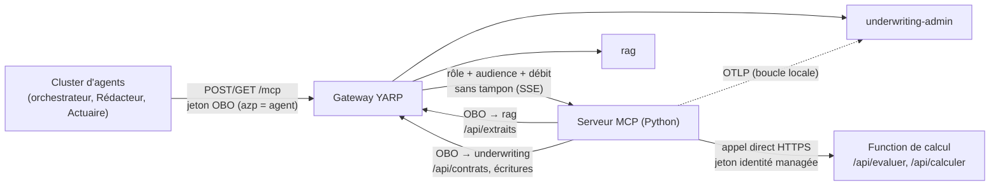

# Serveur MCP (via la gateway) — conception

*Issue #15 · épopée E3 (C9) · échéance : examen blanc du 30/10 · repli le 27/10 au soir (voir § 9)*

## 1. Intention

Le **cluster d'agents** (issue #7, un conteneur, sous-graphes LangGraph, D63) n'accède aux données et aux calculs que par un **serveur MCP**, lui-même joignable **uniquement par la gateway** (D22). Le serveur MCP est le seul endroit où l'on décide **quel agent peut faire quoi** : il porte une matrice d'accès par agent (D34, D67) et rend des refus typés que le cluster sait traiter sans halluciner.

Le cluster sera en place le 30/10 et c'est lui qui appelle le serveur MCP pendant la démo.

## 2. Objectifs, non-objectifs, anti-objectifs

**Objectifs**
- Les **six outils de la V1** (`brief1/dossier-conception-v1.md` § 4.5.3) exposés en MCP, dont deux qui écrivent dans un dossier.
- Les critères d'acceptance de l'issue #15 (rappelés au § 10).
- Une matrice d'accès `azp` × outil appliquée à deux endroits (liste et appel).
- Chaque appel tracé dans la trace du dossier, sans donnée personnelle.

**Non-objectifs**
- Contenu métier de `evaluer_risque` (barème) et `calculer_prime` (formule) : **en attente de la réponse d'Acerola** (§ 5.3). D50 (245 règles) est **écartée**.
- L'`interrupt()` avant décision (D9) : c'est le travail du cluster, pas du serveur MCP.
- Resources et Prompts MCP : non exposés (toute lecture passe par un Tool, donc par la matrice et la trace).
- Nouveau fournisseur d'identité, nouveau journal d'audit, nouvelle stack.

**Anti-objectifs** (échec même si « ça marche »)
- Un appel direct du serveur MCP vers rag, underwriting-admin ou PostgreSQL (hors export OTLP, § 7, **et appel de la Function de calcul**, spec `2026-10-22-calcul-risque-prime-design.md`).
- Une décision `ACCEPTE`/`REFUSE` écrite sans validation du gestionnaire (D9).
- Un refus ou une panne renvoyés comme une réponse normale que le LLM pourrait paraphraser.
- Une donnée personnelle, un jeton ou un `numero_contrat` dans une trace.

## 3. Ce qui existe déjà (à réutiliser)

| Élément | Où | Usage ici |
|---|---|---|
| Échange On-Behalf-Of (identité managée fédérée en Azure, `RAG_CLIENT_SECRET` en local) | `rag/agentinsurflow_rag/infrastructure/entra/obo.py`, `jetons.py` | même mécanisme, même configuration par variables d'environnement |
| Client HTTP vers underwriting-admin par la gateway, `traceparent` injecté à la main | `rag/.../infrastructure/underwriting/client.py` | même forme pour les adaptateurs du serveur MCP |
| Télémétrie OTLP + règles RGPD testées | `rag/.../infrastructure/otel/telemetrie.py`, `rag/tests/integration/test_reponses_api.py` | même configuration, même type de tests |
| `GET /api/extraits?question=&top_k=` (porte de pertinence, `NOT_FOUND_IN_CORPUS`) | rag, route gateway `rag-extraits` | cible de `search_rag` |
| `GET /api/contrats/{numero_contrat}` (vue minimisée, 404 si hors portefeuille) | underwriting-admin, route `underwriting-contrats` | cible de `get_contrat` |
| Tables `Contrat.Statut`, `Decision` (`Score`, `EtatValidation = "brouillon"`), `Prime` (`EtatValidation = "brouillon"`) | `underwriting-admin/.../Dossiers/Entites.cs` | support des écritures, **sans changement de schéma** |
| Politiques gateway (rôle + audience, limites de débit, refus par défaut) | `gateway/src/.../appsettings.Routes.json`, `Program.cs` | modèle pour la route `/mcp` |

## 4. Architecture

- **Langage et emplacement** : Python, architecture **hexagonale** (règle `~/.claude/rules/python-hexagonal.md`), dans `brief2/src/serveur-mcp/` à côté de `rag/` (`specs/03` ; pas `mcp/`, qui masquerait le paquet `mcp` du SDK). Paquet, `pyproject` et `Dockerfile` calqués sur rag.
- **SDK** : le SDK MCP officiel Python (déjà la convention des fiches Sorabel). Version : celle du dernier SDK stable au moment de l'implémentation, **à faire valider par Acerola avant ajout** (aucun changement de version sans accord).
- **Transport** : **Streamable HTTP** sur `/mcp`. `POST` porte les requêtes JSON-RPC et peut répondre en SSE (`text/event-stream`) ; `GET` ouvre le flux SSE serveur. SSE **activé** (pas de `json_response=True`). L'ancien transport HTTP+SSE (`/sse` + `/messages`) n'est pas utilisé.
- **Identités** (D27, D67) : une inscription d'application Entra par agent et pour l'orchestrateur. Le cluster présente au serveur MCP un jeton OBO dont l'`azp` est celui de l'agent appelant et qui porte le rôle du gestionnaire. Le serveur MCP fait à son tour un OBO vers rag ou underwriting-admin (l'`azp` devient celui du serveur MCP ; rag et underwriting-admin contrôlent le rôle et le portefeuille sur l'utilisateur, comme aujourd'hui). Prérequis (#47, réglé par la PR #67) : chaque API **pré-autorise** ses clients OBO (`api.preAuthorizedApplications` : underwriting-admin pré-autorise rag et le serveur MCP, rag pré-autorise le serveur MCP) et déclare l'URI `api://<appId>` en plus de `api://<nom>` ; aucun consentement administrateur du tenant n'est demandé.

- **Jeton et `interrupt()`** : le serveur MCP n'a aucun état de jeton ; chaque appel apporte le sien. Après l'`interrupt()` (D9), la reprise vient du gestionnaire (`/revue`), donc avec un **jeton frais** que le cluster échange de nouveau en OBO. Rien à prévoir côté serveur MCP.
- **Qui fait l'OBO vers le serveur MCP** : le cluster (issue #7), avec l'inscription de l'agent appelant (D67). Le serveur MCP vérifie seulement : audience = sa propre inscription, rôle `Gestionnaire`, `azp` présent dans la matrice. Les inscriptions des agents sont scriptées avec l'issue #7 ; celle du serveur MCP (et le scope qu'il expose) avec cette issue. *Choix de Claude.* Les tests fabriquent des jetons signés par une clé locale, comme rag.
- **Transport sans session** (*choix de Claude*) : le cluster est le seul client ; chaque requête est revalidée seule, sans lier une session à un `azp`.

## 5. Outils

### 5.1 Catalogue

| Outil | Appelé par (`azp`) | Cible (toujours via la gateway) | Nature |
|---|---|---|---|
| `get_contrat` | Orchestrateur (nœud `charger`) | `GET /api/contrats/{numero_contrat}` | lecture |
| `evaluer_risque` | Orchestrateur (nœud `evaluer`) | Function de calcul `POST /api/evaluer` (appel direct, § 5.3) | calcul |
| `search_rag` | Agent Rédacteur (seul outil visible par un LLM, D59) | `GET /api/extraits` | lecture |
| `calculer_prime` | Agent Actuaire | Function de calcul `POST /api/calculer` (appel direct, § 5.3) | calcul |
| `enregistrer_brouillon` | Orchestrateur (nœud `brouillon`) | **nouvel** endpoint underwriting-admin | écriture (brouillon seulement, D66) |
| `update_statut_dossier` | Orchestrateur (nœuds `enregistrer` après `interrupt()`, et `revue_humaine`) | **nouvel** endpoint underwriting-admin | écriture (seul outil qui écrit une décision) |

Les signatures précises des outils (paramètres, schéma de sortie) suivent les DTO existants (`ResultatRechercheDTO` de rag, `VueContrat` d'underwriting-admin) et la fiche de proposition (5 champs, D52). Leur forme exacte est laissée au constructeur, avec une docstring factuelle par outil (c'est elle que lit le LLM du Rédacteur pour `search_rag`).

### 5.2 Écritures dans underwriting-admin

Deux endpoints nouveaux dans underwriting-admin (Clean Architecture, comme `ConsulterContrat`) et deux routes gateway correspondantes (rôle `Gestionnaire` + audience, débit, refus par défaut) :

- **Brouillon** : enregistre la fiche (`Decision`, `EtatValidation = "brouillon"`) et la prime (`Prime`, `EtatValidation = "brouillon"`) d'un contrat. Idempotent (D66).
- **Statut** : change `Contrat.Statut` et, à la validation, fait passer la décision de brouillon à `VALIDEE` ou `CORRIGEE`.

Dans les deux cas, underwriting-admin **revalide le portefeuille** du gestionnaire (D36) et rend le même 404 pour un contrat absent ou hors portefeuille (BOLA), comme la lecture.

Contrat de données (*choix de Claude*, aligné sur la V1) : les champs viennent **du cluster** en arguments d'outil ; le serveur MCP ne calcule rien.
- `enregistrer_brouillon` reçoit le `numero_contrat`, la fiche (5 champs, D52, dont décision proposée et score du barème) et la prime (montant, périodicité, date d'effet, P18). Tant que `evaluer_risque` et `calculer_prime` sont en attente, les tests utilisent des valeurs fournies par le test.
- `update_statut_dossier` reçoit le `numero_contrat`, le statut cible et, pour l'écriture après `/revue`, la validation (`VALIDEE` / `CORRIGEE`) avec la correction éventuelle. C'est le **même** outil pour `REVUE_HUMAINE` et pour la décision validée.

Valeurs de statut (`brief1/dossier-conception-v1.md`) : `BROUILLON`, `EN_ANALYSE`, `REVUE_HUMAINE`, décision `ACCEPTE` / `REFUSE`, validation `VALIDEE` / `CORRIGEE`. Le serveur MCP **ne vérifie pas** que le gestionnaire a validé : il écrit ce qu'on lui envoie une fois les droits vérifiés (D9 reste porté par le cluster). Les chemins, méthodes HTTP et la machine d'états exacte des transitions sont laissés au constructeur, en s'alignant sur les transitions T0 → T12 de la V1.

### 5.3 Calcul

`evaluer_risque` et `calculer_prime` appellent la Function de calcul (barème et formule versionnés) : voir `docs/superpowers/specs/2026-10-22-calcul-risque-prime-design.md`.

## 6. Matrice d'accès

Inspirée de `briefs/sorabel_v3/MCP.md` § 3, réduite à notre besoin.

| Appelant (`azp`) | Outils autorisés |
|---|---|
| Orchestrateur | `get_contrat`, `evaluer_risque`, `enregistrer_brouillon`, `update_statut_dossier` |
| Agent Rédacteur | `search_rag` |
| Agent Actuaire | `calculer_prime` |

- **Où** : un dictionnaire Python dans le domaine du serveur MCP (`azp` → ensemble d'outils), versionné par Git. Les `azp` réels viennent de la configuration (variables d'environnement), pas du code.
- **Deux points d'application** :
  1. `list_tools()` ne renvoie que les outils autorisés pour l'`azp` du jeton ;
  2. `call_tool()` refuse avant tout appel à un backend.
- **Contrôle fin** : le portefeuille (BOLA) reste dans underwriting-admin ; le serveur MCP ne le duplique pas.
- **Gateway** : elle contrôle **qui entre** (jeton Entra, rôle, audience, débit) ; le serveur MCP contrôle **ce que chaque agent peut faire**. Un `azp` inconnu n'a aucun outil.

### Refus et erreurs typés

Tout échec métier est un résultat d'outil avec `isError: true`, un **code stable** et un message minimal (aucune fuite d'existence) :

| Code | Cas |
|---|---|
| `UNAUTHORIZED_TOOL` | outil hors matrice pour cet `azp` |
| `NOT_FOUND_IN_CORPUS` | rag ne trouve rien qui passe la porte (le cluster en fait `REVUE_HUMAINE`, D46) |
| `CONTRAT_INTROUVABLE` | 404 d'underwriting-admin (absent ou hors portefeuille, indiscernables) |
| `DOSSIERS_INDISPONIBLES` | OBO refusé ou backend en panne (même code que rag) |
| `CALCUL_INDISPONIBLE` | Function de calcul injoignable, jeton refusé (401/403) ou requête malformée (400) |
| `DONNEE_HORS_BAREME` | donnée absente ou inconnue du barème (422 de la Function) |

Les erreurs de protocole (jeton absent, JSON-RPC invalide) restent des erreurs HTTP / JSON-RPC. Le nom `CONTRAT_INTROUVABLE` est un choix de Claude.

## 7. Traces

Même fonctionnement que rag.

- **Export** : OTLP/HTTP vers underwriting-admin `/v1/traces` sur la boucle locale (`OTEL_EXPORTER_OTLP_TRACES_ENDPOINT`), seule exception à D22 depuis C15. En Azure, le serveur MCP est un **5e conteneur de la même Container App** (`infra/containerapp.yaml` : les conteneurs partagent `localhost`), donc `http://localhost:8002/v1/traces` ; en local, `http://underwriting-admin:8002/v1/traces` comme rag dans le compose. Le port du serveur MCP (8003 par exemple) n'a jamais d'entrée externe. `OTEL_SDK_DISABLED=true` coupe tout.
- **Une trace par dossier** : le cluster envoie un `traceparent` sur `/mcp`, la gateway le transmet ; le serveur MCP s'y accroche et l'injecte à la main dans ses appels vers la gateway. Relecture : `GET /api/traces/{trace_id}`.

| Span | Attributs |
|---|---|
| Serveur HTTP `POST /mcp` (pas `/health`) | méthode, statut HTTP, URL sans query string |
| `mcp.lister_outils` | `appelant.azp`, nombre d'outils renvoyés |
| `mcp.outil` (un par appel) | `mcp.outil`, `appelant.azp`, `autorisation.decision` (allow/deny), `autorisation.regle`, `resultat.code`, `isError` |
| `obo.echanger` (sous-span) | réussite/échec, cible (rag / underwriting) |
| Appel gateway (sous-span) | route, statut HTTP |
| Écritures | `statut.cible`, `contrat.present` |

**Jamais tracé** (vérifié par tests, comme rag) : jeton, `numero_contrat`, identité du gestionnaire, texte de la requête `search_rag` (seulement `question.sha256` et `question.longueur`), contenu de contrat, de fiche ou de prime. L'audit « qui a validé » se lit dans la table `Decision`.

**Limite connue** : les spans HTTP de la gateway et d'underwriting-admin (instrumentation ASP.NET Core) contiennent `url.path`, donc le `numero_contrat` des routes `/api/contrats/{numero_contrat}…` ; antérieur au serveur MCP, à traiter dans une issue dédiée.

## 8. Gateway

- Route `/mcp` (`POST`, `GET`) dans `appsettings.Routes.json`, cluster `mcp`, politique d'autorisation (rôle `Gestionnaire` + audience du serveur MCP), limite de débit, refus par défaut.
- **Sans mise en mémoire tampon** des réponses (SSE transmis au fil de l'eau).
- `traceparent` transmis.
- Tests WireMock de la route : routage, 401, 403, 429 (même style que `RoutageTests`, `AutorisationTests`, `DebitTests`).
- Routes des deux nouveaux endpoints d'écriture d'underwriting-admin, mêmes garanties.
- `gateway/README.md` : exception REST/Swagger documentée pour `/mcp` (JSON-RPC) — outils, schémas, autorisation.

## 9. Contraintes

- **Échéance** : examen blanc du 30/10. **Repli le 27/10 au soir** : si le serveur MCP n'est pas terminé, les agents appellent underwriting-admin en REST via la gateway. Conséquence pour l'ordre de construction : les endpoints d'écriture d'underwriting-admin et leurs routes gateway passent **en premier**, car ils servent dans les deux cas. **En repli, la perte du contrôle par `azp` (API5) est acceptée** (décision d'Acerola, 21/10) : la gateway ne contrôle que le rôle, aucune politique par `azp` n'y est ajoutée.
- Stack inchangée (Python hexagonal, C# Clean Architecture, YARP, Entra, OTel → underwriting-admin).
- Aucun changement de version sans accord d'Acerola ; un nouveau paquet (SDK MCP) est un ajout de dépendance à valider.
- Déploiement par la chaîne existante, en **5e conteneur**, fumée verte.
- Contrat du monorepo (`brief2/src/CLAUDE.md`) :
  - le serveur MCP **revalide lui-même le jeton** (signature, émetteur, audience, rôle), même derrière la gateway ;
  - les inscriptions Entra des agents et du serveur MCP, et la pré-autorisation de leurs clients OBO (#47), sont **rédigés dans `infra/*.sh` et lancés à la main par Acerola**, jamais par un agent ;
  - les nouveaux endpoints REST d'underwriting-admin sont en OpenAPI (Swagger unique de la gateway) et leurs erreurs en ProblemDetails avec un `code` ;
  - aucun secret dans le dépôt ; `.env.example` sans valeurs ;
  - branche `feat/mcp`, PR en brouillon, jamais de push sur `main` ;
  - tests selon `.claude/rules/testing-pyramid.md` (70/20/10, couverture ≥ 80 %), et test d'architecture des imports comme `rag/tests/unit/test_architecture.py`.

## 10. Critères d'acceptance (issue #15)

- [ ] Accessible uniquement via la gateway
- [ ] Jeton Entra + rôle ; seuls les agents autorisés du cluster (matrice § 6)
- [ ] OWASP API : API1 BOLA (underwriting-admin), API5 autorisation par fonction (matrice), limitation de débit (gateway)
- [ ] Outils conformes au § 5
- [ ] D22 / S3-29 : rag et underwriting-admin appelés par la gateway, en OBO
- [ ] Route `/mcp` (POST, GET), cluster `mcp`, politique, débit, refus par défaut
- [ ] Tests WireMock de la route : routage, 401/403, 429
- [ ] `gateway/README.md` : exception JSON-RPC documentée
- [ ] Streamable HTTP sans tampon
- [ ] Tests d'intégration couvrant chaque outil, résultats interprétés (les deux outils en attente quand leur contenu sera fixé)
- [ ] Documentation : architecture, outils, authentification/autorisation, format accessible
- [ ] Déployé (5e conteneur), fumée verte

## 11. Laissé au constructeur

- Découpage interne hexagonal du serveur MCP (ports pour rag, underwriting-admin, OBO, horloge…).
- Signatures exactes des outils et docstrings.
- Chemins et méthodes HTTP des deux endpoints d'écriture, transitions de statut acceptées.
- Mode avec ou sans session du transport Streamable HTTP, tant que `POST` et `GET` `/mcp` sont servis.
- Répartition des tests (unitaires sur la matrice et les codes d'erreur, intégration par outil, WireMock côté gateway).
