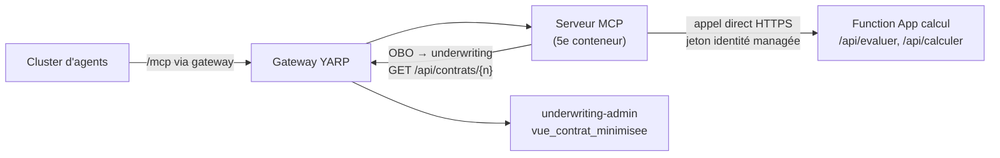

# Calcul du risque et de la prime (Function de calcul) — conception

*Issue #64 (T9 de #15) · épopée E3 · complète le § 5.3 de [`2026-10-21-serveur-mcp-design.md`](2026-10-21-serveur-mcp-design.md) · échéance : examen blanc du 30/10, repli le 27/10*

Sources : `matrice_d_valuation_du_risque_d_terministe.md` et `formule_de_calcul_de_la_prime_d_assurance.md` (Acerola, 22/10), corrigés ici. En cas d'écart, **ce document fait foi**.

## 1. Intention

Débloquer les deux outils MCP en attente : `evaluer_risque` (barème déterministe versionné, D28) et `calculer_prime` (formule, D65). Le LLM ne calcule jamais un score ni une prime : il reçoit un résultat calculé par du code pur, avec son détail (règles déclenchées, coefficients), qu'il explique.

Le calcul vit dans une **Azure Function** Python (choix d'Acerola), appelée **directement** par le serveur MCP, qui reste le 5e conteneur de la Container App.

## 2. Objectifs, non-objectifs, anti-objectifs

**Objectifs**
- Une Function App « calcul », sans état, avec deux routes : `evaluer` et `calculer`.
- Les outils MCP `evaluer_risque` (orchestrateur) et `calculer_prime` (Agent Actuaire), branchés sur la Function par un port.
- La vue minimisée et `VueContrat` d'underwriting-admin enrichies des données nécessaires au calcul (décision d'Acerola, 22/10).
- Les critères d'acceptance du § 11.

**Non-objectifs**
- **`ETUDE_MANUELLE`** : en cible (décision d'Acerola, 22/10). La V1 garde `ACCEPTE` / `REFUSE` ; GF2 et T8 ne changent pas.
- **Barème ou formule modifiables sans déploiement** : un changement est une nouvelle version du code, un commit, un redéploiement (décision d'Acerola, 22/10).
- **Ingestion Légifrance planifiée** : piste notée au § 12, hors T9.
- Règles qui reposent sur des données absentes du modèle : solde de points, motif de résiliation, mois d'assurance continue, véhicule volé, carte grise non conforme.
- Changement de schéma des **tables** (seule la vue change).

**Anti-objectifs** (échec même si « ça marche »)
- Un LLM qui calcule, arrondit ou corrige un score, une classe ou une prime.
- Un résultat qui dépend de la date du jour : à dossier égal, même résultat demain.
- Une valeur inconnue (formule, usage, département) qui tombe silencieusement sur un coefficient par défaut.
- Une donnée de contrat (CRM, sinistres, département…) ou un `numero_contrat` dans une trace ou un log de la Function.
- Un secret pour joindre la Function (clé de fonction ou mot de passe dans le dépôt ou dans l'environnement Azure).

## 3. Architecture



- **Appel direct MCP → Function** : décision d'Acerola (22/10). C'est une **exception à D22**, au même titre que l'export OTLP, à écrire dans le journal des décisions et dans la spec MCP (§ 2 « Anti-objectifs » et § 4). Raison : la Function ne sert que le serveur MCP, elle ne lit ni n'écrit aucune donnée, elle reçoit des faits et rend un calcul.
- **Le serveur MCP garde tout le reste**, dans l'ordre :
  1. matrice d'accès (orchestrateur → `evaluer_risque`, actuaire → `calculer_prime`, déjà en place) ;
  2. lecture du contrat par la gateway en OBO (même chemin que `get_contrat`, donc BOLA par underwriting-admin) ;
  3. extraction des faits utiles de la `VueContrat` ;
  4. appel de la Function ;
  5. résultat d'outil ou erreur typée, trace sans donnée personnelle.
- **Arguments des outils** : `numero_contrat` seul. L'agent ne fournit jamais un fait (CRM, CV…) : il ne peut pas les inventer.
- **Hexagonal côté serveur MCP** :
  - `domain/ports.py` : `CalculateurPort` (`evaluer(faits) -> dict`, `calculer(faits) -> dict`) ;
  - `application/outils.py` : `evaluer_risque` et `calculer_prime`, sur le modèle de `get_contrat` ;
  - `infrastructure/fonction_calcul/client.py` : l'adaptateur HTTP ;
  - un fake du port dans `tests/fakes_mcp.py`.
- **Function** : nouveau dossier `brief2/src/fonction-calcul/`, Python 3.12 (comme rag et serveur-mcp), modèle de programmation v2 (décorateurs). Le barème et la formule sont des **fonctions pures** dans `domain/`, les routes HTTP (`function_app.py`) ne sont qu'un adaptateur. Test d'architecture des imports comme `rag/tests/unit/test_architecture.py`.
- **Nouvelle dépendance** : `azure-functions` (et l'image de base Azure Functions Python pour le compose). Version **à faire valider par Acerola avant ajout**.

### 3.1 Authentification MCP → Function (sans secret)

*Choix de Claude, cohérent avec le déploiement OIDC sans secret.*
- **Azure** : authentification App Service (Easy Auth) activée sur la Function App, fournisseur Entra, une inscription d'application « calcul » (`api://<appId>`). Seule l'identité managée du serveur MCP est autorisée (liste des applications clientes autorisées). Le serveur MCP obtient un jeton pour cette audience avec son identité managée (`azure-identity`, déjà utilisé par l'OBO du serveur MCP en Azure : à vérifier par le constructeur). Toute requête sans jeton valide reçoit 401 de la plateforme, avant le code.
- **Local** : la Function tourne dans le compose (service `calcul`, image officielle Azure Functions Python, `CALCUL_URL=http://calcul:80`), sans Easy Auth, joignable seulement sur le réseau du compose (aucun port publié). L'adaptateur n'ajoute de jeton que si `CALCUL_AUDIENCE` est défini.
- L'inscription « calcul » et le réglage Easy Auth sont **rédigés dans `infra/*.sh` et lancés à la main par Acerola**, comme `infra/entra.sh`.

### 3.2 Déploiement

*Choix de Claude.* Function App en plan **Flex Consumption**, Linux, Python 3.12, dans `svespuceRG`. Déployée par la chaîne GitHub Actions existante (OIDC, `deploy.yml`), en job séparé de la Container App. Création de la ressource : script `infra/`, lancé à la main. Fumée (*choix de Claude*, sur le modèle des `curl …/health` de `deploy.yml`) : un `GET /api/sante` **anonyme**, exclu d'Easy Auth (`excludedPaths`), qui renvoie les deux versions (`bareme`, `formule`) et la version de l'application. Le job de déploiement vérifie ces versions **et** qu'un `POST /api/evaluer` sans jeton reçoit 401 (porte bloquante, comme « API fermée sans jeton »).

## 4. Données : extension de la vue minimisée

Décision d'Acerola (22/10). La vue **reste minimisée** : chaque colonne ajoutée sert une règle ou un coefficient, ce sont des agrégats, et aucune n'identifie directement une personne. Limite connue : plus d'attributs croisés (département, tranche d'âge, CV, usage) rendent une réidentification plus facile. La vue est pseudonymisée (elle porte le `numero_contrat`), pas anonyme.

Nouvelle migration EF Core qui **recrée** `vue_contrat_minimisee` (`migrationBuilder.Sql`, droits rejoués) avec, **en plus** des colonnes existantes, inchangées :

| Colonne | Calcul | Sert à |
|---|---|---|
| `date_effet` | `c.date_effet` | date de référence (§ 5.1) |
| `anciennete_permis_mois` | mois révolus entre `s.permis_date_obtention` et `c.date_effet` | R06, `k_permis` |
| `puissance_fiscale_cv` | `v.puissance_fiscale_cv` | R06, `k_vehicule` |
| `type_usage` | `v.type_usage` | `k_usage` |
| `nb_sinistres_trois_ans` | sinistres dont `date_sinistre` ∈ [`date_effet` − 36 mois, `date_effet`[ | R05 |
| `nb_sinistres_responsables_trois_ans` | idem, avec `taux_responsabilite > 0` | R04 |

- Déjà dans la vue et dans `VueContrat`, sous ces noms JSON : `departement` (DOM sur 3 caractères), `crm_bonus_malus` (`COALESCE(…, 1)` : limite connue, un relevé absent vaut CRM 1), `suspensions`, `resiliations`, `formule`.
- Jointure `vehicule` en `LEFT JOIN` ; les nouvelles colonnes sont **nullables** (contrat sans véhicule, permis sans date). Un véhicule par contrat dans les seeds. Si un contrat en avait plusieurs, le constructeur prend le plus puissant (cas défavorable) et le note.
- **Donnée absente** (`NULL`) nécessaire à une règle ou à un coefficient : la Function rend `DONNEE_HORS_BAREME`, jamais une règle « non déclenchée » ni un coefficient par défaut (*choix de Claude* : on ne peut pas accepter un dossier faute d'information).
- `anciennete_permis_ans` et `nb_sinistres` existants restent tels quels (rag les lit) ; aucun nom JSON ne change.
- `VueContrat` (Domain) gagne les six champs, en snake_case. Les tests existants d'underwriting-admin sur la vue et sur `GET /api/contrats/{n}` sont étendus.
- Seeds : inchangés (ils couvrent déjà acceptation et refus, § 7).

## 5. Barème `evaluer_risque` — version `bareme-2026.10-v1`

### 5.1 Règles

Date de référence : **la date d'effet du contrat**, jamais la date du jour. Toutes les règles sont évaluées ; toutes celles qui se déclenchent sont rendues (et non seulement la première).

| `regle_id` | Refus si | Donnée | Source |
|---|---|---|---|
| `R01_SUSPENSION` | `suspensions ≥ 1` | `suspensions` | red flag « permis suspendu », adapté au champ existant |
| `R02_RESILIATIONS` | `resiliations ≥ 2` | `resiliations` | red flag « résiliation », sans motif connu (*choix de Claude* : à ≥ 1, la moitié des seeds serait refusée) |
| `R03_CRM` | `crm > 1,25` | `crm_bonus_malus` | règle B « CRM » |
| `R04_SINISTRES_RESPONSABLES` | `nb_sinistres_responsables_trois_ans > 2` | idem | règle B « sinistres responsables » |
| `R05_SINISTRES_TOTAL` | `nb_sinistres_trois_ans > 4` | idem | règle B « cumul » |
| `R06_JEUNE_PERMIS_PUISSANCE` | `anciennete_permis_mois < 36` **et** `puissance_fiscale_cv > 7` | idem | règle B, en CV seulement (la conversion « 90 kW ≈ 7 CV » des sources est fausse et abandonnée) |

### 5.2 Résultat

```json
{
  "version_bareme": "bareme-2026.10-v1",
  "classe": "refus",
  "decision": "REFUSE",
  "score": 1.0,
  "regles": [
    {"regle_id": "R01_SUSPENSION", "motif": "Le relevé d'information mentionne une suspension de permis."}
  ]
}
```

- `classe` : `acceptable` si aucune règle ne se déclenche, sinon `refus` ; `decision` en découle (GF2 : `acceptable` → `ACCEPTE`, `refus` → `REFUSE`).
- `score` : **nombre de règles déclenchées** (*choix de Claude* : un score simple qui satisfait D28 et la colonne `Decision.Score` ; `float` pour coller à `Fiche.score`). 0 = acceptable.
- `motif` : phrase fixe par règle, sans valeur du dossier (les valeurs restent dans la vue, que le Rédacteur lit déjà). Ces champs remplissent `Fiche.version_bareme`, `regle_ids`, `motifs`, `score` (GF3).
- `niveau_risque` et `famille_risque` des sources : **abandonnés** (non définis).

## 6. Formule `calculer_prime` — version `formule-2026.10-v1`

### 6.1 Formule

`prime_ht = prime_base × k_permis × k_zone × k_vehicule × k_usage × crm`
`prime_ttc_annuelle = prime_ht × (1 + 0,18)`

Calcul en `Decimal`, **sans arrondi intermédiaire** ; arrondi au centime en `ROUND_HALF_UP` à la fin seulement :
- `prime_ht` = arrondi(HT), `prime_ttc_annuelle` = arrondi(HT × 1,18), `montant_taxes` = `prime_ttc_annuelle` − `prime_ht` (la somme tombe toujours juste), `prime_mensuelle` = arrondi(TTC non arrondi / 12).
- La taxe de 18 % est un **taux fictif** (TSCA + FGAO simplifiés), dit comme tel dans la docstring et le README.

### 6.2 Grilles

| Paramètre | Valeurs |
|---|---|
| `prime_base` (formule du contrat) | `tiers` 250 · `tiers_etendu` 400 · `tous_risques` 650 (codes des seeds, pas ceux des sources) |
| `k_permis` (`anciennete_permis_mois`) | < 12 → 2,00 · < 24 → 1,50 · < 36 → 1,25 · sinon 1,00 |
| `k_zone` (`departement`) | zone C 1,25 : `75`, `92`, `93`, `94`, `13` · zone A 0,90 : `15`, `48`, `23` · zone B 1,00 : tout autre département valide, dont `2A`, `2B` et les DOM `971`–`976` |
| `k_vehicule` (`puissance_fiscale_cv`) | ≤ 4 → 0,90 · ≤ 7 → 1,00 · ≤ 10 → 1,30 · sinon 1,60 |
| `k_usage` (`type_usage`) | `prive` 0,95 · `prive_trajet` 1,00 · `professionnel` 1,35 (*choix de Claude* : codes en minuscules comme `prive` des seeds) |
| `crm` | `crm_bonus_malus` tel quel |

- Département valide : `01`–`95` (sauf `20`), `2A`, `2B`, `971`–`976`. Hors de cette liste, ou formule ou usage inconnus : **erreur** `DONNEE_HORS_BAREME`, jamais un coefficient par défaut.
- `calculer_prime` ne revérifie pas l'éligibilité : le graphe n'appelle l'actuaire que sur une fiche `ACCEPTE` (T8).

### 6.3 Résultat

```json
{
  "version_formule": "formule-2026.10-v1",
  "prime_ht": "694.69",
  "montant_taxes": "125.04",
  "prime_ttc_annuelle": "819.73",
  "prime_mensuelle": "68.31",
  "coefficients": {"prime_base": "650", "k_permis": "1.00", "k_zone": "1.25", "k_vehicule": "1.00", "k_usage": "0.95", "crm": "0.90", "taux_taxe": "0.18"}
}
```

Montants en **chaînes décimales** dans le JSON de la Function (pas de flottant sur le fil) ; le serveur MCP les rend tels quels à l'agent. La conversion en `float` pour `PrimeBrouillon.prime_ttc` se fait au moment du brouillon, côté cluster (*choix de Claude*).

## 7. Cas de référence (tests unitaires de la Function)

Seeds, date d'effet 2026-01-01, 5 CV, usage `prive`, sinistres matériels responsables à 50 % datés de 2024 :

| Contrat | Faits saillants | Barème | Prime TTC annuelle |
|---|---|---|---|
| `AIF-2026-000001` | permis 91 mois, `75`, CRM 0,90, `tous_risques` | ACCEPTE, score 0 | **819,73** (HT 694,69, taxes 125,04, mensuel 68,31) |
| `AIF-2026-000002` | 1 résiliation, 1 sinistre | ACCEPTE (R02 à ≥ 2) | à calculer par le test |
| `AIF-2026-000004` | 1 suspension, CRM 1,25, 2 sinistres responsables | REFUSE, `R01_SUSPENSION` seul (CRM pas > 1,25 ; 2 pas > 2) | — |
| `AIF-2026-000006` | 2 résiliations | REFUSE, `R02_RESILIATIONS` | — |

Exemple des sources, **corrigé** (`tous_risques`, 18 mois, zone C, 6 CV, `prive_trajet`, CRM 0,85) : HT **1 035,94**, taxes **186,47**, TTC **1 222,41**, mensuel **101,87** (la source donnait 637,50 / 752,25, faux).

À couvrir aussi : chaque borne (CRM 1,25 / 1,26 ; 2 / 3 responsables ; 4 / 5 sinistres ; permis 35 / 36 mois avec 7 / 8 CV ; chaque palier de `k_permis` et `k_vehicule`), plusieurs règles déclenchées à la fois, un arrondi au demi-centime, chaque valeur inconnue → `DONNEE_HORS_BAREME`.

## 8. Erreurs typées (ajouts au § 6 de la spec MCP)

| Code | Cas |
|---|---|
| `CALCUL_INDISPONIBLE` | Function injoignable, 401/403, 5xx ou délai dépassé |
| `DONNEE_HORS_BAREME` | formule, usage ou département inconnus de la version, ou donnée absente (422 de la Function) ; le cluster en fait `REVUE_HUMAINE` |

Une requête **malformée** (champ manquant, mauvais type) est un bug du serveur MCP, pas une donnée du dossier : la Function rend 400 `REQUETE_INVALIDE`, que le serveur MCP traduit en `CALCUL_INDISPONIBLE` et journalise comme une erreur (*choix de Claude* : ne pas masquer un bug de correspondance derrière une revue humaine). Le statut du contrat (`actif`…) n'est **pas** contrôlé par le calcul : c'est au graphe de décider quand l'appeler (*choix de Claude*).

`CONTRAT_INTROUVABLE` et `DOSSIERS_INDISPONIBLES` gardent leur sens pour la lecture du contrat. Délai de l'appel à la Function : à fixer par le constructeur (démarrage à froid du plan Flex Consumption à prendre en compte).

## 9. Traces

- Serveur MCP : le span `mcp.outil` existant, plus un sous-span `calcul.appeler` avec `calcul.route` (`evaluer` / `calculer`), statut HTTP, `bareme.version` ou `formule.version`, `resultat.code`.
- **Jamais tracé** (vérifié par tests, comme le reste du serveur MCP) : faits envoyés, classe, score, règles, montants, `numero_contrat`, jeton.
- Function : pas d'export OTLP (elle est hors de la Container App, `localhost:8002` lui est inaccessible) ; journaux de la plateforme seulement, **sans corps de requête ni de réponse**. *Choix de Claude* ; un Application Insights est hors périmètre.

## 10. Contraintes

- Échéance et repli de la spec MCP (§ 9) inchangés : si la Function n'est pas déployée le 27/10, le repli REST du cluster vaut aussi pour ces deux calculs, que le cluster ne peut alors pas faire (fiche en `REVUE_HUMAINE`).
- Aucune version changée, aucune dépendance ajoutée sans accord d'Acerola : `azure-functions` (dernière version stable au moment de l'implémentation) et l'image `mcr.microsoft.com/azure-functions/python:4-python3.12`. **Étape 0 du plan** : faire valider ces deux versions ; rien de `fonction-calcul/` n'est commité avant.
- Aucun secret dans le dépôt ; `.env.example` sans valeur (`CALCUL_URL`, `CALCUL_AUDIENCE`).
- Scripts `infra/*.sh` (Function App, inscription « calcul », Easy Auth) rédigés, **lancés à la main par Acerola**.
- Branche `feat/RiskPrime` (partie de `feat/mcp`), PR en brouillon, jamais de push sur `main`.
- Tests selon `.claude/rules/testing-pyramid.md` (70/20/10, couverture ≥ 80 %).

## 11. Critères d'acceptance

- [ ] Barème et formule en fonctions pures dans `fonction-calcul/`, TU sur les cas du § 7, versions dans chaque résultat
- [ ] Routes `evaluer` et `calculer` testées (entrée invalide → 422 `DONNEE_HORS_BAREME`)
- [ ] Vue minimisée et `VueContrat` étendues (§ 4), tests underwriting-admin verts, rag inchangé et vert
- [ ] `evaluer_risque` et `calculer_prime` dans le serveur MCP, `CalculateurPort` + adaptateur + fake
- [ ] TI d'autorisation : orchestrateur → `evaluer_risque` autorisé, actuaire → `calculer_prime` autorisé, toute autre combinaison `UNAUTHORIZED_TOOL`
- [ ] Erreurs `CALCUL_INDISPONIBLE` et `DONNEE_HORS_BAREME` testées ; aucune donnée de contrat dans les spans (test)
- [ ] Function dans le compose ; parcours local orchestrateur → `evaluer_risque` sur un seed
- [ ] Scripts `infra/` de la Function App et d'Easy Auth rédigés ; déployée par la chaîne existante, fumée verte
- [ ] Spec MCP mise à jour (§ 2, § 4, § 5.1, § 5.3, § 6) et exception à D22 documentée
- [ ] README de `fonction-calcul/` : barème, formule, taux fictif, versionnement

## 12. Piste hors T9 : ingestion Légifrance planifiée

Idée d'Acerola (22/10), **à concevoir dans une issue séparée** : une Function App distincte, déclenchée par minuteur (une fois par mois), qui rafraîchit les articles Légifrance. Elle passe **par la gateway** vers le Service RAG (comme la CLI, D25), avec son identité managée ; les identifiants PISTE par référence Key Vault. Elle amende D13 (l'option « Azure Function planifiée » avait été écartée). Rien n'est construit dans T9.

## 13. Laissé au constructeur

- Forme exacte des schémas d'entrée/sortie des routes de la Function, au-delà des champs du § 5.2 et du § 6.3.
- Délai de l'appel MCP → Function et éventuelle unique relance.
- Découpage des fichiers à l'intérieur de `fonction-calcul/` (hexagonal : `domain/` pur, `function_app.py` adaptateur).
