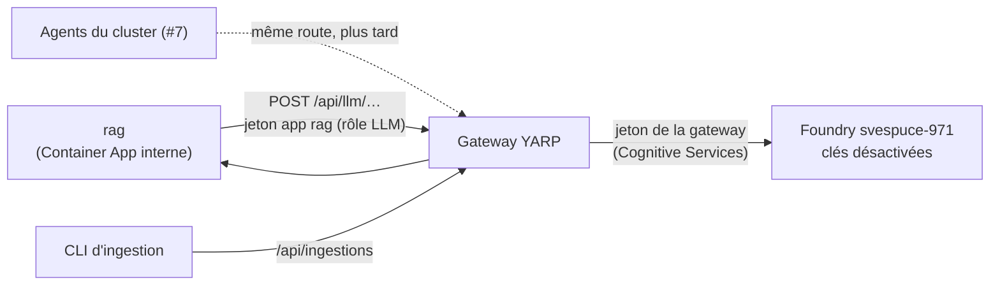

# Canal LLM par la gateway — conception

*Issue #70 · décisions d'Acerola du 22/10 (règles OWASP) · échéance : examen blanc du 30/10, repli le 27/10*

## 1. Intention

Tout appel au modèle (Azure AI Foundry `svespuce-971`, chat et embeddings) passe par la **gateway**, comme le prévoit déjà le schéma L6 (`/internal/llm`) et comme le calcul depuis #64. Foundry **n'accepte que la gateway** : un appel direct de rag ou d'un agent échoue. La gateway limite le débit par appelant et **mesure** les tokens consommés.

Règles visées : OWASP API4 (consommation non bornée), API8 (configuration), API9 (inventaire), API10 (consommation d'API tierces), LLM02 (divulgation : rien du prompt ni de la réponse en trace), LLM10 (consommation non bornée : mesure maintenant, budget plus tard).

## 2. Décisions d'Acerola (22/10)

- Le canal LLM passe par la gateway ; la gateway **échange le jeton** ; Foundry n'accepte que l'identité de la gateway.
- **rag sort de la Container App principale** : sa propre Container App, entrée interne, identité managée propre (même modèle que le serveur MCP, #69).
- **Limite en nombre de requêtes** par appelant, **mesure des tokens** ; le **budget en tokens** bloquant viendra plus tard.

## 3. Non-objectifs, anti-objectifs

**Non-objectifs** : budget bloquant en tokens ; filtrage de contenu ou détection d'injection à la gateway (le garde-fou reste côté application) ; cache de réponses ; plusieurs modèles ou routage entre fournisseurs ; agents du cluster (#7, ils utiliseront la même route).

**Anti-objectifs** (échec même si « ça marche ») :
- une clé API Foundry encore active, ou une identité autre que la gateway (et le poste d'Acerola, § 6) capable d'appeler Foundry ;
- un prompt, une réponse, un jeton ou un `numero_contrat` dans une trace, une métrique ou un journal de la gateway ;
- une réponse en streaming mise en tampon par la gateway.

## 4. Architecture

*Choix de Claude, sauf le § 2.*
- **Route** `llm` : `POST /api/llm/{**reste}` → `{FOUNDRY_ENDPOINT}/openai/{**reste}` (API v1 d'OpenAI sur Azure : `/openai/v1/chat/completions`, `/openai/v1/embeddings`). Politique `llm-appelant` : rôle d'application **`LLM`** + audience « llm » (`api://<appId>` et GUID, leçon de #64). Limite de débit nommée `llm`, **partitionnée par `azp`** (l'application appelante), réglable par configuration. Sans tampon (streaming transmis au fil de l'eau). Refus par défaut inchangé.
- **Inscription Entra** `agentinsurflow-llm` : audience de la route, rôle d'application `LLM` attribué à rag (et aux agents de #7 quand ils existeront).
- **Échange de jeton** : même mécanisme que la route `calcul` (`Azure.Identity` déjà présent) ; portée `https://cognitiveservices.azure.com/.default`. La transformation existante est généralisée en table « route → portée » plutôt que dupliquée.
- **Identité de la gateway en local** : `DefaultAzureCredential` (identité managée en Azure, ton `az login` en local), pour que le canal LLM marche aussi depuis le poste ; le calcul local reste sans jeton (pas de portée configurée).
- **Foundry** : `disableLocalAuth = true` (plus aucune clé) ; rôle « Cognitive Services OpenAI User » **retiré** des Container Apps et de la CI, attribué à la seule identité managée de la **Container App principale (gateway)** et à **ton compte** (poste de développement, traçable). Script `infra/llm.sh`, lancé à la main.
- **rag** : `AZURE_OPENAI_ENDPOINT` devient `${GATEWAY_URL}/api/llm` ; le client `openai` garde `base_url` + un fournisseur de jeton d'**application** (audience « llm », identité managée de rag en Azure, `az login` ou secret de l'inscription rag en local), jamais de clé. `AZURE_OPENAI_API_KEY` disparaît.
- **Container App rag** : `infra/containerapp-rag.yaml`, entrée interne (port 8001), identité managée propre fédérée sur `agentinsurflow-rag` (OBO vers underwriting-admin conservé) ; le cluster `rag` de la gateway vise son adresse interne ; ses traces passent par la gateway (`/v1/traces`, rôle `Telemetrie`, comme le MCP) ; base vecteurs inchangée (PostgreSQL annexe, joignable depuis l'environnement : à vérifier par le constructeur, sinon le signaler).
- **Évals et CI** : les évals passent déjà par `/api/reponses` (gateway → rag) ; la CI perd son accès direct à Foundry ; le job `evals-pr` (désactivé) devra passer par la gateway s'il est réactivé.

## 5. Mesure des tokens

- La gateway lit `usage` (`prompt_tokens`, `completion_tokens`, `total_tokens`) dans les réponses **non streamées** de la route `llm` et émet une métrique OpenTelemetry (histogramme `gen_ai.client.token.usage`, attributs `appelant.azp`, `gen_ai.token.type` = input/output, `gen_ai.request.model` si présent), exportée comme les traces actuelles.
- **Réponses streamées** : pas de lecture du flux (aucun tampon) ; la métrique note `mesure = non_disponible`. *Choix de Claude* ; à revoir avec le budget en tokens (`stream_options.include_usage`).
- Jamais de contenu de prompt ou de réponse, seulement des nombres.

## 6. Erreurs

| Cas | Réponse gateway |
|---|---|
| sans jeton / rôle `LLM` absent / mauvaise audience | 401 / 403 (`NON_AUTHENTIFIE`, `ACCES_REFUSE`) |
| débit dépassé | 429 `TROP_DE_REQUETES` |
| jeton de la gateway impossible à obtenir | 502 `LLM_INDISPONIBLE` |
| erreurs de Foundry (4xx/5xx) | relayées telles quelles (le SDK `openai` de rag les interprète déjà) |

## 7. Contraintes

- Échéance : examen blanc du 30/10, repli le 27/10 (en repli, rag peut revenir à l'appel direct avec son identité managée : documenter la manœuvre).
- Aucune nouvelle dépendance (`Azure.Identity` déjà ajouté) ; aucun changement de version sans accord.
- Scripts `infra/*.sh` rédigés, lancés à la main par Acerola ; aucun secret.
- Tests : WireMock côté gateway (routage, 401/403, 429 par `azp`, échange de jeton, streaming non tamponné, métrique de tokens), unitaires côté rag (fournisseur de jeton, URL de base).

## 8. Critères d'acceptance

- [ ] Route `llm`, politique `LLM` + audience, débit par `azp`, échange de jeton, sans tampon ; tests WireMock
- [ ] Métrique de tokens (non streamé) sans contenu ; test
- [ ] rag : appel par la gateway, jeton d'application, plus de clé ; tests
- [ ] rag dans sa Container App (entrée interne, identité propre) ; `deploy.yml` (ordre, fumées `/health/rag`, garde-fous de variables)
- [ ] `infra/llm.sh` (inscription `agentinsurflow-llm`, rôle `LLM`, Foundry `disableLocalAuth`, rôles RBAC) rédigé ; `bootstrap.sh`/`entra.sh` étendus
- [ ] Docs : `docs/secrets.md`, READMEs, spec MCP/rag, dossier de conception PDF (schéma L6 : rag en Container App dédiée, Foundry derrière la gateway)

## 9. Laissé au constructeur

Valeur par défaut de la limite `llm` ; forme exacte de la table « route → portée » ; manière de lire `usage` sans casser le streaming (ne lire que si `Content-Type: application/json`).
