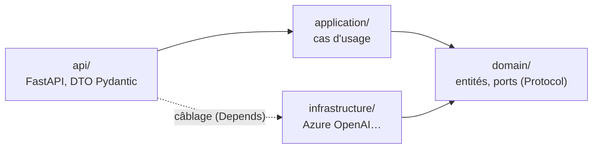

# 🐍 rag — AgentInsurFlow

Service Python (FastAPI) du **corpus réglementaire** : il portera l'ingestion des textes Légifrance (Code des assurances, périmètre auto), la recherche hybride (cosinus pgvector + plein texte + numéro d'article, fusion RRF) et l'**agent** à réponses citées, qui refuse hors corpus (spec du sprint 3, décision S3-16).

> **État (v0.4.0, Tasks R0 → R8)** : socle hexagonal ; PostgreSQL annexe et migrations de la base `vecteurs` ; domaine du corpus (nettoyage, dédup, découpage, porte) ; embeddings et jetons Entra ; ingestion et recherche hybride en REST ; agent à 3 verrous, dossiers en On-Behalf-Of, traces OTLP ; CLI Légifrance ; jeu de démo, evals et calibrage. 🔴 Le premier instantané réel (`data/raw/`) attend les identifiants PISTE (Task G0).

## API (REST, S3-24)

| Méthode · URI | Rôle d'app | Succès | Ressource |
|---|---|---|---|
| `POST /api/ingestions` | `Ingestion` | 201 + `Location` | Ingestion d'un lot d'articles (1 à 50) → rapport (lus, insérés, inchangés, nouvelles versions, rejets avec raison, quasi-doublons) |
| `GET /api/ingestions?limit&offset` | `Ingestion` | 200 | Rapports journalisés, du plus récent au plus ancien |
| `GET /api/ingestions/{ingestion_id}` | `Ingestion` | 200 · 404 | Un rapport (`INGESTION_INTROUVABLE`) |
| `GET /api/extraits?question=…&top_k=…` | `Gestionnaire` | 200 | Extraits qui passent la porte de pertinence ; sinon `statut = NOT_FOUND_IN_CORPUS`, `resultats = []` |
| `GET /api/documents/{doc_id}` | `Gestionnaire` | 200 · 404 | Traçabilité : versions et chunks d'un article, sans les vecteurs (`DOCUMENT_INTROUVABLE`) |
| `POST /api/reponses` | `Gestionnaire` | 200 · 404 | Réponse citée de l'agent, ou refus (`NOT_FOUND_IN_CORPUS`) ; `numero_contrat` facultatif (vue minimisée, `CONTRAT_INTROUVABLE` sinon) ; `trace_id` rendu — remplace `POST /api/agent` du sprint 2 |
| `GET /health` | — | 200 | Santé, versions servies et `corpus` (dernier instantané, chunks courants ; `null` sans base) |

- **Erreurs** en ProblemDetails (RFC 9457) avec un `code` : 401 `JETON_ABSENT` / `JETON_INVALIDE`, 403 `ROLE_MANQUANT`, 404, 409 `CONFLIT_INGESTION` (lot concurrent : le rejouer), 503 `EMBEDDINGS_INDISPONIBLES` / `BASE_INDISPONIBLE` / `AUTH_INDISPONIBLE` / `CONFIGURATION_INCOMPLETE` (`RAG_SEUIL` absent) ; 422 = validation (format FastAPI).
- **Refus par défaut** : chaque route du corpus exige son rôle ; les collections lisibles viennent du rôle (`Gestionnaire` → `textes_reglementaires`), aucune sinon.
- **Swagger** : derrière la gateway, le document est servi en `GET /rag/openapi.json` dans la **page Swagger unique** (`http://localhost:8000/`). Il ne déclare pas de `servers` : le « Try it out » appelle les routes publiques de la gateway (jeton, rôle et limite de débit). Sans gateway, rag sert aussi son propre Swagger sur `/` (`http://localhost:8001/` dans le compose).
- Un test de contrat vérifie que seules ces routes sont publiées (les anciens noms RPC répondent 404) et que chacune documente ses réponses d'erreur et son schéma de sécurité.
- Sans PostgreSQL, sans Entra ou sans `RAG_SEUIL` configurés, l'API **démarre quand même** ; les routes concernées répondent 503 (le déploiement actuel n'a pas encore la base annexe), et un `RAG_SEUIL` absent ou invalide est signalé dès le démarrage (refus de démarrer en U5). Audiences des jetons : `RAG_API_AUDIENCES` (« a, b »), la même liste que la gateway (`Entra__Audiences__rag__0`) ; défaut `<ID client>,api://<ID client>`.

## Agent à trois verrous (spec §4.2)

1. **Porte** : sous la porte de pertinence, refus immédiat, **sans appel au LLM**.
2. **Abstention** : le prompt (`prompts/systeme.md`) impose de répondre exactement `NOT_FOUND_IN_CORPUS` si les extraits ne suffisent pas.
3. **Citation** : la réponse doit citer au moins un article des extraits (`[L211-1]`) ; une réponse sans citation ou avec un article inventé est refusée.

Refus : message unique « Je ne trouve pas la réponse dans le corpus (Code des assurances, assurance auto) : je ne réponds pas sans source. » LLM injoignable : `statut = REVUE_HUMAINE`, mode dégradé du sprint 2, avec les citations trouvées.

**Dossier (`numero_contrat`)** : rag échange le jeton du gestionnaire contre un jeton **On-Behalf-Of** pour underwriting-admin (identité managée fédérée en Azure, `RAG_CLIENT_SECRET` en local seulement), lit la **vue minimisée** (`GET {UNDERWRITING_URL}/api/contrats/{numero_contrat}`) et l'ajoute au contexte, puis cite `vue_contrat_minimisee`. Contrat absent ou d'un autre gestionnaire : même 404 (BOLA, contrôlé par underwriting-admin). OBO refusé ou underwriting-admin en panne : 503 `DOSSIERS_INDISPONIBLES`, et l'agent ne répond pas sans la vue. Les questions **sans** `numero_contrat` ne dépendent pas d'underwriting-admin.

## CLI d'ingestion (spec §3.2)

```bash
make extraire                                    # Légifrance (bac à sable PISTE) → data/raw/code-assurances-<date>.json
make ingest URL=http://localhost:8000            # extraction puis envoi par la gateway
make ingest URL=… INSTANTANE=data/raw/code-assurances-<date>.json   # rejeu, sans PISTE (CI, Azure)
```

① jeton PISTE (identifiants du `.env` local, jamais dans GitHub ; 401 → « identifiants PISTE invalides », code de sortie 1) ; ② plan du Code des assurances, filtre du périmètre auto (`L121-*`, `A121-1`, `L211-*`, `R211-*`, `A211-*`), `getArticle` séquentiel, 3 nouvelles tentatives (1 s, 2 s, 4 s) sur 429 et 5xx ; ③ **instantané versionné** écrit dans un `.tmp` puis renommé, avec son manifeste (date, environnement, périmètre, nombre d'articles, sha256 du JSON canonique, vérifié au rejeu) ; ④ lots de 50 vers `POST /api/ingestions` avec un jeton Entra (`INGESTION_JETON`, sinon `az` pour `api://agentinsurflow-rag`) et le `traceparent` ; rapport cumulé dans `eval/preuves/ingestion-<date>-<env>.json`. Traces `ingest.run` et `ingest.lot` (service `agentinsurflow-ingest`) envoyées par la gateway (`/v1/traces`, rôle `Telemetrie`) ; leur échec ne fait jamais échouer l'ingestion.

> 🔴 Les noms de champs de l'API Légifrance (`cid`, `num`, `dateDebut`, `texteHtml`) et la forme du plan sont à confirmer au premier appel réel (Task G0) ; la correspondance est dans `infrastructure/legifrance/client.py` (`vers_article_entrant`).

## Évaluations et calibrage (`tools/evals.py`)

```bash
EVALS_JETON=<jeton rôle Gestionnaire> make eval URL=…   # golden set + eval/questions-demo.jsonl
EVALS_JETON=… make calibrer URL=…                        # cosinus max par question → RAG_SEUIL
```

- **Contrat vérifié par cas** (`attendu`) : `statut` (`OK` ou `NOT_FOUND_IN_CORPUS`), `articles` (au moins un cité), `http` (404 pour le cas BOLA) ; plus les contrôles du sprint 2 (`contient_un`, longueur). Le rapport s'ouvre sur un manifeste (commit, modèle, prompts, golden, questions, `corpus` de `/health`).
- **Jeu de démo** (`eval/questions-demo.jsonl`) : 5 questions couvertes, 3 refus (hors corpus, hors périmètre, BOLA). Les cas `ci: true` (références exactes, hors corpus, BOLA) sont aussi rejoués en CI sur l'instantané réel, modèles simulés (`tests/integration/test_questions_demo.py`, sauté tant que `data/raw/` est vide). 🔴 Numéros d'articles (L211-1, A121-1, L121-1) à confirmer sur le premier instantané réel (Task G0) ; l'annexe d'A121-1 (règles du bonus-malus) est peut-être hors du filtre de périmètre. 🔴 Les cas avec `numero_contrat` demandent underwriting-admin (U2) et un jeton délégué pour l'On-Behalf-Of.
- **Calibrage** : choisir `RAG_SEUIL` dans l'intervalle affiché, entre le plus grand cosinus des questions hors corpus et le plus petit des questions couvertes ; les questions qui citent un article passent la porte par la référence et ne comptent pas. Reporter la valeur dans `.env` et dans la variable GitHub `RAG_SEUIL`.

## Traces (spec §9)

OpenTelemetry, exportées en OTLP/HTTP vers le référentiel SQL d'underwriting-admin (`OTEL_EXPORTER_OTLP_TRACES_ENDPOINT`, défaut `http://localhost:8002/v1/traces` ; `OTEL_SDK_DISABLED=true` les coupe). Spans : serveur HTTP (sauf `/health`), `agent.repondre`, `rag.recherche`, `ingestion.lot`, `llm.completer`, `embeddings.vectoriser`. Le `traceparent` est propagé vers underwriting-admin. **RGPD** : jamais le texte de la question (seulement `question.sha256` et `question.longueur`), ni nom, ni adresse, ni `numero_contrat` (seulement `contrat.present`), ni dans un attribut ni dans un événement d'exception ; `http.url` sans la query string ; clients httpx non instrumentés (le `traceparent` est injecté à la main) ; image lancée sans journal d'accès — vérifié par des tests (`test_reponses_api.py`).

## Recherche hybride (spec §4.1)

1. **Référence exacte** : un numéro d'article cité (« L. 211-1 », « l211-1 ») est cherché directement et passe en tête.
2. **Deux classements fusionnés par RRF** (k = 60), dans une seule requête SQL : cosinus (index HNSW) et plein texte français (`websearch_to_tsquery`, `ts_rank_cd`, index GIN — ce n'est pas BM25, écart S3-11). Seules les versions non obsolètes des collections du rôle sont lues.
3. **Porte de pertinence** : la question passe si le cosinus max ≥ `RAG_SEUIL` (obligatoire, à calibrer) ou si elle cite exactement un article présent. Le score RRF ne sert qu'à ordonner.

## Base de données

rag ne connaît que la base **`vecteurs`**, avec deux comptes : `writer` (ingestion) et `reader` (recherche) — `infrastructure/postgres/connexions.py` (`ConfigBD`, `creer_moteurs`). Les bases `dossiers` et `traces` appartiennent à underwriting-admin. L'image annexe (`infra/postgres/`) crée les 3 bases, leurs versions `_test`, les 6 comptes, et l'extension `vector` dans `vecteurs` ; chaque compte n'a `CONNECT` que sur sa base. Les mots de passe viennent de l'environnement (`PG_*_PASSWORD`, `.env` en local, générés à chaque run en CI).

**Schéma** (Alembic, `rag/alembic.ini`, section `vecteurs`, migrations écrites à la main en SQL ; `make migrate`, compte `migrateur`) :

| Table | Rôle | Index |
|---|---|---|
| `document` | une **version** d'un article (`doc_id`, `version`, `etat`, `date_debut`, `url_source`, `hash_contenu`, `obsolete`) ; UNIQUE (`doc_id`, `version`), `collection` limitée à 4 valeurs | B-tree partiel (`collection`) WHERE NOT `obsolete` |
| `chunk` | unité de recherche et de citation (`article`, `texte`, `embedding vector(1536)`, `tsv` **généré** en français) | **HNSW** cosinus · **GIN** (`tsv`) · B-tree (`article`) |
| `ingestion` | rapports d'ingestion (`instantane_sha256`, `rapport` jsonb) | — |

Droits : `writer` → SELECT, INSERT, UPDATE (+ séquences) ; `reader` → SELECT seul (vérifié par un test).

## Architecture hexagonale

`~/.claude/rules/python-hexagonal.md` : le domaine ne dépend d'aucun framework ; la règle est **vérifiée par un test** (`tests/unit/test_architecture.py`).



| Couche | Contenu | Analogie .NET |
|---|---|---|
| `domain/ports.py` | `ClientLLM` (`Protocol`), `ErreurLLM` | `interface ILlmClient` |
| `domain/models.py` | `Reponse` (dataclass) | entité du Domain |
| `application/use_cases/repondre.py` | l'agent : prompt système, mode dégradé | service applicatif |
| `infrastructure/azure_openai/` | `AzureLLM`, `fabrique_llm`, `ConfigLLM` | implémentation injectée par DI |
| `api/` | `app`, routes `sante` et `agent`, DTO `Question`, `ReponseDTO`, `Sante` | Minimal API + DTO |

```text
rag/
├── agentinsurflow_rag/{domain,application,infrastructure,api}/ · prompts/systeme.md
├── tests/unit/          TU : aucune I/O, ports simulés (fakes.py)
├── tests/integration/   TI : l'API en mémoire (TestClient), LLM simulé
├── pyproject.toml       paquet agentinsurflow-rag, dépendances d'exécution
├── Dockerfile           contexte = racine du monorepo (uv.lock commun)
└── llm.env              version du LLM épinglée (la modifier déclenche les evals)
```

## Commandes (depuis la racine du monorepo)

```bash
make install            # uv sync --locked (espace de travail : racine + rag)
make lint               # ruff + mypy strict
make test               # TU, sans Docker
make test-integration   # TU + TI (PostgreSQL du compose), couverture >= 80 %
make pyramide           # porte 70 / 20 / 10 (S3-22)
make up                 # postgres + rag (:8001) + gateway (:8000, Swagger unique)
make migrate            # schéma de la base vecteurs (Alembic, compte migrateur)
make run                # rag seul : http://localhost:8000 (lancé depuis rag/ : llm.env y est lu)
make build              # docker build -f rag/Dockerfile .
```

## Tests

| Niveau | Dossier | Exemples |
|---|---|---|
| TU | `tests/unit` | `test_corpus.py` (nettoyage, HTML, numéros, dédup, découpage, porte), `test_ingerer.py` et `test_rechercher.py` (cas d'usage, dépôt en mémoire `FakeDepotCorpus`), `test_jetons.py`, `test_embeddings.py`, `test_agent.py`, `test_llm.py` (HTTP simulé par `httpx.MockTransport`), `test_connexions.py`, `test_architecture.py` (règle de dépendance) |
| TI | `tests/integration` | `test_api.py` (requête HTTP → route → cas d'usage, LLM simulé ; contrat REST, document OpenAPI sans `servers`), `test_bd.py` (image annexe : 6 comptes, cloisonnement des bases, pgvector), `test_migrations_vecteurs.py` (tables, index, droits, unicité, `tsv`, downgrade/upgrade), `test_ingestions_api.py` et `test_extraits_api.py` (ressources REST contre PostgreSQL : SQL RRF réel, idempotence, versions, 503 sans écriture, rôles), `test_securite.py` |

⚠️ `test_llm.py` utilise `httpx.MockTransport` sans réseau ni socket : il reste en TU selon la règle de la pyramide (aucune I/O réelle).
