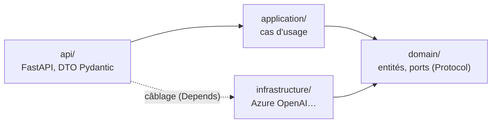

# 🐍 rag — AgentInsurFlow

Service Python (FastAPI) du **corpus réglementaire** : il portera l'ingestion des textes Légifrance (Code des assurances, périmètre auto), la recherche hybride (cosinus pgvector + plein texte + numéro d'article, fusion RRF) et l'**agent** à réponses citées, qui refuse hors corpus (spec du sprint 3, décision S3-16).

> **État (Task R0)** : socle hexagonal en place, avec le code du sprint 2 **déplacé à l'identique** : `GET /health` et `POST /api/agent` (agent + Azure OpenAI, mode dégradé sans LLM). Le corpus, l'ingestion et la recherche arrivent dans les tâches suivantes (R1 → R8).

## Architecture hexagonale

`~/.claude/rules/python-hexagonal.md` : le domaine ne dépend d'aucun framework ; la règle est **vérifiée par un test** (`tests/unit/test_architecture.py`).



| Couche | Contenu | Analogie .NET |
|---|---|---|
| `domain/ports.py` | `ClientLLM` (`Protocol`), `ErreurLLM` | `interface ILlmClient` |
| `domain/models.py` | `Reponse` (dataclass) | entité du Domain |
| `application/use_cases/repondre.py` | l'agent : prompt système, mode dégradé | service applicatif |
| `infrastructure/azure_openai/` | `AzureLLM`, `fabrique_llm`, `ConfigLLM` | implémentation injectée par DI |
| `api/` | `app`, routes `sante` et `agent`, DTO `Question`, `ReponseDTO`, `Sante` | Minimal API + DTO |

```text
rag/
├── agentinsurflow_rag/{domain,application,infrastructure,api}/ · prompts/systeme.md
├── tests/unit/          TU : aucune I/O, ports simulés (fakes.py)
├── tests/integration/   TI : l'API en mémoire (TestClient), LLM simulé
├── pyproject.toml       paquet agentinsurflow-rag, dépendances d'exécution
├── Dockerfile           contexte = racine du monorepo (uv.lock commun)
└── llm.env              version du LLM épinglée (la modifier déclenche les evals)
```

## Commandes (depuis la racine du monorepo)

```bash
make install     # uv sync --locked (espace de travail : racine + rag)
make lint        # ruff + mypy strict
make test        # TU + TI, couverture >= 80 %
make pyramide    # porte 70 / 20 / 10 (S3-22)
make run         # http://localhost:8000 (lancé depuis rag/ : llm.env y est lu)
make build       # docker build -f rag/Dockerfile .
```

## Tests

| Niveau | Dossier | Exemples |
|---|---|---|
| TU | `tests/unit` | `test_agent.py` (agent, ports simulés), `test_llm.py` (adaptateur, HTTP simulé par `httpx.MockTransport`), `test_architecture.py` (règle de dépendance) |
| TI | `tests/integration` | `test_api.py` (requête HTTP → route → cas d'usage, LLM simulé par `dependency_overrides`) |

⚠️ `test_llm.py` utilise `httpx.MockTransport` sans réseau ni socket : il reste en TU selon la règle de la pyramide (aucune I/O réelle).
