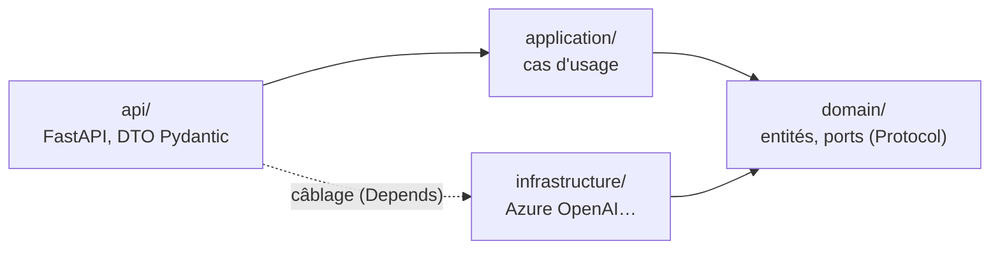

# 🐍 rag — AgentInsurFlow

Service Python (FastAPI) du **corpus réglementaire** : il portera l'ingestion des textes Légifrance (Code des assurances, périmètre auto), la recherche hybride (cosinus pgvector + plein texte + numéro d'article, fusion RRF) et l'**agent** à réponses citées, qui refuse hors corpus (spec du sprint 3, décision S3-16).

> **État (v0.4.0, Task R1)** : socle hexagonal (R0, v0.3.0) ; PostgreSQL annexe (`infra/postgres/`, pgvector) et connexions de rag à la base `vecteurs` ; `docker-compose.yml` (postgres, rag, gateway). API : `GET /health` et `POST /api/reponses` (agent + Azure OpenAI, mode dégradé sans LLM). Le corpus, l'ingestion et la recherche arrivent en R2 → R8.

## API (REST, S3-24)

| Méthode · URI | Succès | Rôle |
|---|---|---|
| `POST /api/reponses` | 200 | Réponse de l'agent à une question (calculée, non conservée) — remplace `POST /api/agent` du sprint 2 |
| `GET /health` | 200 | Santé et versions servies |

- **Swagger** : derrière la gateway, le document est servi en `GET /rag/openapi.json` dans la **page Swagger unique** (`http://localhost:8000/`). Il ne déclare pas de `servers` : le « Try it out » appelle les routes publiques de la gateway (`/api/reponses`, avec jeton, rôle et limite de débit). Sans gateway, rag sert aussi son propre Swagger sur `/` (`http://localhost:8001/` dans le compose).
- Un test vérifie le contrat : seules ces routes sont publiées, et l'ancien nom RPC répond 404.

## Base de données

rag ne connaît que la base **`vecteurs`**, avec deux comptes : `writer` (ingestion) et `reader` (recherche) — `infrastructure/postgres/connexions.py` (`ConfigBD`, `creer_moteurs`). Les bases `dossiers` et `traces` appartiennent à underwriting-admin. L'image annexe (`infra/postgres/`) crée les 3 bases, leurs versions `_test`, les 6 comptes, et l'extension `vector` dans `vecteurs` ; chaque compte n'a `CONNECT` que sur sa base. Les mots de passe viennent de l'environnement (`PG_*_PASSWORD`, `.env` en local, générés à chaque run en CI).

## Architecture hexagonale

`~/.claude/rules/python-hexagonal.md` : le domaine ne dépend d'aucun framework ; la règle est **vérifiée par un test** (`tests/unit/test_architecture.py`).



| Couche | Contenu | Analogie .NET |
|---|---|---|
| `domain/ports.py` | `ClientLLM` (`Protocol`), `ErreurLLM` | `interface ILlmClient` |
| `domain/models.py` | `Reponse` (dataclass) | entité du Domain |
| `application/use_cases/repondre.py` | l'agent : prompt système, mode dégradé | service applicatif |
| `infrastructure/azure_openai/` | `AzureLLM`, `fabrique_llm`, `ConfigLLM` | implémentation injectée par DI |
| `api/` | `app`, routes `sante` et `agent`, DTO `Question`, `ReponseDTO`, `Sante` | Minimal API + DTO |

```text
rag/
├── agentinsurflow_rag/{domain,application,infrastructure,api}/ · prompts/systeme.md
├── tests/unit/          TU : aucune I/O, ports simulés (fakes.py)
├── tests/integration/   TI : l'API en mémoire (TestClient), LLM simulé
├── pyproject.toml       paquet agentinsurflow-rag, dépendances d'exécution
├── Dockerfile           contexte = racine du monorepo (uv.lock commun)
└── llm.env              version du LLM épinglée (la modifier déclenche les evals)
```

## Commandes (depuis la racine du monorepo)

```bash
make install            # uv sync --locked (espace de travail : racine + rag)
make lint               # ruff + mypy strict
make test               # TU, sans Docker
make test-integration   # TU + TI (PostgreSQL du compose), couverture >= 80 %
make pyramide           # porte 70 / 20 / 10 (S3-22)
make up                 # postgres + rag (:8001) + gateway (:8000, Swagger unique)
make run                # rag seul : http://localhost:8000 (lancé depuis rag/ : llm.env y est lu)
make build              # docker build -f rag/Dockerfile .
```

## Tests

| Niveau | Dossier | Exemples |
|---|---|---|
| TU | `tests/unit` | `test_agent.py` (agent, ports simulés), `test_llm.py` (adaptateur, HTTP simulé par `httpx.MockTransport`), `test_connexions.py` (URL des comptes, sans connexion), `test_architecture.py` (règle de dépendance) |
| TI | `tests/integration` | `test_api.py` (requête HTTP → route → cas d'usage, LLM simulé ; contrat REST, document OpenAPI sans `servers`), `test_bd.py` (image annexe : 6 comptes, cloisonnement des bases, pgvector) |

⚠️ `test_llm.py` utilise `httpx.MockTransport` sans réseau ni socket : il reste en TU selon la règle de la pyramide (aucune I/O réelle).
