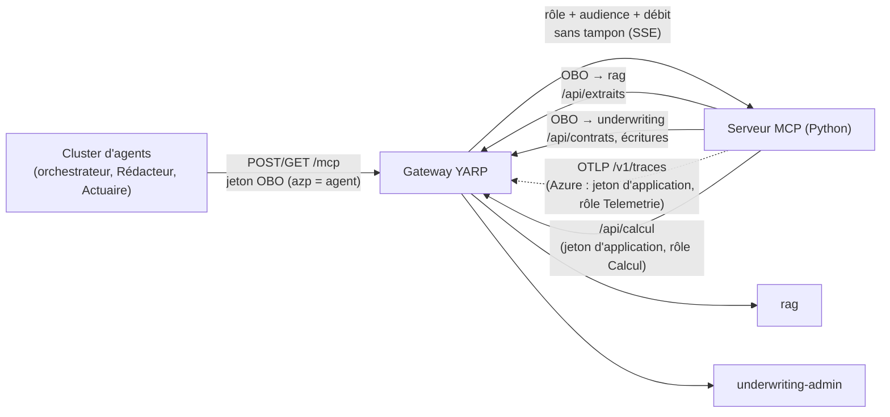

# Serveur MCP — AgentInsurFlow

Serveur MCP (Python, architecture hexagonale) qui donne au cluster d'agents un accès contrôlé à `rag` et à `underwriting-admin`. Il est joint **uniquement par la gateway** (`/mcp`) et ne rédige, ne calcule et ne décide rien : il autorise, relaie et trace. Conception : [`docs/superpowers/specs/2026-10-21-serveur-mcp-design.md`](../docs/superpowers/specs/2026-10-21-serveur-mcp-design.md).

## 1. Architecture



**Texte alternatif du diagramme.** Le cluster d'agents (orchestrateur, Rédacteur, Actuaire) envoie ses requêtes `POST` ou `GET` sur `/mcp` à la gateway, avec un jeton dont l'`azp` est celui de l'agent. La gateway contrôle le rôle, l'audience et le débit, puis transmet sans tampon (SSE) au serveur MCP. Le serveur MCP appelle `rag` (`/api/extraits`) et `underwriting-admin` (`/api/contrats` et les écritures) **en repassant par la gateway**, avec un jeton obtenu en On-Behalf-Of. En Azure, il exporte ses traces en OTLP par la gateway (`/v1/traces`, jeton d'application, rôle `Telemetrie` ; en local, export direct vers underwriting-admin) et appelle la Function de calcul par la gateway (`/api/calcul`, rôle `Calcul`) : aucun appel direct.

### 1.1 Organisation du code

| Couche | Dossier | Contenu |
|---|---|---|
| Domaine | `agentinsurflow_mcp/domain/` | Appelant, erreurs typées, matrice d'accès, ports (stdlib seulement) |
| Application | `agentinsurflow_mcp/application/` | Cas d'usage des outils (jeton OBO puis appel d'un port) |
| Infrastructure | `agentinsurflow_mcp/infrastructure/` | `entra/` (jetons, OBO), `gateway/` (client httpx), `otel/` (traces) |
| API | `agentinsurflow_mcp/api/` | FastAPI : `/health`, `/mcp` (Streamable HTTP sans session), garde d'authentification |

## 2. Catalogue des outils

Les outils sont déclarés avec le SDK MCP officiel ; la docstring de chacun est celle que lit le LLM. Une erreur métier est un résultat d'outil avec `isError: true` et un `structuredContent.code` stable (voir 2.2).

### 2.1 Outils

| Outil | Paramètres | Sortie | Nature |
|---|---|---|---|
| `search_rag` | `question` (texte), `top_k` (1 à 20, facultatif) | Extraits cités (article, version, source, score) tels que rendus par `GET /api/extraits` de rag | Lecture |
| `get_contrat` | `numero_contrat` | Contrat : profil du conducteur, historique, formule (`GET /api/contrats/{numero}`) | Lecture |
| `enregistrer_brouillon` | `numero_contrat`, `fiche` (`decision`, `contrat_type`, `score`, `version_bareme`, `regle_ids`, `motifs`, `citations`), `prime` facultative (`prime_ttc`, `periodicite`, `date_effet` AAAA-MM-JJ) | `{"ecrit": true}` | Écriture, brouillon seulement, idempotente |
| `update_statut_dossier` | `numero_contrat`, `statut` (ex. `REVUE_HUMAINE`, `ACCEPTE`, `REFUSE`), `validation` (`VALIDEE` ou `CORRIGEE`, exigée avec `ACCEPTE` et `REFUSE`) | `{"ecrit": true}` | Écriture, seul outil qui écrit une décision |
| `evaluer_risque` | faits du contrat | Score, classe et règles déclenchées, versions du barème | Calcul (Function de calcul, par la gateway : `POST /api/calcul/evaluer`) |
| `calculer_prime` | faits du contrat et de la formule | Prime détaillée, version de la formule | Calcul (Function de calcul, par la gateway : `POST /api/calcul/calculer`) |

Les deux outils appellent la Function de calcul **par la gateway** (`${GATEWAY_URL}/api/calcul/{evaluer,calculer}`, spec `2026-10-22-calcul-risque-prime-design.md`), avec un jeton d'application de l'inscription MCP (rôle `Calcul`). La gateway ne relaie pas ce jeton : elle l'échange contre le sien (identité managée) avant d'atteindre la Function.

### 2.2 Codes d'erreur

| Code | Cas | Outils concernés |
|---|---|---|
| `UNAUTHORIZED_TOOL` | Outil hors matrice pour l'`azp` du jeton (refus avant tout appel de backend) | tous |
| `NOT_FOUND_IN_CORPUS` | Aucun extrait ne passe la porte de pertinence de rag | `search_rag` |
| `CONTRAT_INTROUVABLE` | 404 d'underwriting-admin : contrat absent **ou** hors portefeuille (indiscernables) | `get_contrat`, `enregistrer_brouillon`, `update_statut_dossier` |
| `DOSSIERS_INDISPONIBLES` | OBO refusé, backend en panne ou réponse inattendue | tous |
| `CALCUL_INDISPONIBLE` | Function de calcul injoignable, jeton refusé ou requête malformée | `evaluer_risque`, `calculer_prime` |
| `DONNEE_HORS_BAREME` | Donnée absente ou inconnue du barème (422) | `evaluer_risque`, `calculer_prime` |
| `ARGUMENTS_INVALIDES` | Le backend refuse la fiche, la prime ou le statut (ex. `ACCEPTE` sans `validation`) | écritures |

Les erreurs de protocole restent des erreurs HTTP ou JSON-RPC : 401 `JETON_ABSENT` ou `JETON_INVALIDE`, 403 `ROLE_MANQUANT`, 503 si Entra n'est pas configuré (ProblemDetails avec `code`).

## 3. Matrice d'accès

| Appelant (`azp` de la variable) | Variable | Outils autorisés |
|---|---|---|
| Orchestrateur | `MCP_AZP_ORCHESTRATEUR` | `get_contrat`, `evaluer_risque`, `enregistrer_brouillon`, `update_statut_dossier` |
| Agent Rédacteur | `MCP_AZP_REDACTEUR` | `search_rag` |
| Agent Actuaire | `MCP_AZP_ACTUAIRE` | `calculer_prime` |
| `azp` inconnu ou variable vide | — | aucun |

La matrice est un dictionnaire du domaine (`domain/matrice.py`), versionné par Git. Elle s'applique à deux endroits : `tools/list` ne renvoie que les outils permis, `tools/call` refuse avant tout appel de backend. Le portefeuille (BOLA) reste contrôlé par underwriting-admin.

## 4. Authentification à deux niveaux

| Niveau | Qui contrôle | Quoi |
|---|---|---|
| 1. Entrée | Gateway **puis** serveur MCP | Jeton Entra valide (signature, émetteur, expiration), audience du serveur MCP (`api://agentinsurflow-mcp` ou son ID client), rôle `Gestionnaire` ; débit limité. Le serveur MCP revalide seul chaque requête (« chaque service revalide »). |
| 2. Sortie | Serveur MCP | Échange **On-Behalf-Of** du jeton reçu vers `rag` ou `underwriting` : l'`azp` devient celui du serveur MCP, l'`oid` du gestionnaire est conservé, donc rag et underwriting-admin contrôlent rôle et portefeuille sur l'utilisateur. |

- Transport **sans session** : aucun état de jeton côté serveur ; après l'`interrupt()` le cluster présente un jeton frais.
- Secret de l'OBO : **aucun en Azure** (identité managée fédérée, `AZURE_UAMI_CLIENT_ID`) ; en local seulement `MCP_CLIENT_SECRET` dans `.env`.
- Inscription Entra : `infra/entra.sh` § ⑥ (lancé à la main). Les inscriptions des agents relèvent de l'issue #7.

## 5. Traces

Export OTLP/HTTP (`OTEL_EXPORTER_OTLP_TRACES_ENDPOINT`) : en local, **direct** vers `http://underwriting-admin:8002/v1/traces` (comme rag, sans jeton) ; en Azure, par la gateway `/v1/traces` (jeton d'application, rôle `Telemetrie`, jamais journalisé). Le `traceparent` entrant est repris et propagé vers la gateway : une trace par dossier, relue par `GET /api/traces/{trace_id}`. `OTEL_SDK_DISABLED=true` coupe tout.

| Span | Attributs |
|---|---|
| Serveur HTTP `POST /mcp` (jamais `/health`) | méthode, statut HTTP, URL sans query string |
| `mcp.lister_outils` | `appelant.azp`, `outils.nombre` |
| `mcp.outil` | `mcp.outil`, `appelant.azp`, `autorisation.decision` (allow/deny), `autorisation.regle`, `resultat.code`, `isError` |
| `obo.echanger` | réussite ou échec, cible (rag, underwriting) |
| Appel gateway | route (gabarit), statut HTTP |
| Écritures | `statut.cible`, `contrat.present` |

**Jamais tracé** (vérifié par les tests) : jeton, `numero_contrat`, identité du gestionnaire, texte de la question (seulement `question.sha256` et `question.longueur`), contenu de contrat, de fiche ou de prime, message d'une exception.

**Limite connue** : les spans HTTP de la gateway et d'underwriting-admin (instrumentation ASP.NET Core) contiennent `url.path`, donc le `numero_contrat` des routes `/api/contrats/{numero_contrat}…` ; antérieur au serveur MCP, à traiter dans une issue dédiée.

## 6. Exploitation

### 6.1 Variables d'environnement

Aucune valeur dans le dépôt : clés dans `.env.example`, déploiement dans `docs/secrets.md`.

| Variable | Rôle | Local (compose) | Azure |
|---|---|---|---|
| `AZURE_TENANT_ID` | Tenant Entra | `.env` | variable GitHub |
| `MCP_API_CLIENT_ID` | ID client de `agentinsurflow-mcp` | `.env` | variable GitHub |
| `MCP_API_AUDIENCES` | Audiences acceptées, « a, b » (même liste que la gateway) | défaut `api://agentinsurflow-mcp` | `api://agentinsurflow-mcp,<ID client>` |
| `MCP_AZP_ORCHESTRATEUR`, `MCP_AZP_REDACTEUR`, `MCP_AZP_ACTUAIRE` | `azp` des agents (matrice) | `.env` | variables GitHub (inscriptions de #7) |
| `RAG_API_CLIENT_ID`, `UNDERWRITING_API_CLIENT_ID` | Cibles de l'OBO | `.env` | variables GitHub |
| `GATEWAY_URL` | Adresse par laquelle rag et underwriting sont joints | `http://gateway:8000` | `http://localhost:8000` |
| `MCP_CLIENT_SECRET` | Secret de l'OBO, **local seulement** | `.env` | jamais |
| `CALCUL_URL`, `CALCUL_AUDIENCE` | Gateway `…/api/calcul` (la base inclut `/api/calcul` ; l'adaptateur appelle `/evaluer`, `/calculer`) et audience `api://<appId agentinsurflow-calcul>` du jeton d'application (rôle `Calcul`) ; sans audience ou sans identité Entra : `CALCUL_INDISPONIBLE`, aucun appel | `.env` | variables GitHub par environnement (`make calcul` les affiche) |
| `TELEMETRIE_AUDIENCE` | Audience `api://<appId underwriting>` du jeton d'application (rôle `Telemetrie`) posé sur chaque export OTLP vers la gateway (Azure seulement) ; absent = export sans jeton (local : direct) | `.env` | variables GitHub |
| `AZURE_UAMI_CLIENT_ID` | Identité managée fédérée (OBO sans secret) | — | variable GitHub |
| `OTEL_EXPORTER_OTLP_TRACES_ENDPOINT` | Récepteur OTLP : direct en local, la gateway en Azure (jeton d'application si `TELEMETRIE_AUDIENCE`) | `http://underwriting-admin:8002/v1/traces` | `http://localhost:8000/v1/traces` |
| `APP_VERSION`, `APP_RELEASE`, `APP_ENV` | Versions gravées au build, environnement | build-args, `local` | build-args de la chaîne, `staging` ou `production` |

Sans `AZURE_TENANT_ID` ou `MCP_API_CLIENT_ID`, l'API démarre mais `/mcp` répond 503 ; sans configuration OBO, les outils répondent en erreur.

### 6.2 Port, santé et déploiement

| Sujet | Valeur |
|---|---|
| Port | `8003` (gateway 8000, rag 8001, underwriting-admin 8002) ; **sa propre Container App, entrée interne seulement** (`infra/containerapp-mcp.yaml`) : la gateway l'appelle en `https://<app>.internal.<domaine de l'environnement>` (FQDN interne : TLS de la plateforme, jamais `http://<app>` en clair), lui joint la gateway par le FQDN de la sienne (`GATEWAY_URL`) ; identité managée propre (`AZURE_UAMI_CLIENT_ID`) |
| Santé directe | `GET /health` : toujours 200, `version`, `release`, `environnement` |
| Santé par la gateway | `GET /health/mcp` (anonyme, sans limite de débit) |
| Sondes Container App | liveness et readiness sur `/health:8003` |
| Image | `agentinsurflow-mcp:<SHA>` (`serveur-mcp/Dockerfile`, contexte = racine du monorepo) |
| Journal d'accès | désactivé (`--no-access-log`) |

### 6.3 Commandes

```bash
make up                                   # solution complète, dont serveur-mcp sur :8003
uv run pytest serveur-mcp/tests --no-cov  # tests du serveur MCP
make test-e2e URL=http://localhost:8000   # E2E : jeton de gestionnaire pour api://agentinsurflow-mcp
```
